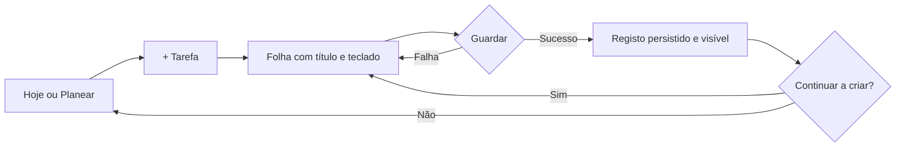

# Hoje, Planear e criação rápida — especificação 3A

Estado: proposta para aprovação; nada deste documento activa interface ou rotas. Base 80576ed, versão de produção 0.9.2+12. Termos de dados, decisões e sequência técnica: [plano de implementação](HOJE_PLANEAR_IMPLEMENTATION.md). Datas dos exemplos em Africa/Maputo: terça-feira, 10/11/2026; amanhã, quarta-feira, 11/11.

## Hoje — «O que tenho para hoje?»
Uma coluna com secções separadas por espaço e listas, sem uma grelha de cartões. A informação prioritária fica fora de expansões; os detalhes aparecem ao tocar num registo.

| Ordem | Componente e comportamento proposto | Razão / prioridade |
| --- | --- | --- |
| 1 | «Hoje», data por extenso curta e, quando existir actividade, «3 tarefas concluídas hoje». Sem saudação que ocupe espaço adicional. | Orientação temporal imediata; a contagem reconhece actividade sem impor um objectivo. Alta. |
| 2 | «Compromissos»: até dois próximos blocos, por hora, incluindo um em curso; indicar a hora final. «Ver dia» abre Planear no dia actual e mostra todos, incluindo os já passados. Se há mais, mostrar «Ver os 5 compromissos». | Compromissos têm hora fixa; um resumo torna-os visíveis sem afastar as tarefas. Alta. |
| 3 | «Tarefas de hoje»: pendentes associadas ao dia, todas acessíveis numa lista contínua. Título, caixa de conclusão e hora só quando definida; associação aparece apenas quando ajuda a distinguir. | Acção central; não exigir explorar um menu. Alta. |
| 4 | «De dias anteriores · N», recolhido por defeito. Ao expandir, ver título/data original e acção «Mudar dia»; também é possível concluir ou retirar a data. | Recuperar pendentes sem misturá-las silenciosamente com hoje nem usar culpa. Média. |
| 5 | «Rotinas de hoje», só se existem hábitos activos previstos para o dia. Mostrar até três e «Ver hábitos» quando houver mais; marcar usa o mesmo registo diário. | Preservar rotinas com pouca ocupação. Média. |
| 6 | «Concluídas hoje · N», recolhido e só presente com registos. Mostrar tarefas concluídas na data actual; tocar permite editar ou reabrir. | Revisão e correcção sem competir com o que falta fazer. Média. |
| 7 | Ligações discretas «Planear amanhã» e «Planear semana». | Entradas directas para intenções frequentes; não obrigam a planear. Média. |
| Persistente | Uma única acção principal «+ Tarefa», acima da área de navegação e sem cobrir o último item. | Criar é sempre acessível, sem escolha prévia de tipo. Alta. |

Regras da lista: tarefas pendentes do dia usam importância e prioridade existentes; dentro de empates, hora definida crescente, depois criação/ID para estabilidade. Esta ordenação é uma proposta futura e exige aprovação; não muda a ordenação actual. Não reordenar manualmente nem introduzir arrastar nesta primeira entrega. Com 50 ou 200 tarefas, manter deslocação contínua e construção progressiva; nunca ocultar definitivamente itens por um limite de «prioridades».

Uma tarefa pertence a «hoje» quando a sua única data associada coincide com o dia civil actual e está pendente. «De dias anteriores» significa data civil anterior e pendente; uma hora já passada no próprio dia não move a tarefa para essa secção. Não mover datas automaticamente, não activar alarmes retroactivos e não usar vermelho como estado normal. O número N é uma contagem, sem badge urgente.

«Concluídas hoje» e a contagem do cabeçalho usam completed_at no dia civil actual, independentemente da data planeada; cada ID conta uma vez. Uma tarefa concluída ontem, mesmo associada a hoje, não é pendente nem entra nessa contagem. Hábitos, aulas e eventos não aumentam esta métrica. Não mostrar XP, nível, percentagens ou constelações no cabeçalho. A vista do dia em Planear pode mostrar as tarefas associadas àquele dia, concluídas ou pendentes: é uma consulta de planeamento, não a mesma métrica de actividade.

Concluir: manter feedback táctil leve, persistir pelo serviço e actualizar a contagem/lista; oferecer «Desfazer» numa linha local discreta até à próxima acção ou mudança de vista. Depois disso, «Concluídas hoje» continua a permitir reabrir. Reabrir não remove XP nem multiplica recompensas. Falha de gravação mantém a tarefa pendente com «Não foi possível concluir. Tentar novamente». Nenhuma tarefa pode aparecer simultaneamente nas duas listas de Hoje.

Compromissos académicos mantêm a origem: aula/avaliação abre o editor académico existente; estudo abre Estudos, com selecção da sessão como melhoria futura a implementar explicitamente. Concluir uma tarefa não conclui uma avaliação. Eventos pessoais conservam o editor e as regras de recorrência; «Editar» deve continuar a indicar quando afecta a série completa. Não converter aulas ou avaliações em cópias de tarefas.

## Planear — «Quando quero fazer isto?»
Um único destino com controlos textuais seleccionáveis **Hoje | Amanhã | Semana | Sem data**. Data/range sempre visível. Hoje e Amanhã são atalhos que seleccionam uma data real; mudar o selector de data permite qualquer outro dia sem criar um quinto destino ou nova página. Não há aprovação final da semana: cada alteração confirmada é guardada imediatamente.

| Contexto | Conteúdo | Acções |
| --- | --- | --- |
| Hoje / Amanhã / outro dia | Lista de tarefas desse dia, pendentes primeiro; concluídas numa expansão. Compromissos do dia em lista cronológica separada, recolhível. | «+ Tarefa» sugere o dia; «Escolher pendente» selecciona um ID sem data; tocar numa tarefa abre edição. |
| Semana | Sete dias em lista vertical, cada um com data e contagem; um dia expandido de cada vez. Nele, tarefas e compromissos existentes, sem exigir hora. | Seleccionar dia; criar nele; escolher pendente; navegar entre semanas. O rodapé indica o dia efectivo de criação. |
| Sem data | Tarefas pendentes com due nulo, incluindo associações existentes; concluídas acessíveis por expansão/filtro. | «Escolher dia» numa tarefa, editar ou concluir; «+ Tarefa» começa sem data. Não inventar data à meia-noite. |

**Visualizar um dia** consulta os registos e não escreve. **Planear um dia** é escolher/criar/reagendar tarefas explicitamente. **Consultar a semana** também não escreve: expandir dias e mudar de semana não cria um plano paralelo nem eventos. Não há tarefas automáticas, horários sugeridos por IA ou metas de produtividade obrigatórias.

Selecção inicial proposta: ao entrar pela barra, abrir Hoje na primeira visita; conservar a última vista/data durante a sessão ao voltar de um editor ou outro separador. «Planear amanhã» abre exactamente o dia seguinte; «Planear semana» aplica a regra semanal existente: domingo sugere segunda seguinte, restantes dias mostram a semana actual. Sempre mostrar o intervalo e permitir outra semana. Não prometer restauro dessa selecção após terminar o processo na primeira entrega.

Exemplo: «Ler um capítulo» sem data → escolher 11 Nov → Guardar. Passa a aparecer nesse dia, preservando ID, meta e disciplina. Mudar para 12 Nov actualiza o mesmo registo; a linha sai do dia anterior. «Retirar dia» deixa-a em Sem data, sem apagar título ou associações. Esta acção não significa eliminar. Não permitir selecção repetida da mesma tarefa criar duas linhas no mesmo dia.

Ao reagendar um timestamp, conservar a hora existente como opção explícita e visível no editor. Ao escolher apenas dia ou retirar a data, explicar junto do campo: «Sem hora, o lembrete fica desligado»; guardar cancela o alarme anterior. Não reactivar automaticamente ao voltar a definir hora. Alterar apenas o título preserva hora e lembrete. Ao reagendar com hora e lembrete ligado, substituir o alarme do mesmo ID. Recusa de permissão não impede guardar, mas exige aviso claro de que o lembrete não ficou activo.

Conflitos de horários são informação local, não bloqueiam a gravação. Tarefas só com dia não ocupam blocos nem causam colisões à meia-noite. Compromissos que atravessam dias precisam de correcção do modelo de leitura antes de esta vista poder prometer mostrar a continuação; ver dependências técnicas. Eventos e tarefas conservam distinção de comportamento.

Eventos continuam disponíveis por uma acção secundária «Adicionar evento» no contexto do dia; Mais conserva os acessos existentes a Estudos, Hábitos, Finanças, Progresso, Revisões e Definições. Metas mantém a criação/detalhe actuais. A lista global Tarefas deve permanecer acessível em Mais → Tarefas, com pendentes/concluídas e edições existentes. Nenhuma funcionalidade é eliminada ao reorganizar a barra.

## Criação rápida — do título ao registo

Abertura: folha inferior com título «Nova tarefa», campo «O que queres fazer?» focado e teclado activo. Só título não vazio é obrigatório. Uma linha «Hoje», «11 Nov» ou «Sem data» revela o contexto; tocar permite mudar/retirar o dia. A hora não é preenchida automaticamente. Deslocar a folha e o conteúdo permite alcançar Guardar com teclado, ecrã estreito e texto ampliado.

Proposta de data: Hoje sugere hoje; Planear usa o dia seleccionado; Semana usa o dia expandido claramente indicado; Sem data sugere nenhuma. Em detalhe de meta/disciplina, herdar a associação mas começar sem dia, salvo data já seleccionada explicitamente no contexto. O utilizador pode sempre escolher Sem data. Nunca copiar a hora corrente para uma tarefa nova.

«Mais opções» revela hora, lembrete, prioridade/importância e associações a meta/disciplina, sem as tornar obrigatórias. Chips/rótulos mostram associações já herdadas, permitindo removê-las. Lembrete exige dia e hora; não pedir permissões ao abrir a folha. Não apresentar campos de prazo final separado, recorrência de tarefa, duração ou subtarefas que ainda não existem.

Guardar: um único botão principal, activo com título válido e desactivado durante a escrita. Enviar pelo teclado usa a mesma operação e guarda uma única vez. Só fechar/limpar após confirmação da persistência. Preservar o ecrã anterior, data, filtro e posição, e actualizar os consumidores. Se o registo fica na vista actual, a nova linha é a confirmação; se fica fora dela, mostrar uma única linha de estado «Guardada para 11 Nov · Ver» ou «Guardada sem data · Ver», sem mudança automática de separador. Anunciar o resultado ao leitor de ecrã; sem banner de celebração.

«Continuar a criar» é uma opção secundária, desligada por defeito, apenas na criação. Ligada: Guardar persiste uma tarefa, mantém folha/teclado, limpa o título e mostra uma confirmação curta. Mantém dia e associações visíveis; repõe hora/lembrete desligados, prioridade normal e importância desligada para a próxima. Não há gravação em lote ao fechar: tarefas já guardadas ficam guardadas. A contagem não gera XP.

Cancelar, arrastar para fechar ou Voltar sem alterações fecha sem escrita. Com título/alterações não guardadas, propor confirmação «Descartar alterações?» com «Continuar a editar» e «Descartar». Ao regressar à aplicação, manter o rascunho apenas enquanto a folha existir na sessão; não prometer recuperação após encerramento do processo. Se continuar a criar, descartar afecta só o rascunho actual.

Editar: carregar os valores existentes e actualizar o mesmo ID. Não aplicar defaults de criação a campos ocultos, precisão da data, completed ou associações. Não mostrar «Continuar a criar». Guardar/cancelar regressa ao mesmo ponto de entrada. Tarefa entretanto eliminada deve produzir mensagem, não um novo registo; esse controlo exige trabalho futuro no serviço. Eliminação mantém confirmação e ordenação actual do cancelamento do lembrete. Reabrir continua possível; a proposta não introduz desfazer eliminação.

## Estados e situações excepcionais

| Situação | Resposta proposta |
| --- | --- |
| Primeira utilização, sem dados | «Ainda não tens nada para hoje. Adiciona uma tarefa quando quiseres.» Usa a mesma acção principal + Tarefa. Ligações de planeamento disponíveis; sem secções vazias de hábitos/metas. |
| Dia livre mas há compromissos noutra data/tarefas sem data | Mostrar o que existe hoje e uma ligação «N tarefas sem data» para Planear/Sem data. Não dizer que a aplicação está vazia. |
| Tudo concluído | «Por hoje, está feito.» Manter compromissos em curso/futuros e acesso às concluídas; sem pedir novo objectivo. |
| Sem tarefas no dia seleccionado / Sem data vazio | «Nada planeado para 11 Nov» / «Não há tarefas sem data». Acção principal permanece; Escolher pendente só aparece quando existem candidatos. |
| Carregamento inicial | Estado neutro com indicação acessível de carregamento; não mostrar falsos zeros nem lista fictícia. |
| Falha de leitura | «Não foi possível abrir os dados. Tentar novamente.» Não substituir dados por exemplos ou tratar erro como lista vazia. |
| Gravação falha | Rascunho e associações ficam na folha; erro junto da acção, Guardar volta a estar disponível. Nenhuma confirmação de sucesso. |
| Dados guardados, lembrete falha | Confirmar separadamente a tarefa guardada e «Lembrete indisponível». Não repetir create ao tentar recuperar o lembrete. |
| Muitas tarefas/compromissos | Lista progressiva e deslocável, todos acessíveis. Resumo de compromissos leva à lista completa; sem recortar por altura fixa ou sobrepor o teclado. |
| Regressar após dias de ausência | Hoje usa a data actual, mostra «De dias anteriores · N» sem mover os registos. Sem perda de XP, avisos de sequência perdida ou exigência de recuperar tudo. |

## Direcção visual e acessibilidade
Não substitui o Design System actual. Proposta futura: fundo #F7F8F5, grafite #202B29 para leitura, superfície #E8EDE6 para agrupamentos necessários, Sage #9ECB8F para acção/progresso e verde profundo #456C50 para texto activo com contraste validado. Mineral #ABAFB0 serve detalhes discretos, nunca texto informativo ou única fronteira essencial sobre fundo claro. Não usar Sage/Mineral como texto normal sobre branco.

Inter para interface e Newsreader para títulos são a base local disponível. Título 34/700, secção 22/600, corpo 16, legenda 13; permitir quebra de linha e escala a 200%. Margens 20, ritmo de 8 px, grupos planos e poucos contentores. Um detalhe de progresso e tipografia cuidada dão personalidade sem uma colecção de cartões. Tema escuro precisa de especificação/contraste próprios, ainda por aprovar; não inverter cores automaticamente.

Alvos propostos de pelo menos 48×48 px; selecção dos controlos comunicada semanticamente, não só por cor/peso. Contraste AA: 4,5:1 para texto normal, 3:1 para texto grande/elementos essenciais. Animações funcionais curtas, respeitando movimento reduzido. Não depender de arrastar/swipe para acções essenciais. Validar VoiceOver/TalkBack, foco, teclado e retorno ao item editado. A percepção premium e a compreensão sem tutorial ainda não foram testadas.
