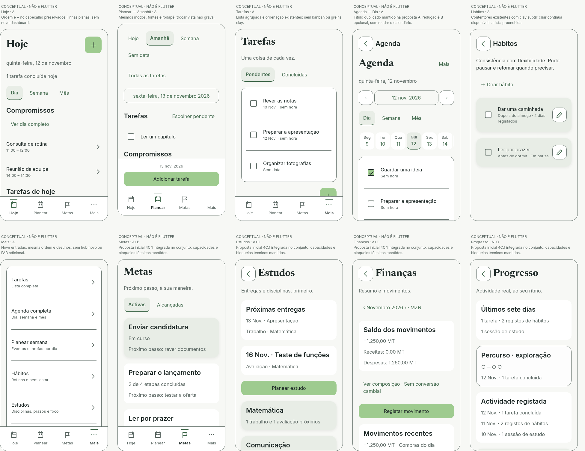
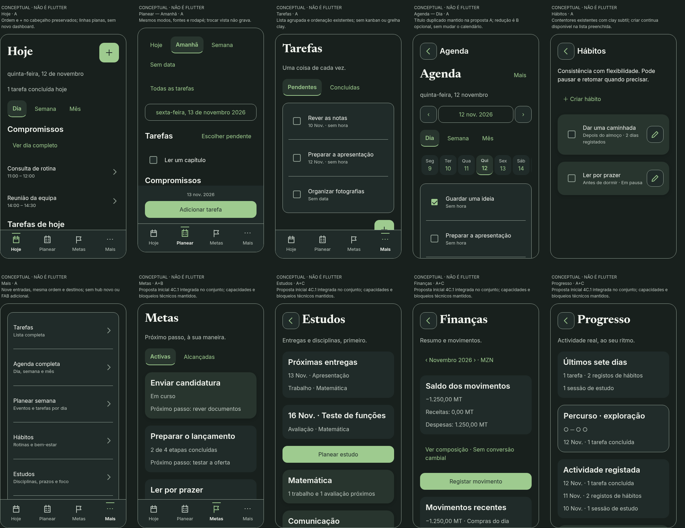

# Protótipos globais — identidade Visual e Premium

**Propostas conceptuais, não capturas Flutter e não implementação da aplicação.** Exemplos fictícios. Nenhum controlo grava dados, atribui XP ou altera uma rota de produção. Complementam e ampliam os seis wireframes da primeira entrega; não os fazem passar por ecrãs já implementados.

## Avaliação do conjunto

[Prancha interactiva global](global.html) · [Matriz A/B/C](GLOBAL_IDENTITY.md) · [Foco e alvos](GLOBAL_COMPONENTS.md) · [Contraste global](GLOBAL_CONTRAST.md)

As duas pranchas seguintes são **recortes de revisão** de dez contextos principais, para comparar paleta, tipografia, superfícies e navegação. Não mostram todo o conteúdo, não são medições de viewport nativo e não substituem as imagens integrais abaixo. A altura reduzida de cada recorte não autoriza remover funções ou esconder informação na app.

### Conjunto claro

### Conjunto escuro

## Protótipos integrais dos 23 contextos

A = actualização visual; A+B inclui simplificação de UX; A+C inclui redesenho profundo. A categoria está identificada em cada imagem, fora da interface do produto. As barras, molduras e anotações são de revisão; os PNGs de conteúdo comprido mostram a estrutura deslocável completa, não um telefone físico dessa altura.

| Contexto | Categoria | Claro | Escuro | Condição de preservação / revisão |
| --- | --- | --- | --- | --- |
| Hoje | A | [Ver](global/hoje-light.png) | [Ver](global/hoje-dark.png) | Ordem e + no cabeçalho preservados; linhas planas, sem novo dashboard. |
| Planear — Amanhã | A | [Ver](global/planear-dia-light.png) | [Ver](global/planear-dia-dark.png) | Mesmos modos, fontes e rodapé; trocar vista não grava. |
| Planear — Semana | A | [Ver](global/planear-semana-light.png) | [Ver](global/planear-semana-dark.png) | Sete dias verticais; um expandido. Sem substituir por grelha. |
| Planear — Sem data | A | [Ver](global/planear-sem-data-light.png) | [Ver](global/planear-sem-data-dark.png) | Mesmo registo e associações, sem data inventada. |
| Tarefas | A | [Ver](global/tarefas-light.png) | [Ver](global/tarefas-dark.png) | Lista agrupada e ordenação existentes; sem kanban ou grelha clay. |
| Agenda — Dia | A | [Ver](global/agenda-dia-light.png) | [Ver](global/agenda-dia-dark.png) | Título duplicado mantido na proposta A; redução é B opcional, sem mudar o calendário. |
| Agenda — Mês | A | [Ver](global/agenda-mes-light.png) | [Ver](global/agenda-mes-dark.png) | A vista mensal actual apresenta dias em lista; não se propõe uma grelha nova. |
| Hábitos | A | [Ver](global/habitos-light.png) | [Ver](global/habitos-dark.png) | Contentores existentes com clay subtil; criar continua disponível na lista preenchida. |
| Mais | A | [Ver](global/mais-light.png) | [Ver](global/mais-dark.png) | Nove entradas, mesma ordem e destinos; sem hub novo ou FAB adicional. |
| Revisões | A | [Ver](global/revisoes-light.png) | [Ver](global/revisoes-dark.png) | A estrutura e data ISO actuais permanecem; localizar a data é B opcional. |
| Definições | A | [Ver](global/definicoes-light.png) | [Ver](global/definicoes-dark.png) | Preferências e avisos preservados; exportação não promete restauro. |
| Metas | A+B | [Ver](global/metas-light.png) | [Ver](global/metas-dark.png) | Proposta inicial 4C.1 integrada no conjunto; capacidades e bloqueios técnicos mantidos. |
| Estudos | A+C | [Ver](global/estudos-light.png) | [Ver](global/estudos-dark.png) | Proposta inicial 4C.1 integrada no conjunto; capacidades e bloqueios técnicos mantidos. |
| Finanças | A+C | [Ver](global/financas-light.png) | [Ver](global/financas-dark.png) | Proposta inicial 4C.1 integrada no conjunto; capacidades e bloqueios técnicos mantidos. |
| Progresso | A+C | [Ver](global/progresso-light.png) | [Ver](global/progresso-dark.png) | Proposta inicial 4C.1 integrada no conjunto; capacidades e bloqueios técnicos mantidos. |
| Nova tarefa | A | [Ver](global/tarefa-light.png) | [Ver](global/tarefa-dark.png) | Proposta inicial 4C.1 integrada no conjunto; capacidades e bloqueios técnicos mantidos. |
| Criar meta | A+B | [Ver](global/meta-light.png) | [Ver](global/meta-dark.png) | Proposta inicial 4C.1 integrada no conjunto; capacidades e bloqueios técnicos mantidos. |
| Criar evento | A | [Ver](global/evento-light.png) | [Ver](global/evento-dark.png) | Formulário opaco; recorrência, datas e editor existente preservados. |
| Reagendar tarefa | A | [Ver](global/reagendar-light.png) | [Ver](global/reagendar-dark.png) | Alteração explícita do mesmo ID; sem duplicação ou novo prazo paralelo. |
| Selector global Criar | A | [Ver](global/criar-light.png) | [Ver](global/criar-dark.png) | Selector existente preservado em Hoje/Tarefas/Agenda; FAB de Metas continua directo. |
| Diálogo de rascunho | A | [Ver](global/dialogo-descartar-light.png) | [Ver](global/dialogo-descartar-dark.png) | Superfície plana; foco inicial seguro; não apaga tarefas já guardadas. |
| Diálogo de eliminação | A | [Ver](global/dialogo-eliminar-light.png) | [Ver](global/dialogo-eliminar-dark.png) | Consequência integral; Cancelar mantém o registo; sem clay/glass. |
| Componentes — estados | A | [Ver](global/estados-light.png) | [Ver](global/estados-dark.png) | Revisão de design: alvos ≥48 dp, foco 2 dp; CSS px do protótipo não certifica dp Flutter. |

## Como rever a prancha HTML

Abrir o ficheiro a partir de uma cópia do repositório ou servir a raiz do repositório com `python3 -m http.server 8765` e visitar `/docs/ux/phase4c1/global.html`. Não é necessário Flutter nem instalar dependências. Fontes locais Inter/Newsreader e iconografia SVG conceptual; nenhum serviço externo.

- Alternar tema claro/escuro, largura conceptual 320/360/390 CSS px e texto 100/200%.
- Filtrar A, B ou C para comparar intensidades. Apenas Estudos, Finanças e Progresso entram no grupo C; não existe C em Hoje/Planear/Tarefas/Agenda.
- Abrir as expansões e percorrer controlos por Tab/Shift+Tab. O catálogo Estados mostra foco, selecção, erro, indisponibilidade, gravação, vazio, erro de leitura e carregamento.
- A faixa de sete dias é deslocável horizontalmente para conservar alvos legíveis; o restante conteúdo não precisa de overflow horizontal.
- O planeador semanal conceptual mantém um dia aberto de cada vez. Acções de criar/guardar/voltar apenas anunciam simulação; não se prometem operações reais.
- Os diálogos são apresentados isoladamente para comparar estilos e consequências, não como modais nativos funcionais. A especificação define o isolamento/foco/guard que a futura implementação terá de verificar.

## Decisões visuais que podem ser avaliadas agora

Uma paleta semântica em todas as áreas, sem regressar ao teal legado nas páginas secundárias. Newsreader no título de página e Inter no conteúdo; estilos de acção, campos, ícones e foco comuns. Superfície plana em Hoje/Planear/Tarefas/Agenda, barra, formulários e diálogos. Clay subtil nos cartões existentes de hábitos e disciplinas e numa meta em destaque. Glass apenas no painel opcional de Progresso, com composição calculada e alternativa sólida.

O título repetido da Agenda foi intencionalmente preservado na proposta A: retirar a redundância é uma opção B separada, não uma alteração disfarçada do fluxo aprovado. O Progresso C, pelo contrário, já propõe um título único e hierarquia nova. Esta diferença torna visível a separação entre actualizar a identidade e reformular a experiência.

A representação estática não simula o relógio, o temporizador de foco, a IME, SafeArea, notificações, gestos do SO, navigators ou escrita SQLite. O rodapé e a barra nas imagens indicam o lugar/estilo; a coexistência com teclado e foco continua a exigir widget tests e ensaio nativo. A regra 4A de criação sem sobreposição e a criação rápida 4B não são substituídas por CSS.

## Verificação efectuada na adenda

[Registo mecânico de validação conceptual](global-validation.json).

Chromium/Playwright com fontes locais: **23 contextos × 12 combinações = 276 verificações de contexto**, nos dois temas, 320/360/390 CSS px e 100/200%. Sem overflow horizontal dos contentores principais; a faixa de dias tem deslocação intencional. Sem alvos inferiores a 48×48 CSS px entre botões, selects, campos de texto, cabeçalhos expansíveis e wrappers medidos de checkbox/radio. A dimensão do glifo de checkbox não foi confundida com a área activável do wrapper.

Verificados anel de foco por teclado de 2 CSS px num controlo do diálogo, selecção do filtro C com exactamente três módulos, mensagem de simulação sem gravação e expansão exclusiva dos dias da semana. Sem erros JavaScript. **46 PNGs integrais e 2 pranchas de conjunto** foram gerados do artefacto HTML; não são screenshots da app Flutter. Os resultados não certificam alvos em dp, todos os percursos de foco, leitores de ecrã ou conformidade WCAG.

Inspecção visual directa durante a revisão: Hoje claro, Planear Semana escuro, diálogo de rascunho claro, catálogo de estados escuro e pranchas de conjunto. A inspecção das capturas reais que fundamentam a proposta está documentada em GLOBAL_IDENTITY. Não se declara uma pesquisa com utilizadores ou ensaio Android que não tenha sido feito.

A matriz original foi recalculada: 578 pares / 92 utilizações sem falhas; GLOBAL_CONTRAST acrescenta os mínimos por família global. Links locais, sintaxe do artefacto e preservação Git foram verificados. Não houve novos testes Flutter/build nesta etapa documental. Os 254 testes e Actions verdes continuam a ser os da base 4B. Antes de autorizar código, rever separadamente A/B/C, compatibilidade e critérios de ACCESSIBILITY/ACCEPTANCE.
