# Wireframes — propostas conceptuais

**Não são capturas Flutter. Nenhum ecrã foi implementado na app.** Dados fictícios, sem gravação, XP ou navegação de produção. A prancha HTML serve para rever hierarquia, estados expandidos e pares de cor; os SVGs permitem revisão directa no repositório.

[Abrir prancha HTML](wireframes.html) (descarregar/abrir localmente ou servir a raiz do repositório). Seleccionar Claro/Escuro, largura 320/360/390 CSS px e texto 100/200%. Os controlos de revisão não fazem parte da interface proposta da app. Os seis contextos aparecem lado a lado quando houver espaço; dentro de cada um a estrutura é de uma coluna.

## Estruturas propostas

| Contexto | Ordem e gesto principal |
| --- | --- |
| Metas | Activas ✓ · Alcançadas → Enviar candidatura → Preparar o lançamento → Ler por prazer → Criar meta |
| Estudos | Próximas entregas → 16 Nov. · Teste de funções → Planear estudo → Matemática → Comunicação → Sessões e histórico → Horários e aulas |
| Finanças | ‹ Novembro 2026 › · MZN → Saldo dos movimentos → Ver composição · Sem conversão cambial → Registar movimento → Movimentos recentes → Orçamentos por categoria → Poupanças → Recorrências e histórico |
| Progresso | Últimos sete dias → Exploração do Percurso → Actividade registada → Metas em evolução → Hábitos e histórico → Conquistas e XP, se activados → Fazer uma revisão |
| Nova tarefa | Nome → Dia: sem data · Escolher dia → Mais opções → Guardar → Guardar e adicionar outra surge ao escrever ou abrir opções. Contrato 4B preservado. |
| Criar meta | Nome → Prazo em dias (opcional) → Exemplo: criação 12 Nov. → até 12 Dez. 2026. → Acompanhamento adicional → Criar → Sem medida escolhida: concluir quando alcançar. Sem percentagem artificial. |

## Metas

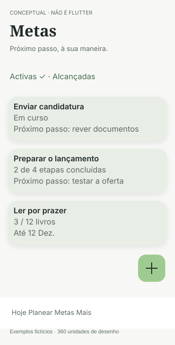

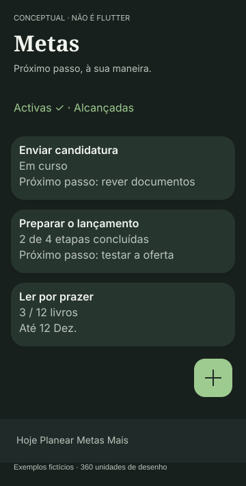

## Estudos

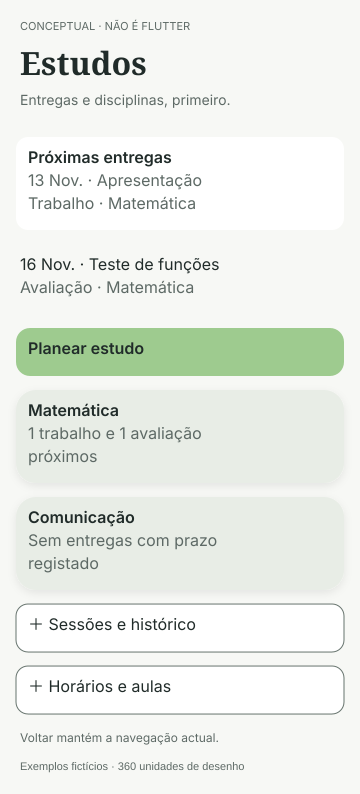

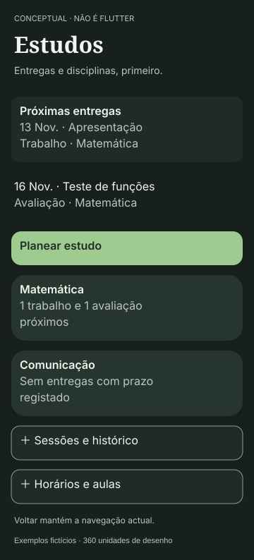

## Finanças

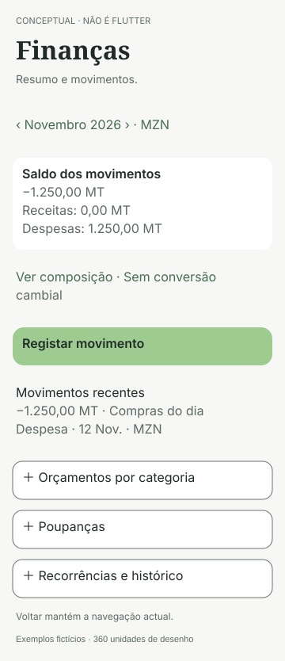

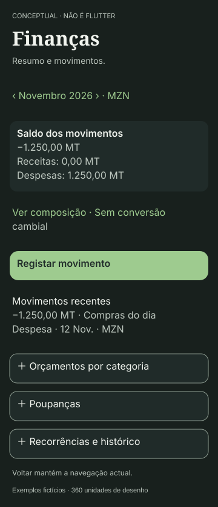

## Progresso

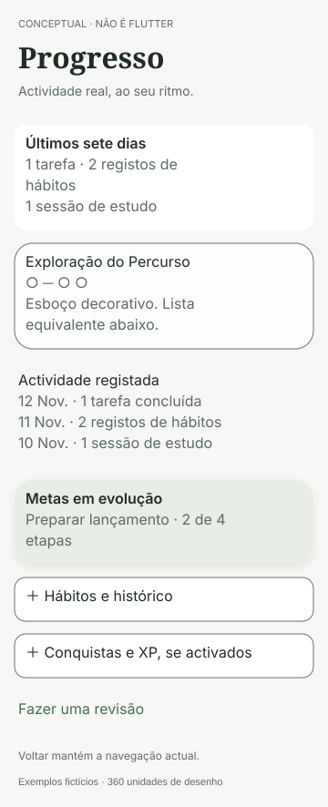

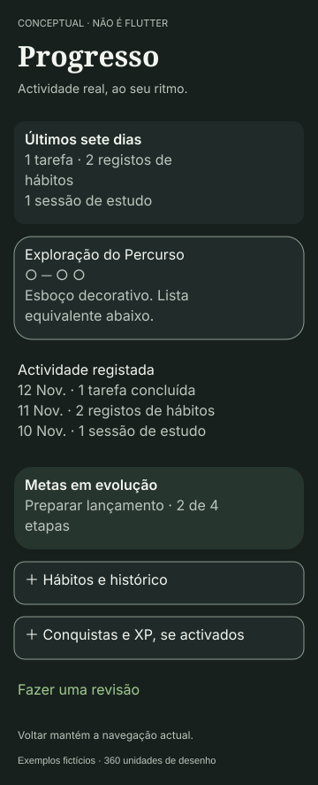

## Nova tarefa

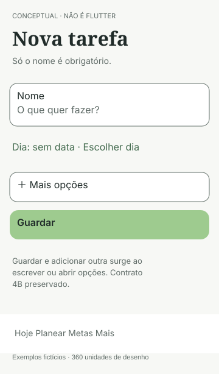

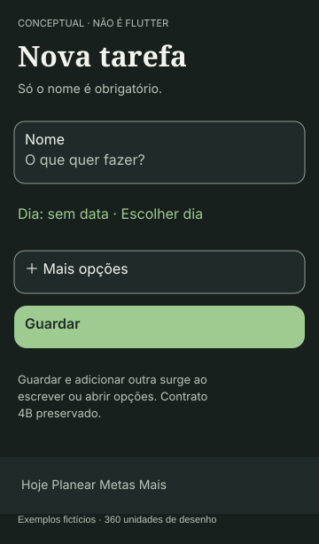

## Criar meta

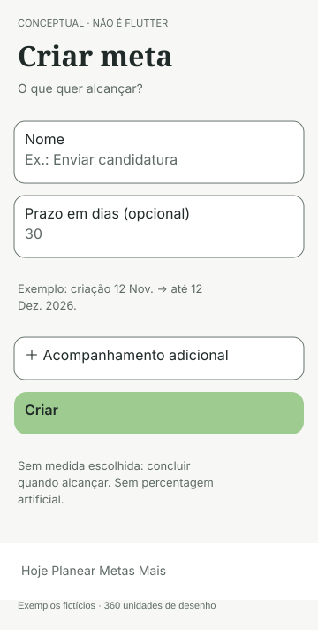

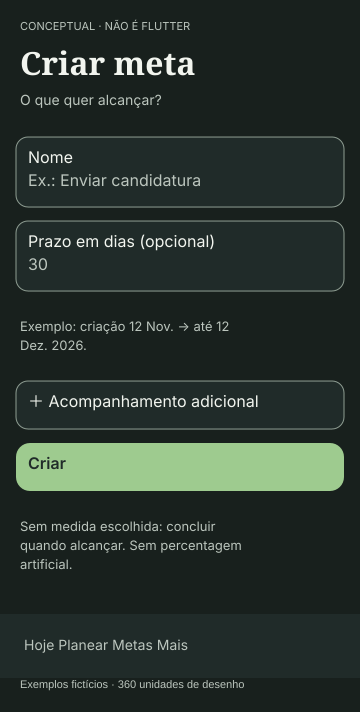

## Fidelidade e limites

Os SVGs têm largura de desenho 360, altura variável e aproximação tipográfica Inter/Newsreader com fallback local do visualizador. A prancha HTML referencia as fontes TTF existentes; sem rede. Não são um catálogo de componentes Flutter nem uma especificação de pixels físicos. A barra principal é representada, não redesenhada: o protótipo usa ligações internas para consulta e não simula GoRouter. O corpo do formulário pode expandir; não simula IME/rodapé nativo. Algumas linhas secundárias dos SVGs são descrições de controlo, não controlos activáveis.

A selecção de modo ilustra os três significados, não grava discriminador. Datas são exemplos. O painel de Progresso é apenas exploração decorativa, não Percurso completo. Botões Criar/Guardar/Planear/Registar só anunciam simulação. Os detalhes dos módulos são placeholders nomeados; todas as capacidades preservadas estão nas especificações, não implementadas aqui.

## Verificação executada do artefacto conceptual

Chromium headless com Playwright: 2 temas × 3 larguras (320/360/390 CSS px) × 2 escalas (100/200%) = **12 combinações, seis contextos em cada uma**, sem overflow horizontal e sem erros JavaScript. Verificadas abertura de opções, selecção conceptual de etapas, mensagem de simulação sem persistência e foco visível de 2 CSS px num botão ao navegar com teclado. Dois recortes do preview foram inspeccionados durante a revisão (Metas clara e Progresso escuro), sem os apresentar como capturas Flutter.

O primeiro ensaio de foco procurava :focus-visible após uma sequência de rato/foco programático; corrigiu-se o ensaio para Tab/Shift+Tab, que é o cenário de teclado especificado. Não foi uma correcção à aplicação. O ensaio não certifica o foco de todos os controlos, ordem de leitura nativa ou alvos em dp Flutter.

Verificação documental: 43 links internos resolvidos, 12 SVGs com XML válido, sintaxe Python válida, 92 utilizações de contraste aprovadas e 578 pares calculados. Nenhuma alteração fora de docs/ux/phase4c1; nenhum teste/ficheiro Flutter existente modificado. Não foram executados ensaios nativos nesta fase.
