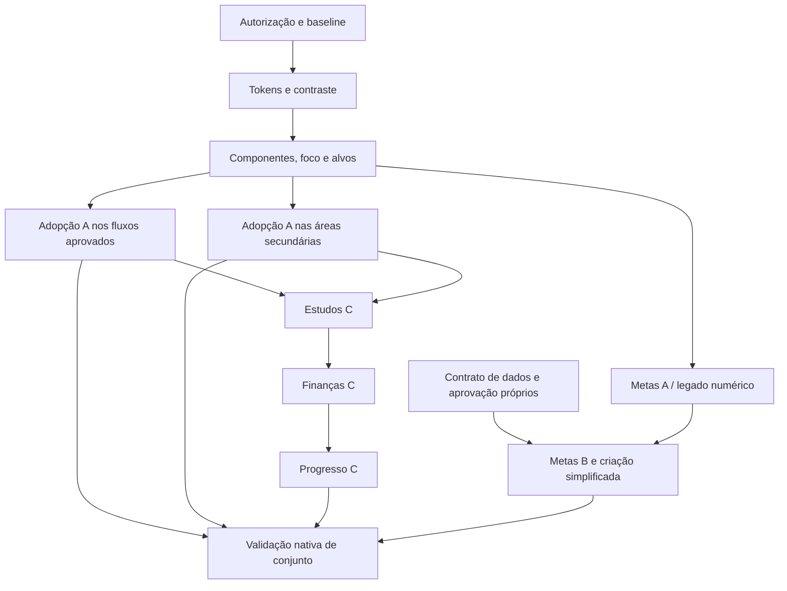

# Plano progressivo para 4C.3 — não iniciado

**Só executar após autorização explícita do utilizador, com âmbito por incremento.** Este plano identifica pontos de integração, não altera nenhum ficheiro Flutter. A prioridade é DS global e componentes; depois hierarquia dos módulos mais problemáticos. Cada incremento tem demonstração, testes pertinentes, comparação visual e commit/PR revistos, sem merge automático.

## Condições de entrada e grafo de dependências

Confirmar o HEAD de código 4B que acompanha os documentos finais 4C.2, árvore Git e alterações existentes; criar branch de implementação separado. Flutter 3.35.7/Dart 3.9.2/Java 21 e a suite de 254 são referências registadas, não uma garantia de que o ambiente futuro está preparado. Ler AGENTS e os contratos de datas/TaskOperations/XP/finanças. Escolher A/B/C e as decisões do relatório antes de escrever código.

K é opcional/bloqueado se não houver autorização de dados. A sua ausência não impede adoptar A ou validar os módulos autorizados. Não disfarçar uma migração como mudança de tema.

## Incrementos verificáveis

| ID / tamanho | Componentes e ficheiros Flutter candidatos | Dependência / risco | Testes necessários | Aceitação específica |
| --- | --- | --- | --- | --- |
| C3.0 — baseline e decisão | Sem alteração funcional; inventário das rotas/editores e fixtures | Antes de tudo; risco de partir de código anterior à 4B | Confirmar HEAD/Git/versões; suite actual, análise e baseline visual quando preparado | 4B intacta, diferenças do utilizador preservadas; A/B/C e decisões do relatório seleccionadas |
| C3.1 — tokens (um incremento de tema) | lib/core/theme/app_colors.dart, app_theme.dart, today_theme.dart; eventual ficheiro de tokens semânticos sob core/theme | Não substituir Riverpod/Cubits/GoRouter; dois temas actuais não podem divergir em funções semânticas | Novo teste de contraste/tokens para pares usados/estados; garantir fontes locais e sem pacotes novos | Mesma paleta em claro/escuro; primaryBorder e foco calculados; zero novas cores não verificadas; desactivado sem opacidade global |
| C3.2 — campos/botões/foco (separar de navegação) | app_theme.dart e adaptadores TodayTheme; componentes de field/action existentes | C3.1; risco de reduzir alvo ou cortar labels ao alterar densidade | Widget tests alvo ≥48 dp, texto 200%, erro+foco, busy, teclado físico simulado; snapshot dos controlos | Todos os estados do catálogo distinguíveis; título/ajuda/erro com semântica; zero duplo envio introduzido |
| C3.3 — shells e componentes planos | lib/core/widgets/workspace_page.dart, skeleton_page.dart (InsetGroup), legacy_section_page.dart; app/app.dart e areas_screen.dart apenas em estilo | C3.2; risco de tema secundário diferente, recorte de foco, estado/rota perdido | navigation_v2/contract, phase3f_modal, foco da barra e safe areas; 320/360/390, 100/200% | Quatro destinos, nomes/ordem/estado/guard iguais; nada de dock glass/clay; carregamento/erro/vazio coerentes |
| C3.4a — Hoje / lista de tarefas | features/agenda/presentation/today_screen.dart; tasks/presentation/tasks_screen.dart e task_row.dart | C3.3; risco de regressão 4A, ordenação ou XP | today_screen/content, phase4a_responsive, phase3f_task_journey e fluxos de tarefa | + no cabeçalho não cobre conteúdo; mesma ordem/contagens/filtros; mesmo ID e XP; sem dashboard novo |
| C3.4b — Planear / Agenda | planning_screen.dart, planner_task_tile.dart, task_schedule_sheet.dart; weekly_planner_screen.dart; agenda_browser.dart | C3.3; risco de datas/horas, dia escolhido, fontes académicas e rolagem | planning_screen/dates, weekly_planner_widget, agenda_integration, task_operations e selecção contextual | Mesmos modos, sete dias, intervalo e regra de domingo; consulta sem escrita; nenhum formato de due reinterpretado |
| C3.5 — criação rápida (polimento limitado) | features/tasks/presentation/quick_task_sheet.dart; estilos em forms.dart só se exigidos pelos componentes | C3.2/3; risco alto de invalidar 3B/4A/4B | quick_task_sheet/entry, phase4a_responsive; casos IME, Guardar outra, falha/recusa de lembrete e rascunho | Não reconstruir folha ou TaskOperations; mesma retenção de contexto, bloqueios e retorno. Testar horizontal/fallback e foco não oculto |
| C3.6 — A nas áreas secundárias (subincrementos por área) | habits_screen.dart; reviews_screen.dart; settings_screen.dart; académicos/financeiros só estilos dos editores | C3.3; risco de apagar acesso ou mudar comportamento por widget partilhado | legacy_modules, phase4b, academics/finance widget; três hábitos distintos e reabertura sintética | Criar em lista preenchida, pausa/edição, campos/avisos de dados e exportação iguais; zero novos XP ou migrations |
| C3.7 — Metas A/legado | goals_screen.dart, goal_detail.dart, goal_plan.dart, goals_cubit.dart só se necessário ao estilo; FAB em app.dart | C3.3; risco de converter legado para binário | goal_planning, goal_planning_widget, phase4b FAB, app_test; valores iniciais/histórico/due/relações | FAB directo preservado; métricas antigas e etapas auxiliares intactas; nenhuma inferência por alvo/unidade |
| C3.8 — Estudos C (não alterar serviços) | features/academics/academics_panel.dart; academic_editor.dart / focus_timer.dart apenas para acesso e disposição aprovada | A global adoptada; risco de perder foco, origens ou funções nas expansões | academics/focus_lifecycle/quick_task_entry; retoma de foco, nova avaliação, disciplina, aula, trabalho e histórico | Entregas/disciplinas relevantes primeiro; Planear/Retomar evidente; cada função existente localizável; Task.due continua Dia da tarefa |
| C3.9 — Finanças C (incremento próprio) | features/finance/finance_panel.dart, finance_editor.dart apenas apresentação; Editor Transacção/Poupança preservado | A global; risco material de cálculos/moeda/contribuição/recorrência | finance, currency e respectivos widgets; igualdade de totais sintéticos por mês/moeda; criar/editar/eliminar e confirmar vencimentos | Registar movimento acessível; composição explícita; mesmos cêntimos/tipos; abrir não gera movimentos. finance_rules/repository sem mudança de cálculo |
| C3.10 — Progresso C (lista antes do mapa) | features/progress/progress_screen.dart, progress_panel.dart; progress_rules.dart só leitura existente, sem mudar regras | A global e contrato das fontes; risco de métricas fictícias e história incompleta | progress_test, gamificação desligada, ausência de registos, reabertura/eliminação; equivalência da lista e visual | Sem XP/regras novos; actividade/metas primeiro; mapa opcional não é necessário para usar a área; fallback sólido e estático |
| C3.M — metas simplificadas B (gate separado) | forms.dart/novo apresentador de criação se aprovado, goal_detail/plan e repositório/schema **apenas após autorização técnica explícita** | Contrato durável de modos, histórico, conversão/reabertura, exportação/migração aprovado | Fixtures v5, migração aditiva se autorizada, reabertura/round-trip, 3 modos, prazo vazio/dias/data ISO e erro | Criar só com nome é válido sem %; etapas não actualizam métrica por acidente; legado preservado. Sem aprovação de dados, não activar este incremento |
| C3.V — conjunto / distribuição separada | Ferramentas existentes de captura e workflows; sem alterações de domínio | Após cada módulo e no conjunto; risco nativo não coberto por browser | Formatação/análise/suite pertinente e completa; Flutter/Android Actions no SHA; teclado/IME/TalkBack/dispositivos/actualização próprios | Evidência clara/escura, 200%, pequenos ecrãs, safe areas; nenhuma promessa de assinatura/notificação/restauro sem ensaio |

Os ficheiros são pontos de integração reais, não autorização para mudar todos. Dividir os subincrementos se uma alteração tocar mais de um fluxo de negócio; não juntar C3.8/9/10 num redesenho monolítico. Todos os testes citados são suites existentes; novos testes futuros devem verificar comportamento/contrato, sem espelhar a implementação.

## Estratégia visual e de regressão

1. Congelar fixtures sintéticas/relógio, dados de longo texto, vazio e preenchido, fontes locais, engine e dimensões. Capturar a base de código real antes de aplicar o incremento.
2. Reutilizar tool/capture_quality.dart e os padrões RepaintBoundary já existentes; adaptar casos só no incremento autorizado. Não acrescentar dependências de golden/ícones por conveniência. Separar screenshots reais de protótipos HTML.
3. Comparar ecrã/estado a 320/360/390 dp, ambos os temas, 100/200%, teclado, SafeArea e horizontal; medir sobreposição de foco/alvos e ordem semântica. Comparação pixel a pixel só com engine/fontes/plataforma fixados, complementada por critérios geométricos e leitura humana.
4. Em cada commit/PR, documentar o que muda em A/B/C, funções preservadas, riscos e resultados reais. Não actualizar um golden para aceitar regressão de ID, moeda, due, XP ou retorno.
5. Executar testes pertinentes após cada incremento; suite completa e Actions antes da entrega. Se os workflows não incluem o novo branch, acrescentá-lo apenas quando a implementação for autorizada, sem enfraquecer comandos/critérios.
6. Revisão manual nativa com teclado físico, TalkBack, IME/gestos e aparelho de menor desempenho. Verificar glass sólido/sem animações e luz real; recolher pesquisa formativa conforme RESEARCH_PLAN antes de concluir compreensão sem tutorial.

## Rollback e dados

A/B/C visuais devem poder ser revertidos por commit sem migração de dados. Feature flags, se julgadas necessárias, precisam de contrato e testes, não dados paralelos. Uma futura mudança de modo de meta exige rollback e compatibilidade próprios; não é reversão cosmética. Não desinstalar app com dados para contornar assinatura. Nenhuma publicação, merge ou Fase 4C.3 foi iniciada aqui.
