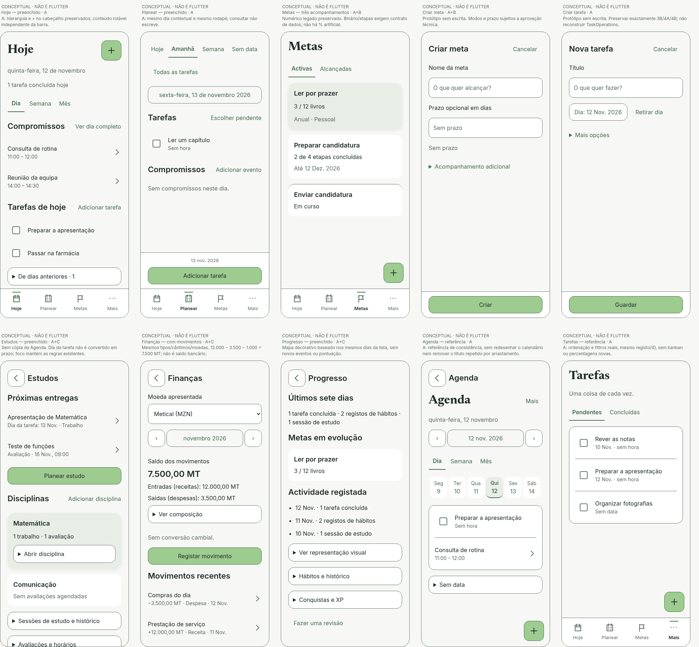
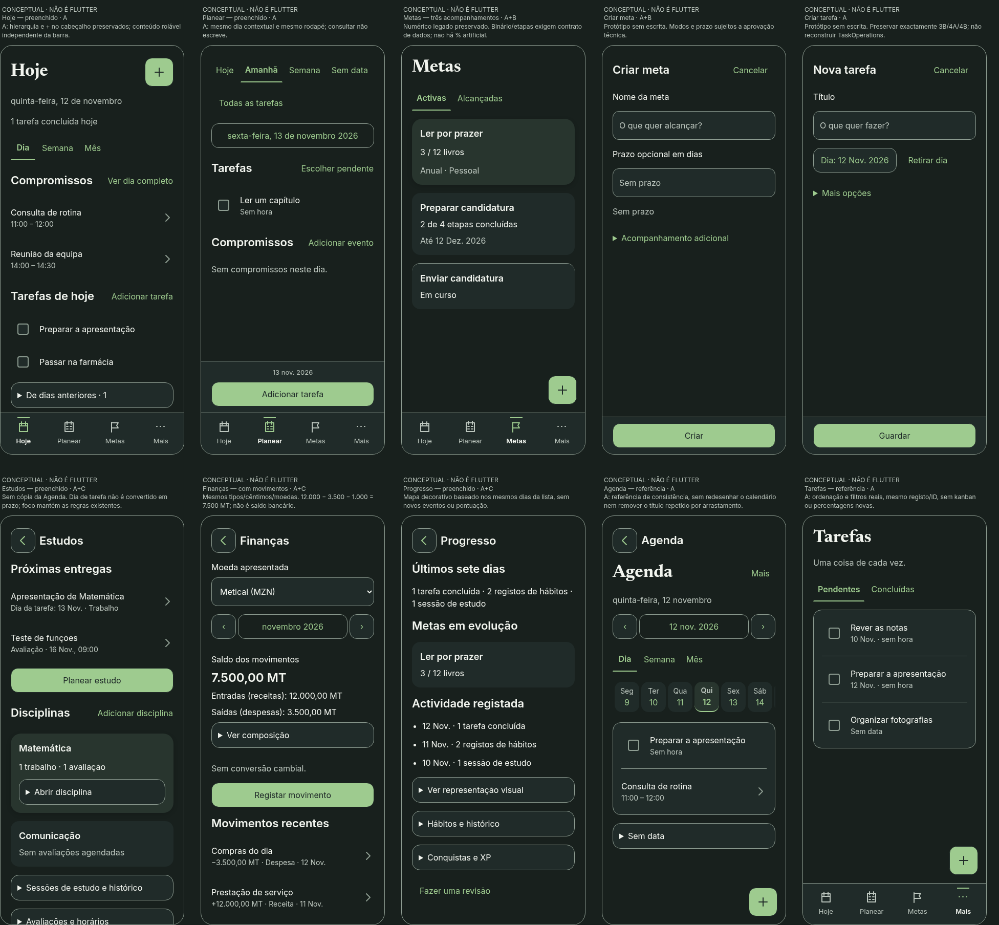

# Protótipos e maquetas — 4C.2

**Conceptuais, produzidos em HTML/Chromium, não capturas de implementação Flutter.** Nenhuma escrita SQLite ou operação real de negócio. Só as referências ligadas em COMPARISON são capturas Flutter históricas. Dados fictícios e relógio fixo: 12 Novembro 2026.

[Prancha interactiva](prototypes.html) · [Comparação com a app actual](COMPARISON.md) · [Revisão crítica](DESIGN_REVIEW.md) · [Ensaio de browser](validation.json)

## Conjunto claro e escuro

As pranchas seguintes juntam dez frames de conteúdo delimitado; não alteram a ordem dos elementos para caber num recorte. Para inspeccionar leitura e alvos, usar a imagem individual ou a prancha HTML. O conteúdo que não cabe continua por scroll dentro do frame, não foi eliminado.

## Casos e estados

A = actualização visual; B = simplificação; C = redesenho de hierarquia. São categorias de **proposta**, não aprovações de implementação. Nos modos novos de Metas, a nota fora do ecrã assinala o bloqueio de dados.

| Caso | Claro | Escuro |
| --- | --- | --- |
| Hoje — preenchido | [Ver](previews/hoje-filled-light.png) | [Ver](previews/hoje-filled-dark.png) |
| Hoje — vazio | [Ver](previews/hoje-empty-light.png) | [Ver](previews/hoje-empty-dark.png) |
| Planear — preenchido | [Ver](previews/planear-filled-light.png) | [Ver](previews/planear-filled-dark.png) |
| Planear — vazio | [Ver](previews/planear-empty-light.png) | [Ver](previews/planear-empty-dark.png) |
| Planear — Semana | [Ver](previews/planear-semana-light.png) | [Ver](previews/planear-semana-dark.png) |
| Metas — três acompanhamentos | [Ver](previews/metas-filled-light.png) | [Ver](previews/metas-filled-dark.png) |
| Metas — vazio | [Ver](previews/metas-empty-light.png) | [Ver](previews/metas-empty-dark.png) |
| Criar meta | [Ver](previews/meta-form-light.png) | [Ver](previews/meta-form-dark.png) |
| Criar meta — opções | [Ver](previews/meta-numeric-light.png) | [Ver](previews/meta-numeric-dark.png) |
| Criar tarefa | [Ver](previews/task-empty-light.png) | [Ver](previews/task-empty-dark.png) |
| Criar tarefa | [Ver](previews/task-filled-light.png) | [Ver](previews/task-filled-dark.png) |
| Criar tarefa — opções | [Ver](previews/task-advanced-light.png) | [Ver](previews/task-advanced-dark.png) |
| Meta binária — proposta | [Ver](previews/meta-binary-light.png) | [Ver](previews/meta-binary-dark.png) |
| Meta por etapas — proposta | [Ver](previews/meta-steps-light.png) | [Ver](previews/meta-steps-dark.png) |
| Estudos — preenchido | [Ver](previews/estudos-filled-light.png) | [Ver](previews/estudos-filled-dark.png) |
| Estudos — vazio | [Ver](previews/estudos-empty-light.png) | [Ver](previews/estudos-empty-dark.png) |
| Estudos — foco activo | [Ver](previews/estudos-focus-light.png) | [Ver](previews/estudos-focus-dark.png) |
| Finanças — com movimentos | [Ver](previews/financas-filled-light.png) | [Ver](previews/financas-filled-dark.png) |
| Finanças — vazio | [Ver](previews/financas-empty-light.png) | [Ver](previews/financas-empty-dark.png) |
| Progresso — preenchido | [Ver](previews/progresso-filled-light.png) | [Ver](previews/progresso-filled-dark.png) |
| Progresso — vazio | [Ver](previews/progresso-empty-light.png) | [Ver](previews/progresso-empty-dark.png) |
| Progresso — visual opcional | [Ver](previews/progresso-map-light.png) | [Ver](previews/progresso-map-dark.png) |
| Agenda — referência | [Ver](previews/agenda-light.png) | [Ver](previews/agenda-dark.png) |
| Tarefas — referência | [Ver](previews/tarefas-light.png) | [Ver](previews/tarefas-dark.png) |
| Estados e foco | [Ver](previews/states-light.png) | [Ver](previews/states-dark.png) |

### Texto 200% e teclado simulado

| Caso em 320 CSS px | Claro | Escuro |
| --- | --- | --- |
| Tarefa com opções | [Ver](previews/task-advanced-200-keyboard-light.png) | [Ver](previews/task-advanced-200-keyboard-dark.png) |
| Meta com números | [Ver](previews/meta-numeric-200-keyboard-light.png) | [Ver](previews/meta-numeric-200-keyboard-dark.png) |

Não existe IME real desenhada: a zona de 280 CSS px é um espaço simulado. O formulário pode deslocar-se para mostrar o campo focado; não é necessário que título, todos os campos e todos os botões fiquem simultaneamente no mesmo viewport. As acções e o foco precisam de continuar acessíveis.

## Como explorar

Servir a raiz do repositório com `python3 -m http.server 8765 --bind 127.0.0.1` e abrir `/docs/ux/phase4c2/prototypes.html`. Usar o selector **Caso** (ou Todos), tema, largura, texto, Fundo sólido e Teclado simulado. Fontes são as TTF locais; não é necessário Flutter nem um serviço externo.

Metas: expandir Acompanhamento adicional e seleccionar os três modos. Com números revela unidade/inicial/alvo; o protótipo verifica nome/prazo/alvo apenas para explorar o feedback, **sem guardar**. Na meta por etapas, marcar as quatro oferece conclusão explícita, não altera XP ou outras metas. Na tarefa, Guardar outra aparece ao escrever ou expandir, como no contrato 4B. Cancelar um rascunho preenchido abre a demonstração de diálogo; Esc/Continuar repõem foco.

Mês/moeda, linhas e opções secundárias mostram os pontos de acesso; não executam consultas reais, notificações ou navegação GoRouter. Uma acção sem implementação apenas anuncia «Simulação… nenhum dado foi gravado». Temporizador, exportação, finanças e persistência não são emulados como serviços funcionais. O mapa liga somente os dias da fixture que têm actividade, com a mesma lista textual e opção sólida; não é o Percurso completo.

O frame 800 CSS px melhora a avaliação do primeiro viewport face à prancha longa da 4C.1, mas não é um emulador Android: SafeArea, barras/gestos, teclado, semântica e desempenho nativos requerem validação futura. A fonte dentro de um campo pode rolar horizontalmente como na edição normal; não confundir isso com truncar o valor guardado ou o nome acessível.

## Reprodução dos ensaios

Com Playwright e Chromium disponíveis no ambiente de revisão, executar `node docs/ux/phase4c2/validate_prototypes.cjs` com o servidor acima activo. O script está no pacote documental; não adiciona dependências à app. Se o Chromium estiver noutro caminho, definir CHROMIUM_PATH. A matriz de contraste usa somente Python standard: `python3 -B docs/ux/phase4c2/contrast_calculator.py`.

Resultados e limites constam de validation.json e do relatório principal. Não transformar browser, árvore AX Chromium ou sucesso de scripts em alegação de TalkBack/WCAG integral ou pesquisa com participantes.
