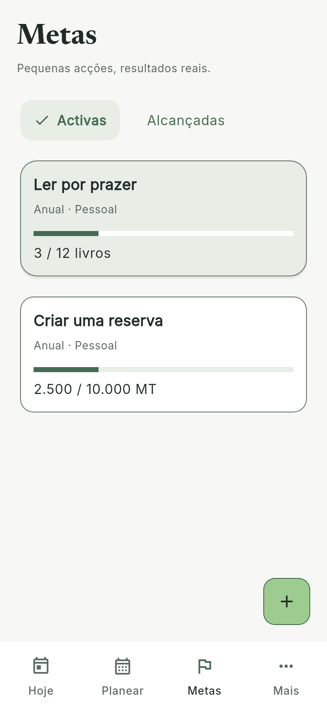
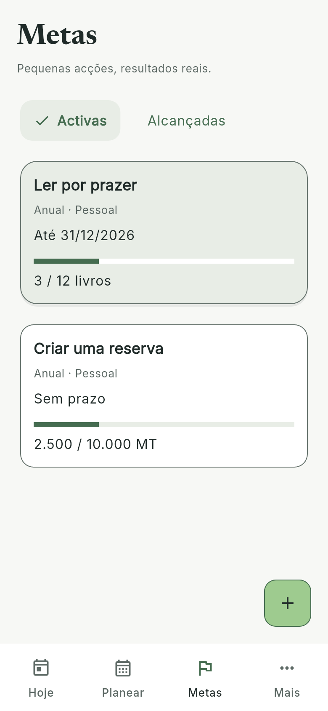
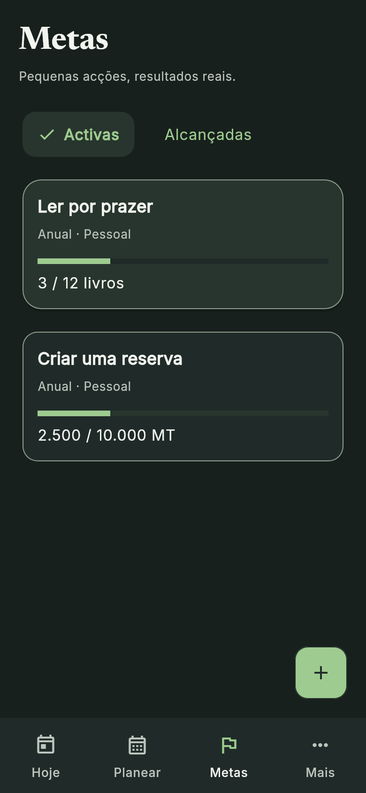
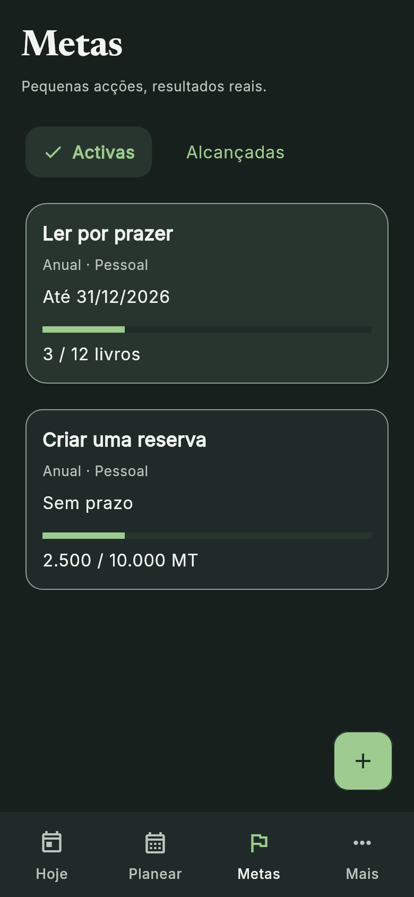
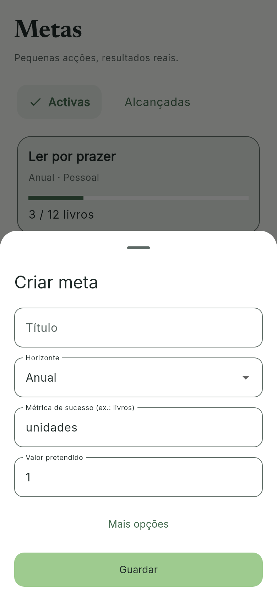
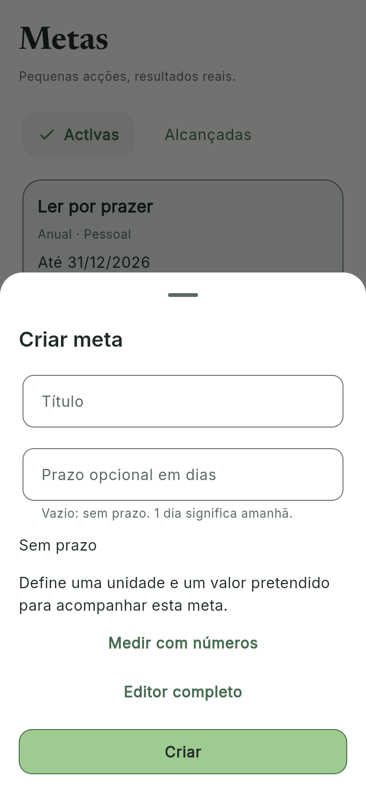
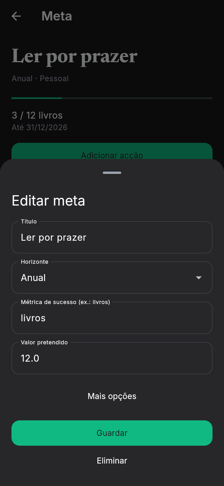
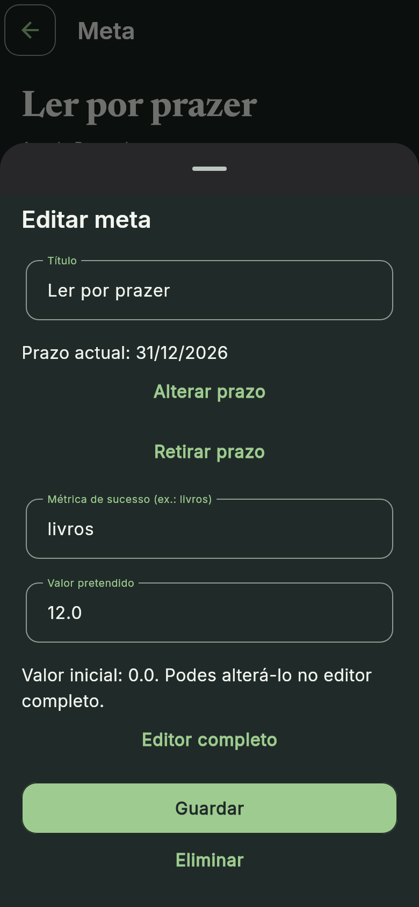

# Capturas Flutter — Fase 4C.3B

**56 pares / 112 PNGs reais do engine Flutter**, sem HTML ou edição das imagens. Mesmas fixtures, fontes, engine e dimensões em cada par. Relógio sintético: 11/11/2026 às 10:30. DPI de saída 2×; tabela em dp lógicos.

Base anterior: 3b86f88. Os casos iniciais foram capturados antes de alterar produção; as variantes medida/editor completo foram complementadas num checkout isolado desse mesmo SHA com o mesmo utilitário. Novos modos não foram simulados como funcionalidades existentes.

## Comparação principal

| Contexto | Antes | Depois |
| --- | --- | --- |
| goals-light |  |  |
| goals-dark |  |  |
| goals-create-light |  |  |
| goals-edit-dark |  |  |

## Matriz completa

| Caso | Dimensões / texto | Antes | Depois |
| --- | --- | --- | --- |
| goals-200-dark | 320×640 / 200% | [Flutter](../previews/phase4c3b/before/goals-200-dark.png) | [Flutter](../previews/phase4c3b/after/goals-200-dark.png) |
| goals-200-light | 320×640 / 200% | [Flutter](../previews/phase4c3b/before/goals-200-light.png) | [Flutter](../previews/phase4c3b/after/goals-200-light.png) |
| goals-create-200-dark | 320×640 / 200% | [Flutter](../previews/phase4c3b/before/goals-create-200-dark.png) | [Flutter](../previews/phase4c3b/after/goals-create-200-dark.png) |
| goals-create-200-light | 320×640 / 200% | [Flutter](../previews/phase4c3b/before/goals-create-200-light.png) | [Flutter](../previews/phase4c3b/after/goals-create-200-light.png) |
| goals-create-advanced-200-dark | 320×640 / 200% | [Flutter](../previews/phase4c3b/before/goals-create-advanced-200-dark.png) | [Flutter](../previews/phase4c3b/after/goals-create-advanced-200-dark.png) |
| goals-create-advanced-200-light | 320×640 / 200% | [Flutter](../previews/phase4c3b/before/goals-create-advanced-200-light.png) | [Flutter](../previews/phase4c3b/after/goals-create-advanced-200-light.png) |
| goals-create-advanced-dark | 390×844 / 100% | [Flutter](../previews/phase4c3b/before/goals-create-advanced-dark.png) | [Flutter](../previews/phase4c3b/after/goals-create-advanced-dark.png) |
| goals-create-advanced-light | 390×844 / 100% | [Flutter](../previews/phase4c3b/before/goals-create-advanced-light.png) | [Flutter](../previews/phase4c3b/after/goals-create-advanced-light.png) |
| goals-create-advanced-small-dark | 320×640 / 100% | [Flutter](../previews/phase4c3b/before/goals-create-advanced-small-dark.png) | [Flutter](../previews/phase4c3b/after/goals-create-advanced-small-dark.png) |
| goals-create-advanced-small-light | 320×640 / 100% | [Flutter](../previews/phase4c3b/before/goals-create-advanced-small-light.png) | [Flutter](../previews/phase4c3b/after/goals-create-advanced-small-light.png) |
| goals-create-dark | 390×844 / 100% | [Flutter](../previews/phase4c3b/before/goals-create-dark.png) | [Flutter](../previews/phase4c3b/after/goals-create-dark.png) |
| goals-create-error-200-dark | 320×640 / 200% | [Flutter](../previews/phase4c3b/before/goals-create-error-200-dark.png) | [Flutter](../previews/phase4c3b/after/goals-create-error-200-dark.png) |
| goals-create-error-200-light | 320×640 / 200% | [Flutter](../previews/phase4c3b/before/goals-create-error-200-light.png) | [Flutter](../previews/phase4c3b/after/goals-create-error-200-light.png) |
| goals-create-error-dark | 390×844 / 100% | [Flutter](../previews/phase4c3b/before/goals-create-error-dark.png) | [Flutter](../previews/phase4c3b/after/goals-create-error-dark.png) |
| goals-create-error-light | 390×844 / 100% | [Flutter](../previews/phase4c3b/before/goals-create-error-light.png) | [Flutter](../previews/phase4c3b/after/goals-create-error-light.png) |
| goals-create-error-small-dark | 320×640 / 100% | [Flutter](../previews/phase4c3b/before/goals-create-error-small-dark.png) | [Flutter](../previews/phase4c3b/after/goals-create-error-small-dark.png) |
| goals-create-error-small-light | 320×640 / 100% | [Flutter](../previews/phase4c3b/before/goals-create-error-small-light.png) | [Flutter](../previews/phase4c3b/after/goals-create-error-small-light.png) |
| goals-create-focus-200-dark | 320×640 / 200% | [Flutter](../previews/phase4c3b/before/goals-create-focus-200-dark.png) | [Flutter](../previews/phase4c3b/after/goals-create-focus-200-dark.png) |
| goals-create-focus-200-light | 320×640 / 200% | [Flutter](../previews/phase4c3b/before/goals-create-focus-200-light.png) | [Flutter](../previews/phase4c3b/after/goals-create-focus-200-light.png) |
| goals-create-focus-dark | 390×844 / 100% | [Flutter](../previews/phase4c3b/before/goals-create-focus-dark.png) | [Flutter](../previews/phase4c3b/after/goals-create-focus-dark.png) |
| goals-create-focus-light | 390×844 / 100% | [Flutter](../previews/phase4c3b/before/goals-create-focus-light.png) | [Flutter](../previews/phase4c3b/after/goals-create-focus-light.png) |
| goals-create-focus-small-dark | 320×640 / 100% | [Flutter](../previews/phase4c3b/before/goals-create-focus-small-dark.png) | [Flutter](../previews/phase4c3b/after/goals-create-focus-small-dark.png) |
| goals-create-focus-small-light | 320×640 / 100% | [Flutter](../previews/phase4c3b/before/goals-create-focus-small-light.png) | [Flutter](../previews/phase4c3b/after/goals-create-focus-small-light.png) |
| goals-create-keyboard-200-dark | 320×640 / 200% | [Flutter](../previews/phase4c3b/before/goals-create-keyboard-200-dark.png) | [Flutter](../previews/phase4c3b/after/goals-create-keyboard-200-dark.png) |
| goals-create-keyboard-200-light | 320×640 / 200% | [Flutter](../previews/phase4c3b/before/goals-create-keyboard-200-light.png) | [Flutter](../previews/phase4c3b/after/goals-create-keyboard-200-light.png) |
| goals-create-light | 390×844 / 100% | [Flutter](../previews/phase4c3b/before/goals-create-light.png) | [Flutter](../previews/phase4c3b/after/goals-create-light.png) |
| goals-create-measure-200-dark | 320×640 / 200% | [Flutter](../previews/phase4c3b/before/goals-create-measure-200-dark.png) | [Flutter](../previews/phase4c3b/after/goals-create-measure-200-dark.png) |
| goals-create-measure-200-light | 320×640 / 200% | [Flutter](../previews/phase4c3b/before/goals-create-measure-200-light.png) | [Flutter](../previews/phase4c3b/after/goals-create-measure-200-light.png) |
| goals-create-measure-dark | 390×844 / 100% | [Flutter](../previews/phase4c3b/before/goals-create-measure-dark.png) | [Flutter](../previews/phase4c3b/after/goals-create-measure-dark.png) |
| goals-create-measure-light | 390×844 / 100% | [Flutter](../previews/phase4c3b/before/goals-create-measure-light.png) | [Flutter](../previews/phase4c3b/after/goals-create-measure-light.png) |
| goals-create-measure-small-dark | 320×640 / 100% | [Flutter](../previews/phase4c3b/before/goals-create-measure-small-dark.png) | [Flutter](../previews/phase4c3b/after/goals-create-measure-small-dark.png) |
| goals-create-measure-small-light | 320×640 / 100% | [Flutter](../previews/phase4c3b/before/goals-create-measure-small-light.png) | [Flutter](../previews/phase4c3b/after/goals-create-measure-small-light.png) |
| goals-create-small-dark | 320×640 / 100% | [Flutter](../previews/phase4c3b/before/goals-create-small-dark.png) | [Flutter](../previews/phase4c3b/after/goals-create-small-dark.png) |
| goals-create-small-light | 320×640 / 100% | [Flutter](../previews/phase4c3b/before/goals-create-small-light.png) | [Flutter](../previews/phase4c3b/after/goals-create-small-light.png) |
| goals-dark | 390×844 / 100% | [Flutter](../previews/phase4c3b/before/goals-dark.png) | [Flutter](../previews/phase4c3b/after/goals-dark.png) |
| goals-detail-200-dark | 320×640 / 200% | [Flutter](../previews/phase4c3b/before/goals-detail-200-dark.png) | [Flutter](../previews/phase4c3b/after/goals-detail-200-dark.png) |
| goals-detail-200-light | 320×640 / 200% | [Flutter](../previews/phase4c3b/before/goals-detail-200-light.png) | [Flutter](../previews/phase4c3b/after/goals-detail-200-light.png) |
| goals-detail-dark | 390×844 / 100% | [Flutter](../previews/phase4c3b/before/goals-detail-dark.png) | [Flutter](../previews/phase4c3b/after/goals-detail-dark.png) |
| goals-detail-light | 390×844 / 100% | [Flutter](../previews/phase4c3b/before/goals-detail-light.png) | [Flutter](../previews/phase4c3b/after/goals-detail-light.png) |
| goals-detail-small-dark | 320×640 / 100% | [Flutter](../previews/phase4c3b/before/goals-detail-small-dark.png) | [Flutter](../previews/phase4c3b/after/goals-detail-small-dark.png) |
| goals-detail-small-light | 320×640 / 100% | [Flutter](../previews/phase4c3b/before/goals-detail-small-light.png) | [Flutter](../previews/phase4c3b/after/goals-detail-small-light.png) |
| goals-edit-200-dark | 320×640 / 200% | [Flutter](../previews/phase4c3b/before/goals-edit-200-dark.png) | [Flutter](../previews/phase4c3b/after/goals-edit-200-dark.png) |
| goals-edit-200-light | 320×640 / 200% | [Flutter](../previews/phase4c3b/before/goals-edit-200-light.png) | [Flutter](../previews/phase4c3b/after/goals-edit-200-light.png) |
| goals-edit-dark | 390×844 / 100% | [Flutter](../previews/phase4c3b/before/goals-edit-dark.png) | [Flutter](../previews/phase4c3b/after/goals-edit-dark.png) |
| goals-edit-light | 390×844 / 100% | [Flutter](../previews/phase4c3b/before/goals-edit-light.png) | [Flutter](../previews/phase4c3b/after/goals-edit-light.png) |
| goals-edit-small-dark | 320×640 / 100% | [Flutter](../previews/phase4c3b/before/goals-edit-small-dark.png) | [Flutter](../previews/phase4c3b/after/goals-edit-small-dark.png) |
| goals-edit-small-light | 320×640 / 100% | [Flutter](../previews/phase4c3b/before/goals-edit-small-light.png) | [Flutter](../previews/phase4c3b/after/goals-edit-small-light.png) |
| goals-empty-200-dark | 320×640 / 200% | [Flutter](../previews/phase4c3b/before/goals-empty-200-dark.png) | [Flutter](../previews/phase4c3b/after/goals-empty-200-dark.png) |
| goals-empty-200-light | 320×640 / 200% | [Flutter](../previews/phase4c3b/before/goals-empty-200-light.png) | [Flutter](../previews/phase4c3b/after/goals-empty-200-light.png) |
| goals-empty-dark | 390×844 / 100% | [Flutter](../previews/phase4c3b/before/goals-empty-dark.png) | [Flutter](../previews/phase4c3b/after/goals-empty-dark.png) |
| goals-empty-light | 390×844 / 100% | [Flutter](../previews/phase4c3b/before/goals-empty-light.png) | [Flutter](../previews/phase4c3b/after/goals-empty-light.png) |
| goals-empty-small-dark | 320×640 / 100% | [Flutter](../previews/phase4c3b/before/goals-empty-small-dark.png) | [Flutter](../previews/phase4c3b/after/goals-empty-small-dark.png) |
| goals-empty-small-light | 320×640 / 100% | [Flutter](../previews/phase4c3b/before/goals-empty-small-light.png) | [Flutter](../previews/phase4c3b/after/goals-empty-small-light.png) |
| goals-light | 390×844 / 100% | [Flutter](../previews/phase4c3b/before/goals-light.png) | [Flutter](../previews/phase4c3b/after/goals-light.png) |
| goals-small-dark | 320×640 / 100% | [Flutter](../previews/phase4c3b/before/goals-small-dark.png) | [Flutter](../previews/phase4c3b/after/goals-small-dark.png) |
| goals-small-light | 320×640 / 100% | [Flutter](../previews/phase4c3b/before/goals-small-light.png) | [Flutter](../previews/phase4c3b/after/goals-small-light.png) |

Os casos measure mostram o mesmo nome/unidade/alvo introduzidos explicitamente. Advanced abre Mais opções na base e Editor completo na entrega. Error submete o título vazio. Focus foca o título nativo; keyboard acrescenta viewInsets de 280 dp a 200%, **sem IME Android real**. Os formulários deslocam-se normalmente para alcançar campos e acções; não se exige que tudo caiba no primeiro viewport.

Reprodução: `source tool/env.sh`; `export XDG_CONFIG_HOME=/workspace/.tools/config`; `flutter test --no-pub tool/capture_goals.dart --dart-define=QUALITY_OUTPUT=docs/ux/previews/phase4c3b/after`. O utilitário falha perante excepções do renderer. As capturas estão fora de test/ e não são somadas à suite.

Fixtures: duas metas activas numéricas, uma alcançada; 3/12 livros com due ISO e associação a tarefa, 2500/10000 MT, tarefas/estudo/hábitos/finanças/revisão sintéticos. A data antiga conserva a string ISO em persistência. [Hashes e dimensões](visual-validation.json).
