# Estudos — capturas Flutter 4C.3C

200 PNG produzidos pelo renderer Flutter, 100 pares com dados/dimensões iguais. Base antes: 058ae625bbec82eb97c7eaf0f4eeca0414672f7f. Depois: implementação deste branch. [Dimensões e SHA-256](visual-validation.json).

Fixtures SQLite sintéticas; relógio 11/11/2026 10:30; fontes locais; DPR lógico 1 e exportação a 2×. 320×640, 360×800, 390×844 dp. Os sufixos 200 indicam texto 200%; restantes 100%. A janela do trabalho ampliado inclui 280 dp de espaço de teclado simulado, sem desenhar um IME fictício. As vistas de detalhe/foco são deslocadas até à disciplina/acção e o foco é real do Flutter. A lista de disciplinas é o cenário subjects; o detalhe é uma expansão em linha, como no produto.

Cada par é uma captura de viewport, não uma página composta; conteúdos abaixo continuam acessíveis por scroll e são exercitados pelos testes. Há 84 pares académicos (sete cenários × seis combinações de largura/escala × dois temas) e 16 externos (oito contextos × dois temas). Os 16 pares externos são **byte a byte iguais**: Hoje, Planear, Metas, Tarefas, Finanças, Progresso, Hábitos e Agenda. Isto cobre as fixtures capturadas, não todos os estados possíveis.

Comando de reprodução no branch: `flutter test --no-pub --dart-define=QUALITY_OUTPUT=docs/ux/previews/phase4c3c/after tool/capture_academics.dart --reporter expanded`. Para reproduzir antes, usar a base com o mesmo utilitário de diagnóstico (não executar sobre dados reais). Nenhuma imagem provém de HTML ou maquetas.

## Comparações principais

### Vazio

| Antes | Depois |
| --- | --- |
| 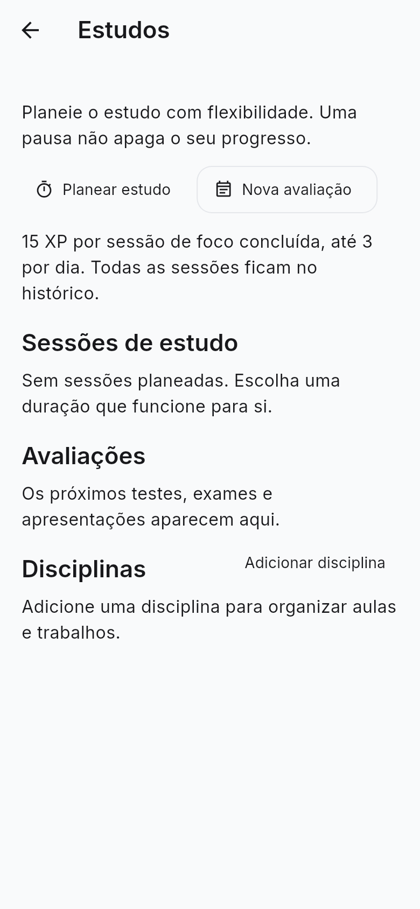 | 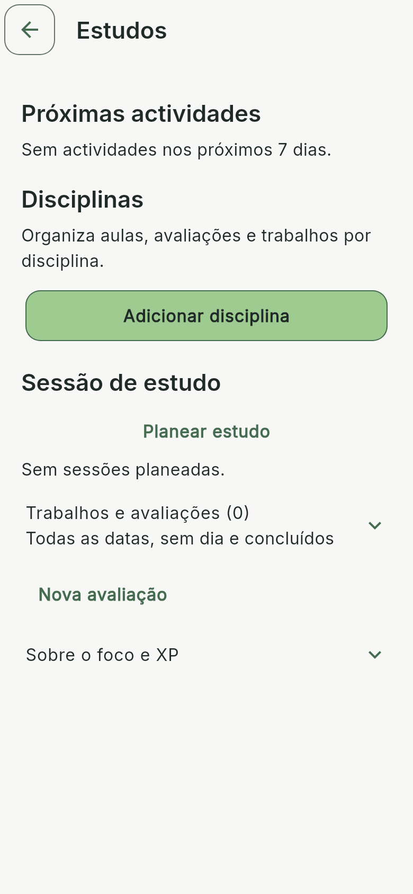 |

### Actividades e disciplinas

| Antes | Depois |
| --- | --- |
|  | 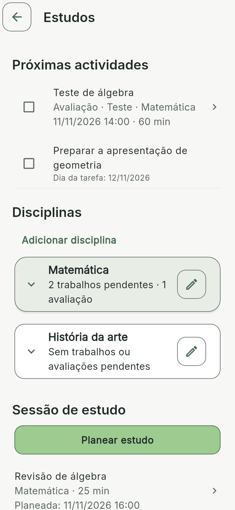 |

### Disciplinas — escuro

| Antes | Depois |
| --- | --- |
| 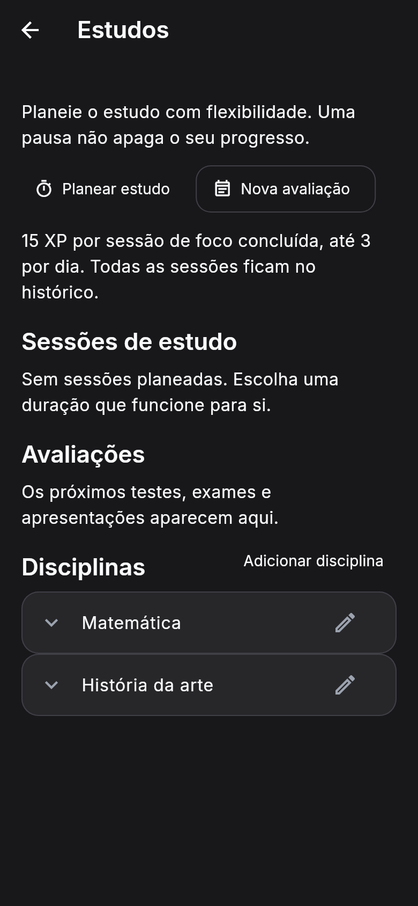 | 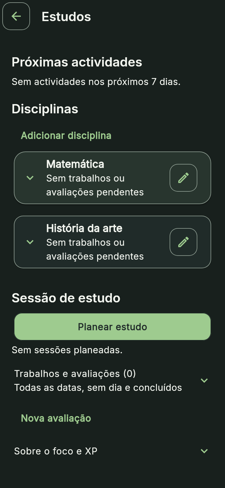 |

### Retoma prioritária

| Antes | Depois |
| --- | --- |
| 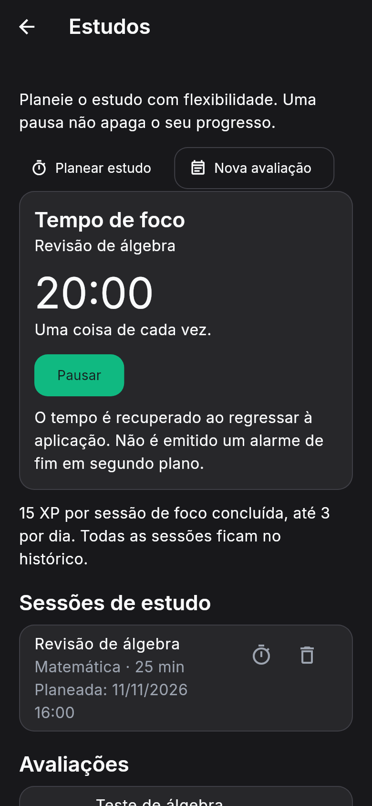 |  |

### Detalhe de disciplina

| Antes | Depois |
| --- | --- |
| 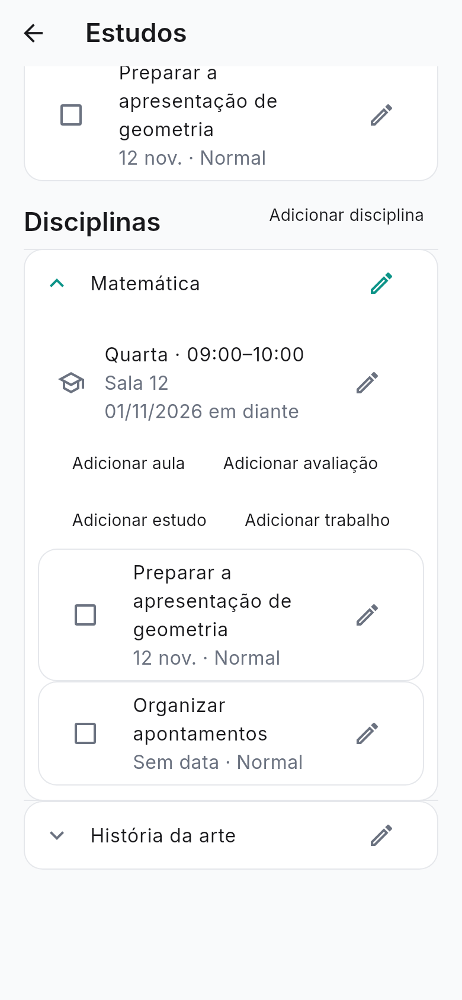 | 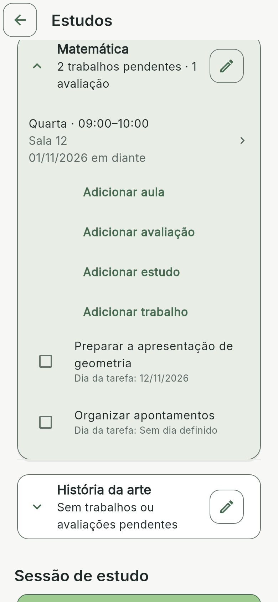 |

### Trabalho — 320 dp / 200% / teclado simulado

| Antes | Depois |
| --- | --- |
| 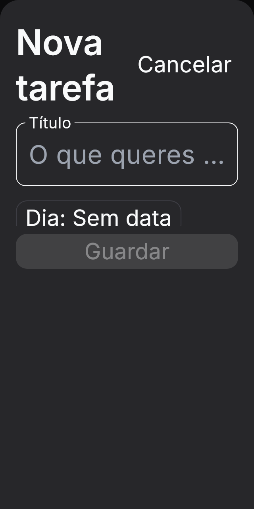 |  |

### Foco — 320 dp / 200%

| Antes | Depois |
| --- | --- |
| 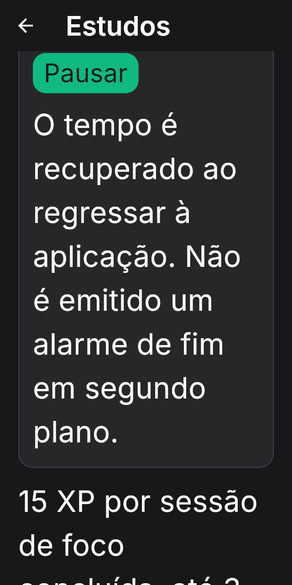 | 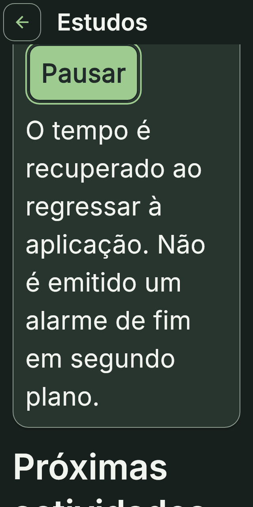 |

## Índice completo

| Cenário / tema | dp | Texto | Antes | Depois |
| --- | --- | --- | --- | --- |
| academics-active-200-dark | 390×844 | 200% | [PNG](../previews/phase4c3c/before/academics-active-200-dark.png) | [PNG](../previews/phase4c3c/after/academics-active-200-dark.png) |
| academics-active-200-light | 390×844 | 200% | [PNG](../previews/phase4c3c/before/academics-active-200-light.png) | [PNG](../previews/phase4c3c/after/academics-active-200-light.png) |
| academics-active-320-200-dark | 320×640 | 200% | [PNG](../previews/phase4c3c/before/academics-active-320-200-dark.png) | [PNG](../previews/phase4c3c/after/academics-active-320-200-dark.png) |
| academics-active-320-200-light | 320×640 | 200% | [PNG](../previews/phase4c3c/before/academics-active-320-200-light.png) | [PNG](../previews/phase4c3c/after/academics-active-320-200-light.png) |
| academics-active-320-dark | 320×640 | 100% | [PNG](../previews/phase4c3c/before/academics-active-320-dark.png) | [PNG](../previews/phase4c3c/after/academics-active-320-dark.png) |
| academics-active-320-light | 320×640 | 100% | [PNG](../previews/phase4c3c/before/academics-active-320-light.png) | [PNG](../previews/phase4c3c/after/academics-active-320-light.png) |
| academics-active-360-200-dark | 360×800 | 200% | [PNG](../previews/phase4c3c/before/academics-active-360-200-dark.png) | [PNG](../previews/phase4c3c/after/academics-active-360-200-dark.png) |
| academics-active-360-200-light | 360×800 | 200% | [PNG](../previews/phase4c3c/before/academics-active-360-200-light.png) | [PNG](../previews/phase4c3c/after/academics-active-360-200-light.png) |
| academics-active-360-dark | 360×800 | 100% | [PNG](../previews/phase4c3c/before/academics-active-360-dark.png) | [PNG](../previews/phase4c3c/after/academics-active-360-dark.png) |
| academics-active-360-light | 360×800 | 100% | [PNG](../previews/phase4c3c/before/academics-active-360-light.png) | [PNG](../previews/phase4c3c/after/academics-active-360-light.png) |
| academics-active-dark | 390×844 | 100% | [PNG](../previews/phase4c3c/before/academics-active-dark.png) | [PNG](../previews/phase4c3c/after/academics-active-dark.png) |
| academics-active-light | 390×844 | 100% | [PNG](../previews/phase4c3c/before/academics-active-light.png) | [PNG](../previews/phase4c3c/after/academics-active-light.png) |
| academics-activities-200-dark | 390×844 | 200% | [PNG](../previews/phase4c3c/before/academics-activities-200-dark.png) | [PNG](../previews/phase4c3c/after/academics-activities-200-dark.png) |
| academics-activities-200-light | 390×844 | 200% | [PNG](../previews/phase4c3c/before/academics-activities-200-light.png) | [PNG](../previews/phase4c3c/after/academics-activities-200-light.png) |
| academics-activities-320-200-dark | 320×640 | 200% | [PNG](../previews/phase4c3c/before/academics-activities-320-200-dark.png) | [PNG](../previews/phase4c3c/after/academics-activities-320-200-dark.png) |
| academics-activities-320-200-light | 320×640 | 200% | [PNG](../previews/phase4c3c/before/academics-activities-320-200-light.png) | [PNG](../previews/phase4c3c/after/academics-activities-320-200-light.png) |
| academics-activities-320-dark | 320×640 | 100% | [PNG](../previews/phase4c3c/before/academics-activities-320-dark.png) | [PNG](../previews/phase4c3c/after/academics-activities-320-dark.png) |
| academics-activities-320-light | 320×640 | 100% | [PNG](../previews/phase4c3c/before/academics-activities-320-light.png) | [PNG](../previews/phase4c3c/after/academics-activities-320-light.png) |
| academics-activities-360-200-dark | 360×800 | 200% | [PNG](../previews/phase4c3c/before/academics-activities-360-200-dark.png) | [PNG](../previews/phase4c3c/after/academics-activities-360-200-dark.png) |
| academics-activities-360-200-light | 360×800 | 200% | [PNG](../previews/phase4c3c/before/academics-activities-360-200-light.png) | [PNG](../previews/phase4c3c/after/academics-activities-360-200-light.png) |
| academics-activities-360-dark | 360×800 | 100% | [PNG](../previews/phase4c3c/before/academics-activities-360-dark.png) | [PNG](../previews/phase4c3c/after/academics-activities-360-dark.png) |
| academics-activities-360-light | 360×800 | 100% | [PNG](../previews/phase4c3c/before/academics-activities-360-light.png) | [PNG](../previews/phase4c3c/after/academics-activities-360-light.png) |
| academics-activities-dark | 390×844 | 100% | [PNG](../previews/phase4c3c/before/academics-activities-dark.png) | [PNG](../previews/phase4c3c/after/academics-activities-dark.png) |
| academics-activities-light | 390×844 | 100% | [PNG](../previews/phase4c3c/before/academics-activities-light.png) | [PNG](../previews/phase4c3c/after/academics-activities-light.png) |
| academics-empty-200-dark | 390×844 | 200% | [PNG](../previews/phase4c3c/before/academics-empty-200-dark.png) | [PNG](../previews/phase4c3c/after/academics-empty-200-dark.png) |
| academics-empty-200-light | 390×844 | 200% | [PNG](../previews/phase4c3c/before/academics-empty-200-light.png) | [PNG](../previews/phase4c3c/after/academics-empty-200-light.png) |
| academics-empty-320-200-dark | 320×640 | 200% | [PNG](../previews/phase4c3c/before/academics-empty-320-200-dark.png) | [PNG](../previews/phase4c3c/after/academics-empty-320-200-dark.png) |
| academics-empty-320-200-light | 320×640 | 200% | [PNG](../previews/phase4c3c/before/academics-empty-320-200-light.png) | [PNG](../previews/phase4c3c/after/academics-empty-320-200-light.png) |
| academics-empty-320-dark | 320×640 | 100% | [PNG](../previews/phase4c3c/before/academics-empty-320-dark.png) | [PNG](../previews/phase4c3c/after/academics-empty-320-dark.png) |
| academics-empty-320-light | 320×640 | 100% | [PNG](../previews/phase4c3c/before/academics-empty-320-light.png) | [PNG](../previews/phase4c3c/after/academics-empty-320-light.png) |
| academics-empty-360-200-dark | 360×800 | 200% | [PNG](../previews/phase4c3c/before/academics-empty-360-200-dark.png) | [PNG](../previews/phase4c3c/after/academics-empty-360-200-dark.png) |
| academics-empty-360-200-light | 360×800 | 200% | [PNG](../previews/phase4c3c/before/academics-empty-360-200-light.png) | [PNG](../previews/phase4c3c/after/academics-empty-360-200-light.png) |
| academics-empty-360-dark | 360×800 | 100% | [PNG](../previews/phase4c3c/before/academics-empty-360-dark.png) | [PNG](../previews/phase4c3c/after/academics-empty-360-dark.png) |
| academics-empty-360-light | 360×800 | 100% | [PNG](../previews/phase4c3c/before/academics-empty-360-light.png) | [PNG](../previews/phase4c3c/after/academics-empty-360-light.png) |
| academics-empty-dark | 390×844 | 100% | [PNG](../previews/phase4c3c/before/academics-empty-dark.png) | [PNG](../previews/phase4c3c/after/academics-empty-dark.png) |
| academics-empty-light | 390×844 | 100% | [PNG](../previews/phase4c3c/before/academics-empty-light.png) | [PNG](../previews/phase4c3c/after/academics-empty-light.png) |
| academics-focus-200-dark | 390×844 | 200% | [PNG](../previews/phase4c3c/before/academics-focus-200-dark.png) | [PNG](../previews/phase4c3c/after/academics-focus-200-dark.png) |
| academics-focus-200-light | 390×844 | 200% | [PNG](../previews/phase4c3c/before/academics-focus-200-light.png) | [PNG](../previews/phase4c3c/after/academics-focus-200-light.png) |
| academics-focus-320-200-dark | 320×640 | 200% | [PNG](../previews/phase4c3c/before/academics-focus-320-200-dark.png) | [PNG](../previews/phase4c3c/after/academics-focus-320-200-dark.png) |
| academics-focus-320-200-light | 320×640 | 200% | [PNG](../previews/phase4c3c/before/academics-focus-320-200-light.png) | [PNG](../previews/phase4c3c/after/academics-focus-320-200-light.png) |
| academics-focus-320-dark | 320×640 | 100% | [PNG](../previews/phase4c3c/before/academics-focus-320-dark.png) | [PNG](../previews/phase4c3c/after/academics-focus-320-dark.png) |
| academics-focus-320-light | 320×640 | 100% | [PNG](../previews/phase4c3c/before/academics-focus-320-light.png) | [PNG](../previews/phase4c3c/after/academics-focus-320-light.png) |
| academics-focus-360-200-dark | 360×800 | 200% | [PNG](../previews/phase4c3c/before/academics-focus-360-200-dark.png) | [PNG](../previews/phase4c3c/after/academics-focus-360-200-dark.png) |
| academics-focus-360-200-light | 360×800 | 200% | [PNG](../previews/phase4c3c/before/academics-focus-360-200-light.png) | [PNG](../previews/phase4c3c/after/academics-focus-360-200-light.png) |
| academics-focus-360-dark | 360×800 | 100% | [PNG](../previews/phase4c3c/before/academics-focus-360-dark.png) | [PNG](../previews/phase4c3c/after/academics-focus-360-dark.png) |
| academics-focus-360-light | 360×800 | 100% | [PNG](../previews/phase4c3c/before/academics-focus-360-light.png) | [PNG](../previews/phase4c3c/after/academics-focus-360-light.png) |
| academics-focus-dark | 390×844 | 100% | [PNG](../previews/phase4c3c/before/academics-focus-dark.png) | [PNG](../previews/phase4c3c/after/academics-focus-dark.png) |
| academics-focus-light | 390×844 | 100% | [PNG](../previews/phase4c3c/before/academics-focus-light.png) | [PNG](../previews/phase4c3c/after/academics-focus-light.png) |
| academics-subject-detail-200-dark | 390×844 | 200% | [PNG](../previews/phase4c3c/before/academics-subject-detail-200-dark.png) | [PNG](../previews/phase4c3c/after/academics-subject-detail-200-dark.png) |
| academics-subject-detail-200-light | 390×844 | 200% | [PNG](../previews/phase4c3c/before/academics-subject-detail-200-light.png) | [PNG](../previews/phase4c3c/after/academics-subject-detail-200-light.png) |
| academics-subject-detail-320-200-dark | 320×640 | 200% | [PNG](../previews/phase4c3c/before/academics-subject-detail-320-200-dark.png) | [PNG](../previews/phase4c3c/after/academics-subject-detail-320-200-dark.png) |
| academics-subject-detail-320-200-light | 320×640 | 200% | [PNG](../previews/phase4c3c/before/academics-subject-detail-320-200-light.png) | [PNG](../previews/phase4c3c/after/academics-subject-detail-320-200-light.png) |
| academics-subject-detail-320-dark | 320×640 | 100% | [PNG](../previews/phase4c3c/before/academics-subject-detail-320-dark.png) | [PNG](../previews/phase4c3c/after/academics-subject-detail-320-dark.png) |
| academics-subject-detail-320-light | 320×640 | 100% | [PNG](../previews/phase4c3c/before/academics-subject-detail-320-light.png) | [PNG](../previews/phase4c3c/after/academics-subject-detail-320-light.png) |
| academics-subject-detail-360-200-dark | 360×800 | 200% | [PNG](../previews/phase4c3c/before/academics-subject-detail-360-200-dark.png) | [PNG](../previews/phase4c3c/after/academics-subject-detail-360-200-dark.png) |
| academics-subject-detail-360-200-light | 360×800 | 200% | [PNG](../previews/phase4c3c/before/academics-subject-detail-360-200-light.png) | [PNG](../previews/phase4c3c/after/academics-subject-detail-360-200-light.png) |
| academics-subject-detail-360-dark | 360×800 | 100% | [PNG](../previews/phase4c3c/before/academics-subject-detail-360-dark.png) | [PNG](../previews/phase4c3c/after/academics-subject-detail-360-dark.png) |
| academics-subject-detail-360-light | 360×800 | 100% | [PNG](../previews/phase4c3c/before/academics-subject-detail-360-light.png) | [PNG](../previews/phase4c3c/after/academics-subject-detail-360-light.png) |
| academics-subject-detail-dark | 390×844 | 100% | [PNG](../previews/phase4c3c/before/academics-subject-detail-dark.png) | [PNG](../previews/phase4c3c/after/academics-subject-detail-dark.png) |
| academics-subject-detail-light | 390×844 | 100% | [PNG](../previews/phase4c3c/before/academics-subject-detail-light.png) | [PNG](../previews/phase4c3c/after/academics-subject-detail-light.png) |
| academics-subjects-200-dark | 390×844 | 200% | [PNG](../previews/phase4c3c/before/academics-subjects-200-dark.png) | [PNG](../previews/phase4c3c/after/academics-subjects-200-dark.png) |
| academics-subjects-200-light | 390×844 | 200% | [PNG](../previews/phase4c3c/before/academics-subjects-200-light.png) | [PNG](../previews/phase4c3c/after/academics-subjects-200-light.png) |
| academics-subjects-320-200-dark | 320×640 | 200% | [PNG](../previews/phase4c3c/before/academics-subjects-320-200-dark.png) | [PNG](../previews/phase4c3c/after/academics-subjects-320-200-dark.png) |
| academics-subjects-320-200-light | 320×640 | 200% | [PNG](../previews/phase4c3c/before/academics-subjects-320-200-light.png) | [PNG](../previews/phase4c3c/after/academics-subjects-320-200-light.png) |
| academics-subjects-320-dark | 320×640 | 100% | [PNG](../previews/phase4c3c/before/academics-subjects-320-dark.png) | [PNG](../previews/phase4c3c/after/academics-subjects-320-dark.png) |
| academics-subjects-320-light | 320×640 | 100% | [PNG](../previews/phase4c3c/before/academics-subjects-320-light.png) | [PNG](../previews/phase4c3c/after/academics-subjects-320-light.png) |
| academics-subjects-360-200-dark | 360×800 | 200% | [PNG](../previews/phase4c3c/before/academics-subjects-360-200-dark.png) | [PNG](../previews/phase4c3c/after/academics-subjects-360-200-dark.png) |
| academics-subjects-360-200-light | 360×800 | 200% | [PNG](../previews/phase4c3c/before/academics-subjects-360-200-light.png) | [PNG](../previews/phase4c3c/after/academics-subjects-360-200-light.png) |
| academics-subjects-360-dark | 360×800 | 100% | [PNG](../previews/phase4c3c/before/academics-subjects-360-dark.png) | [PNG](../previews/phase4c3c/after/academics-subjects-360-dark.png) |
| academics-subjects-360-light | 360×800 | 100% | [PNG](../previews/phase4c3c/before/academics-subjects-360-light.png) | [PNG](../previews/phase4c3c/after/academics-subjects-360-light.png) |
| academics-subjects-dark | 390×844 | 100% | [PNG](../previews/phase4c3c/before/academics-subjects-dark.png) | [PNG](../previews/phase4c3c/after/academics-subjects-dark.png) |
| academics-subjects-light | 390×844 | 100% | [PNG](../previews/phase4c3c/before/academics-subjects-light.png) | [PNG](../previews/phase4c3c/after/academics-subjects-light.png) |
| academics-work-200-dark | 390×844 | 200% | [PNG](../previews/phase4c3c/before/academics-work-200-dark.png) | [PNG](../previews/phase4c3c/after/academics-work-200-dark.png) |
| academics-work-200-light | 390×844 | 200% | [PNG](../previews/phase4c3c/before/academics-work-200-light.png) | [PNG](../previews/phase4c3c/after/academics-work-200-light.png) |
| academics-work-320-200-dark | 320×640 | 200% | [PNG](../previews/phase4c3c/before/academics-work-320-200-dark.png) | [PNG](../previews/phase4c3c/after/academics-work-320-200-dark.png) |
| academics-work-320-200-light | 320×640 | 200% | [PNG](../previews/phase4c3c/before/academics-work-320-200-light.png) | [PNG](../previews/phase4c3c/after/academics-work-320-200-light.png) |
| academics-work-320-dark | 320×640 | 100% | [PNG](../previews/phase4c3c/before/academics-work-320-dark.png) | [PNG](../previews/phase4c3c/after/academics-work-320-dark.png) |
| academics-work-320-light | 320×640 | 100% | [PNG](../previews/phase4c3c/before/academics-work-320-light.png) | [PNG](../previews/phase4c3c/after/academics-work-320-light.png) |
| academics-work-360-200-dark | 360×800 | 200% | [PNG](../previews/phase4c3c/before/academics-work-360-200-dark.png) | [PNG](../previews/phase4c3c/after/academics-work-360-200-dark.png) |
| academics-work-360-200-light | 360×800 | 200% | [PNG](../previews/phase4c3c/before/academics-work-360-200-light.png) | [PNG](../previews/phase4c3c/after/academics-work-360-200-light.png) |
| academics-work-360-dark | 360×800 | 100% | [PNG](../previews/phase4c3c/before/academics-work-360-dark.png) | [PNG](../previews/phase4c3c/after/academics-work-360-dark.png) |
| academics-work-360-light | 360×800 | 100% | [PNG](../previews/phase4c3c/before/academics-work-360-light.png) | [PNG](../previews/phase4c3c/after/academics-work-360-light.png) |
| academics-work-dark | 390×844 | 100% | [PNG](../previews/phase4c3c/before/academics-work-dark.png) | [PNG](../previews/phase4c3c/after/academics-work-dark.png) |
| academics-work-light | 390×844 | 100% | [PNG](../previews/phase4c3c/before/academics-work-light.png) | [PNG](../previews/phase4c3c/after/academics-work-light.png) |
| calendar-dark | 390×844 | 100% | [PNG](../previews/phase4c3c/before/calendar-dark.png) | [PNG](../previews/phase4c3c/after/calendar-dark.png) |
| calendar-light | 390×844 | 100% | [PNG](../previews/phase4c3c/before/calendar-light.png) | [PNG](../previews/phase4c3c/after/calendar-light.png) |
| finance-dark | 390×844 | 100% | [PNG](../previews/phase4c3c/before/finance-dark.png) | [PNG](../previews/phase4c3c/after/finance-dark.png) |
| finance-light | 390×844 | 100% | [PNG](../previews/phase4c3c/before/finance-light.png) | [PNG](../previews/phase4c3c/after/finance-light.png) |
| goals-dark | 390×844 | 100% | [PNG](../previews/phase4c3c/before/goals-dark.png) | [PNG](../previews/phase4c3c/after/goals-dark.png) |
| goals-light | 390×844 | 100% | [PNG](../previews/phase4c3c/before/goals-light.png) | [PNG](../previews/phase4c3c/after/goals-light.png) |
| habits-dark | 390×844 | 100% | [PNG](../previews/phase4c3c/before/habits-dark.png) | [PNG](../previews/phase4c3c/after/habits-dark.png) |
| habits-light | 390×844 | 100% | [PNG](../previews/phase4c3c/before/habits-light.png) | [PNG](../previews/phase4c3c/after/habits-light.png) |
| hoje-filled-dark | 390×844 | 100% | [PNG](../previews/phase4c3c/before/hoje-filled-dark.png) | [PNG](../previews/phase4c3c/after/hoje-filled-dark.png) |
| hoje-filled-light | 390×844 | 100% | [PNG](../previews/phase4c3c/before/hoje-filled-light.png) | [PNG](../previews/phase4c3c/after/hoje-filled-light.png) |
| plan-tomorrow-dark | 390×844 | 100% | [PNG](../previews/phase4c3c/before/plan-tomorrow-dark.png) | [PNG](../previews/phase4c3c/after/plan-tomorrow-dark.png) |
| plan-tomorrow-light | 390×844 | 100% | [PNG](../previews/phase4c3c/before/plan-tomorrow-light.png) | [PNG](../previews/phase4c3c/after/plan-tomorrow-light.png) |
| progress-dark | 390×844 | 100% | [PNG](../previews/phase4c3c/before/progress-dark.png) | [PNG](../previews/phase4c3c/after/progress-dark.png) |
| progress-light | 390×844 | 100% | [PNG](../previews/phase4c3c/before/progress-light.png) | [PNG](../previews/phase4c3c/after/progress-light.png) |
| tasks-dark | 390×844 | 100% | [PNG](../previews/phase4c3c/before/tasks-dark.png) | [PNG](../previews/phase4c3c/after/tasks-dark.png) |
| tasks-light | 390×844 | 100% | [PNG](../previews/phase4c3c/before/tasks-light.png) | [PNG](../previews/phase4c3c/after/tasks-light.png) |
