# Finanças — comparações Flutter 4C.3D

**336 PNG reais:** 160 anteriores + 164 posteriores + 12 detalhes posteriores de valores longos. São 160 pares comparáveis, mais quatro correcções sem frame anterior válido. [Manifesto de dimensões e hashes](visual-validation.json) · [Falhas da renderização anterior](BASELINE_RENDER_ERRORS.md).

A base 49e1724319988ef66890f5742de8eea84692c112 passou os 292 testes existentes. Na matriz de esforço adicional, 26/164 casos anteriores falharam: 22 ainda geraram imagem e quatro casos de valores elevados/200% falharam antes de poder gerar PNG. Não se contam essas quatro lacunas como comparações aprovadas, nem se usam maquetas para as substituir. Depois da correcção, os 164 casos passaram sem excepções; os 12 detalhes adicionais também passaram.

Fixtures SQLite sintéticas, relógio 11/11/2026 10:30, fontes locais, mesmo dataset/dimensões por par. Renderer Flutter de testes, RepaintBoundary exportado a 2×; 320×640, 360×800 e 390×844 dp; texto 100/200%, claro/escuro. Campos de registo/erro a 200% recebem 280 dp de insets simulados; não é um teclado físico desenhado ou ensaiado. Foco é do Flutter. Cada PNG mostra um viewport rolável, não uma colagem da página inteira.

12 cenários financeiros × seis combinações de largura/escala × dois temas = 144. Acrescentam-se dez contextos externos × dois temas = 20: Hoje, Planear, Metas, Tarefas, Progresso, Hábitos, Agenda, Estudos, editor completo de tarefa e criação de meta. **Os 20 pares externos são byte a byte iguais**. A garantia refere-se a estas fixtures, não a todos os estados de cada módulo.

Reproduzir depois: `flutter test --no-pub --dart-define=QUALITY_OUTPUT=docs/ux/previews/phase4c3d/after tool/capture_finance.dart --reporter expanded`. Antes: usar a base com o mesmo utilitário/fixture de diagnóstico; são esperadas as falhas registadas, sem corrigir essa base para obter imagens. Detalhes: acrescentar `--dart-define=QUALITY_FINANCE_AMOUNT_FOCUS=true`, escolher outro QUALITY_OUTPUT e `--plain-name 'finance Flutter capture finance-long'`.

## Comparações principais

### Vazio

| Antes | Depois |
| --- | --- |
| 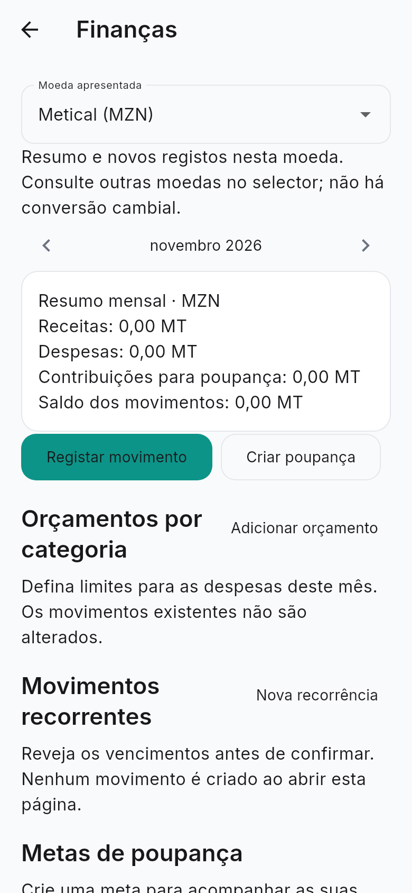 | 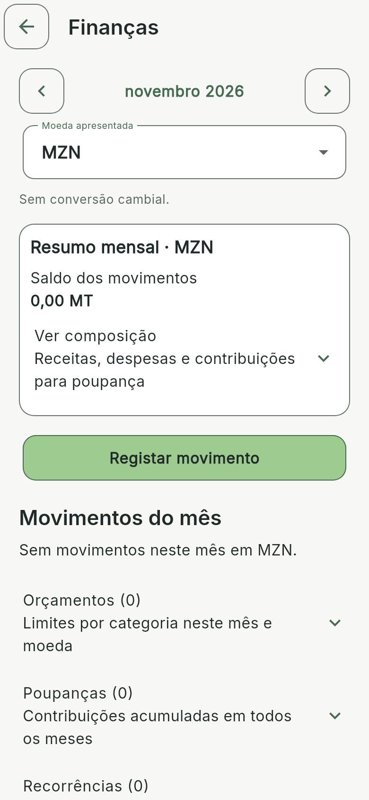 |

### Resumo, registo e movimentos

| Antes | Depois |
| --- | --- |
| 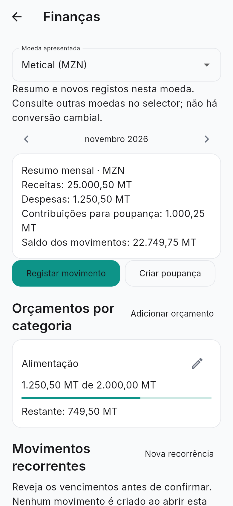 | 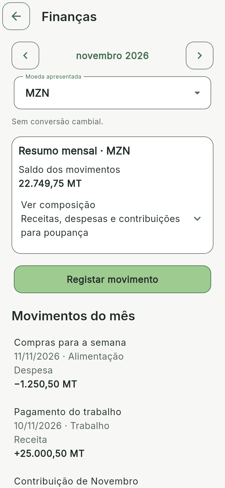 |

### Moeda USD

| Antes | Depois |
| --- | --- |
| 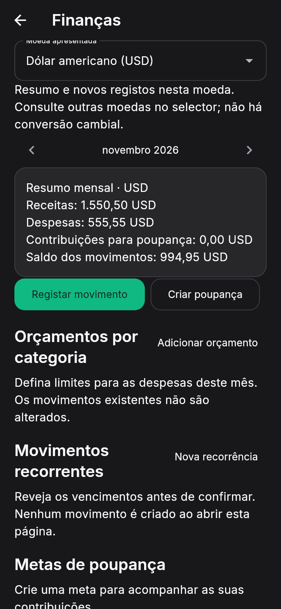 | 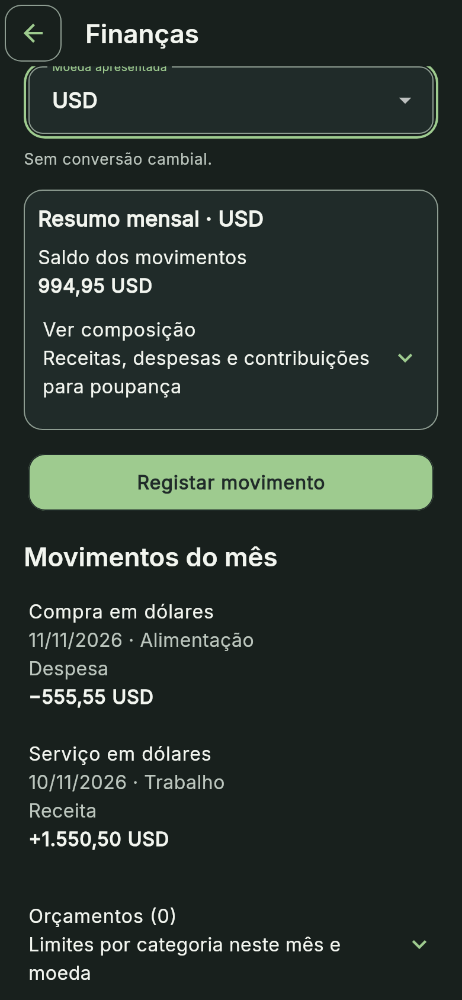 |

### Mês sem movimentos

| Antes | Depois |
| --- | --- |
| 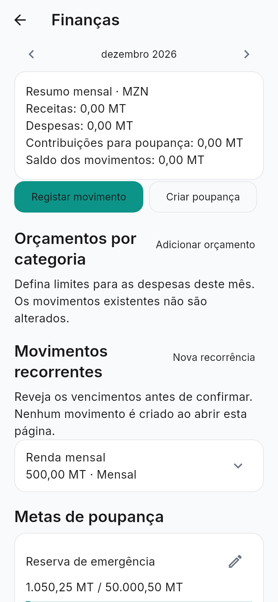 | 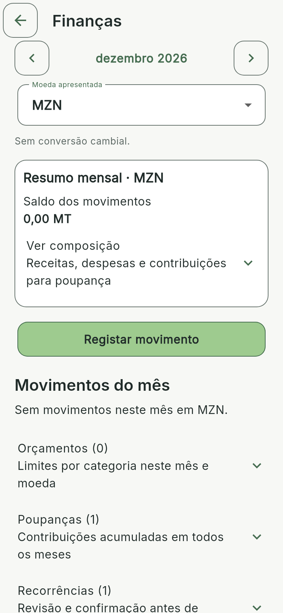 |

### Registar — 320 dp, 200%, foco e teclado simulado

| Antes | Depois |
| --- | --- |
| 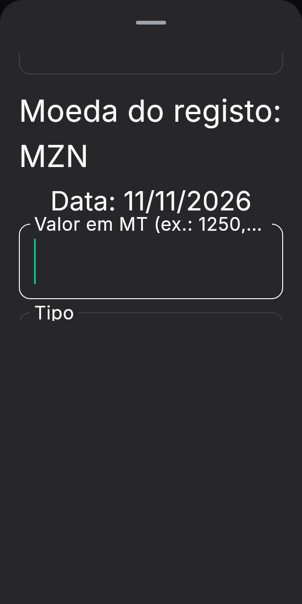 | 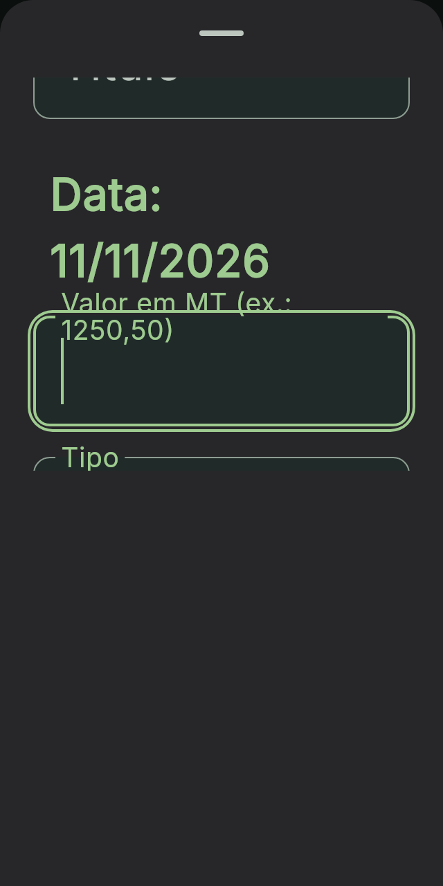 |

### Editar movimento

| Antes | Depois |
| --- | --- |
| 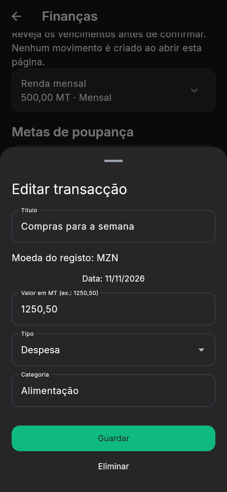 | 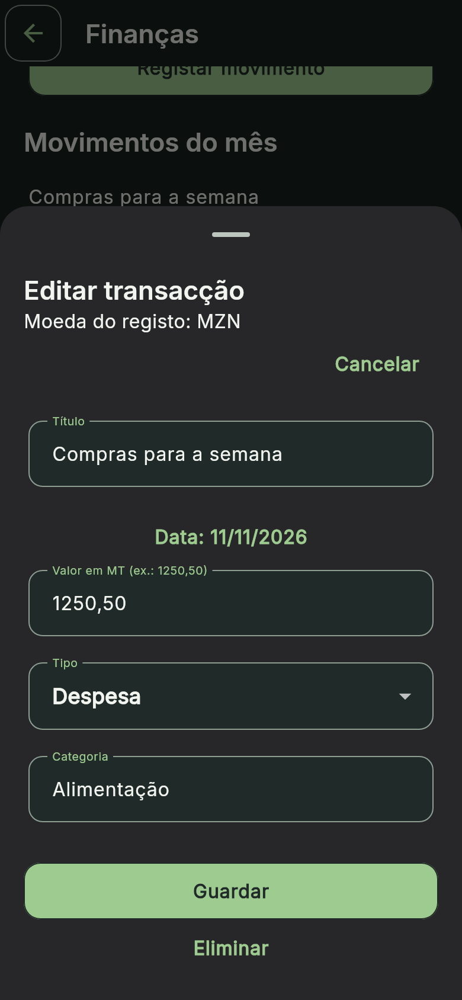 |

### Erro de valor zero

| Antes | Depois |
| --- | --- |
|  |  |

### Orçamento

| Antes | Depois |
| --- | --- |
| 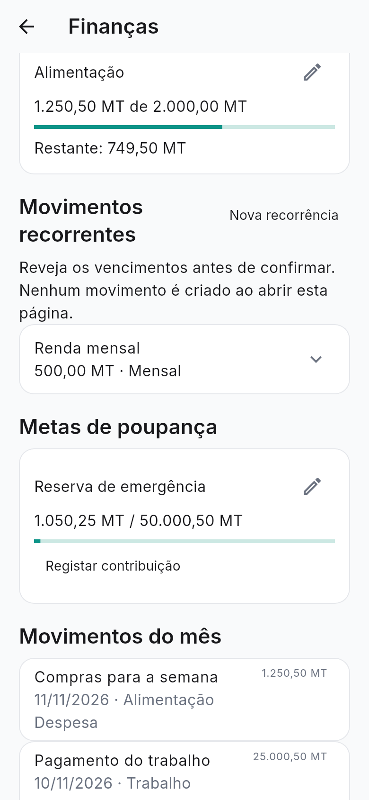 | 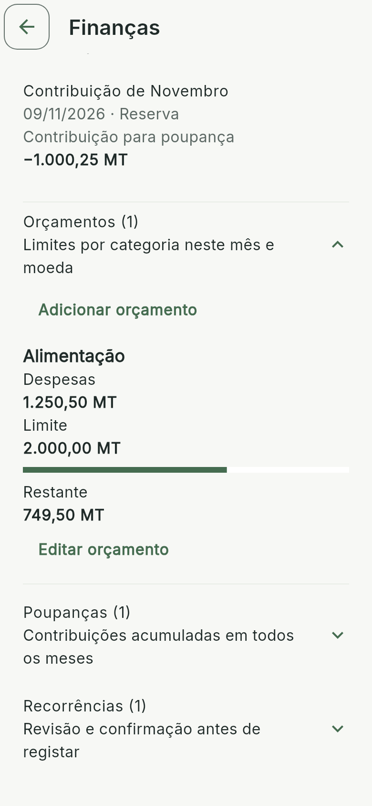 |

### Poupança

| Antes | Depois |
| --- | --- |
| 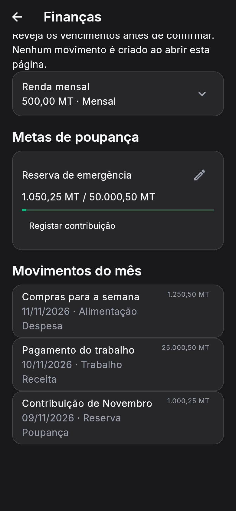 | 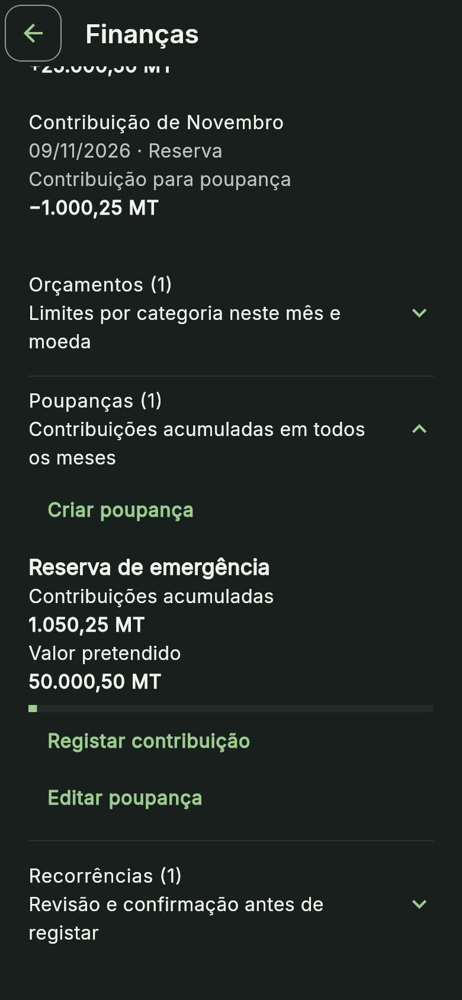 |

### Recorrência e histórico

| Antes | Depois |
| --- | --- |
| 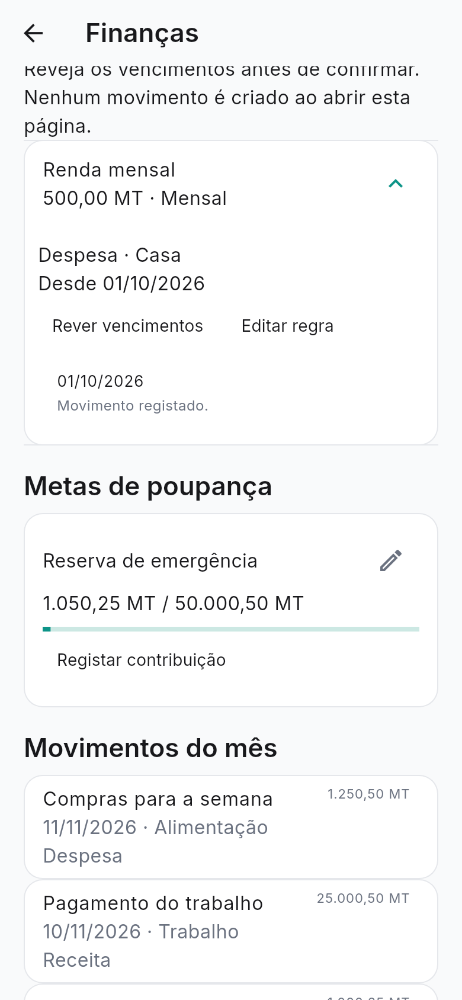 | 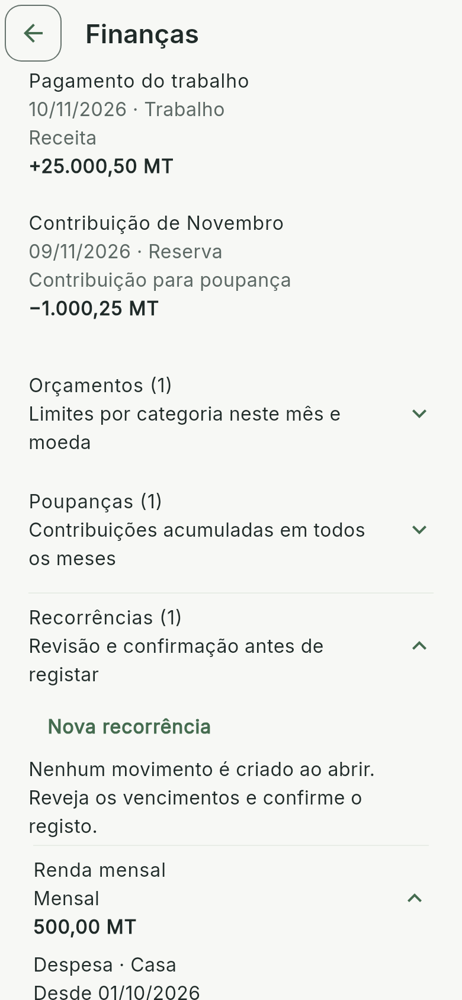 |

### Confirmação de vencimentos

| Antes | Depois |
| --- | --- |
|  | 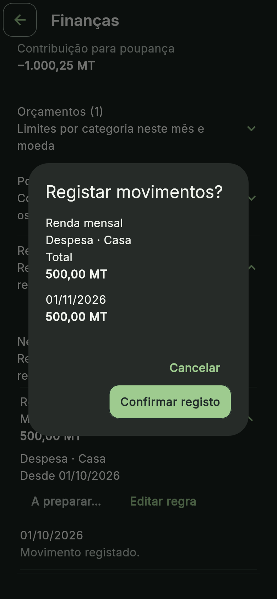 |

## Montantes longos e foco

O formatter conserva todos os dígitos e a moeda. Quando uma linha não cabe, existe deslocação horizontal com barra visível, foco por teclado, setas esquerda/direita e indicação explícita da moeda. Não se abrevia o montante nem se reduz a fonte. A semântica contém o valor completo e o nome/código da moeda. O frame não pode mostrar simultaneamente um número arbitrariamente longo a 200% em 320 dp; a leitura integral exige deslocação ou leitor de ecrã.

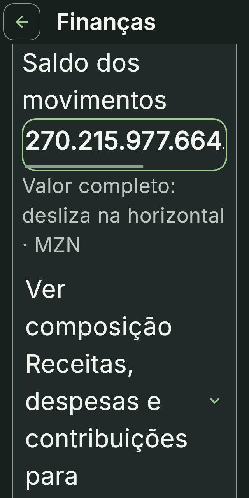

## Índice completo

| Cenário / tema | dp | Texto | Antes | Depois |
| --- | --- | --- | --- | --- |
| academics-dark | 390×844 | 100% | [PNG](../previews/phase4c3d/before/academics-dark.png) | [PNG](../previews/phase4c3d/after/academics-dark.png) |
| academics-light | 390×844 | 100% | [PNG](../previews/phase4c3d/before/academics-light.png) | [PNG](../previews/phase4c3d/after/academics-light.png) |
| calendar-dark | 390×844 | 100% | [PNG](../previews/phase4c3d/before/calendar-dark.png) | [PNG](../previews/phase4c3d/after/calendar-dark.png) |
| calendar-light | 390×844 | 100% | [PNG](../previews/phase4c3d/before/calendar-light.png) | [PNG](../previews/phase4c3d/after/calendar-light.png) |
| editor-dark | 390×844 | 100% | [PNG](../previews/phase4c3d/before/editor-dark.png) | [PNG](../previews/phase4c3d/after/editor-dark.png) |
| editor-light | 390×844 | 100% | [PNG](../previews/phase4c3d/before/editor-light.png) | [PNG](../previews/phase4c3d/after/editor-light.png) |
| finance-budget-200-dark | 390×844 | 200% | [PNG](../previews/phase4c3d/before/finance-budget-200-dark.png) | [PNG](../previews/phase4c3d/after/finance-budget-200-dark.png) |
| finance-budget-200-light | 390×844 | 200% | [PNG](../previews/phase4c3d/before/finance-budget-200-light.png) | [PNG](../previews/phase4c3d/after/finance-budget-200-light.png) |
| finance-budget-320-200-dark | 320×640 | 200% | [PNG](../previews/phase4c3d/before/finance-budget-320-200-dark.png) | [PNG](../previews/phase4c3d/after/finance-budget-320-200-dark.png) |
| finance-budget-320-200-light | 320×640 | 200% | [PNG](../previews/phase4c3d/before/finance-budget-320-200-light.png) | [PNG](../previews/phase4c3d/after/finance-budget-320-200-light.png) |
| finance-budget-320-dark | 320×640 | 100% | [PNG](../previews/phase4c3d/before/finance-budget-320-dark.png) | [PNG](../previews/phase4c3d/after/finance-budget-320-dark.png) |
| finance-budget-320-light | 320×640 | 100% | [PNG](../previews/phase4c3d/before/finance-budget-320-light.png) | [PNG](../previews/phase4c3d/after/finance-budget-320-light.png) |
| finance-budget-360-200-dark | 360×800 | 200% | [PNG](../previews/phase4c3d/before/finance-budget-360-200-dark.png) | [PNG](../previews/phase4c3d/after/finance-budget-360-200-dark.png) |
| finance-budget-360-200-light | 360×800 | 200% | [PNG](../previews/phase4c3d/before/finance-budget-360-200-light.png) | [PNG](../previews/phase4c3d/after/finance-budget-360-200-light.png) |
| finance-budget-360-dark | 360×800 | 100% | [PNG](../previews/phase4c3d/before/finance-budget-360-dark.png) | [PNG](../previews/phase4c3d/after/finance-budget-360-dark.png) |
| finance-budget-360-light | 360×800 | 100% | [PNG](../previews/phase4c3d/before/finance-budget-360-light.png) | [PNG](../previews/phase4c3d/after/finance-budget-360-light.png) |
| finance-budget-dark | 390×844 | 100% | [PNG](../previews/phase4c3d/before/finance-budget-dark.png) | [PNG](../previews/phase4c3d/after/finance-budget-dark.png) |
| finance-budget-light | 390×844 | 100% | [PNG](../previews/phase4c3d/before/finance-budget-light.png) | [PNG](../previews/phase4c3d/after/finance-budget-light.png) |
| finance-confirm-200-dark | 390×844 | 200% | [PNG](../previews/phase4c3d/before/finance-confirm-200-dark.png) | [PNG](../previews/phase4c3d/after/finance-confirm-200-dark.png) |
| finance-confirm-200-light | 390×844 | 200% | [PNG](../previews/phase4c3d/before/finance-confirm-200-light.png) | [PNG](../previews/phase4c3d/after/finance-confirm-200-light.png) |
| finance-confirm-320-200-dark | 320×640 | 200% | [PNG](../previews/phase4c3d/before/finance-confirm-320-200-dark.png) | [PNG](../previews/phase4c3d/after/finance-confirm-320-200-dark.png) |
| finance-confirm-320-200-light | 320×640 | 200% | [PNG](../previews/phase4c3d/before/finance-confirm-320-200-light.png) | [PNG](../previews/phase4c3d/after/finance-confirm-320-200-light.png) |
| finance-confirm-320-dark | 320×640 | 100% | [PNG](../previews/phase4c3d/before/finance-confirm-320-dark.png) | [PNG](../previews/phase4c3d/after/finance-confirm-320-dark.png) |
| finance-confirm-320-light | 320×640 | 100% | [PNG](../previews/phase4c3d/before/finance-confirm-320-light.png) | [PNG](../previews/phase4c3d/after/finance-confirm-320-light.png) |
| finance-confirm-360-200-dark | 360×800 | 200% | [PNG](../previews/phase4c3d/before/finance-confirm-360-200-dark.png) | [PNG](../previews/phase4c3d/after/finance-confirm-360-200-dark.png) |
| finance-confirm-360-200-light | 360×800 | 200% | [PNG](../previews/phase4c3d/before/finance-confirm-360-200-light.png) | [PNG](../previews/phase4c3d/after/finance-confirm-360-200-light.png) |
| finance-confirm-360-dark | 360×800 | 100% | [PNG](../previews/phase4c3d/before/finance-confirm-360-dark.png) | [PNG](../previews/phase4c3d/after/finance-confirm-360-dark.png) |
| finance-confirm-360-light | 360×800 | 100% | [PNG](../previews/phase4c3d/before/finance-confirm-360-light.png) | [PNG](../previews/phase4c3d/after/finance-confirm-360-light.png) |
| finance-confirm-dark | 390×844 | 100% | [PNG](../previews/phase4c3d/before/finance-confirm-dark.png) | [PNG](../previews/phase4c3d/after/finance-confirm-dark.png) |
| finance-confirm-light | 390×844 | 100% | [PNG](../previews/phase4c3d/before/finance-confirm-light.png) | [PNG](../previews/phase4c3d/after/finance-confirm-light.png) |
| finance-currency-200-dark | 390×844 | 200% | [PNG](../previews/phase4c3d/before/finance-currency-200-dark.png) | [PNG](../previews/phase4c3d/after/finance-currency-200-dark.png) |
| finance-currency-200-light | 390×844 | 200% | [PNG](../previews/phase4c3d/before/finance-currency-200-light.png) | [PNG](../previews/phase4c3d/after/finance-currency-200-light.png) |
| finance-currency-320-200-dark | 320×640 | 200% | [PNG](../previews/phase4c3d/before/finance-currency-320-200-dark.png) | [PNG](../previews/phase4c3d/after/finance-currency-320-200-dark.png) |
| finance-currency-320-200-light | 320×640 | 200% | [PNG](../previews/phase4c3d/before/finance-currency-320-200-light.png) | [PNG](../previews/phase4c3d/after/finance-currency-320-200-light.png) |
| finance-currency-320-dark | 320×640 | 100% | [PNG](../previews/phase4c3d/before/finance-currency-320-dark.png) | [PNG](../previews/phase4c3d/after/finance-currency-320-dark.png) |
| finance-currency-320-light | 320×640 | 100% | [PNG](../previews/phase4c3d/before/finance-currency-320-light.png) | [PNG](../previews/phase4c3d/after/finance-currency-320-light.png) |
| finance-currency-360-200-dark | 360×800 | 200% | [PNG](../previews/phase4c3d/before/finance-currency-360-200-dark.png) | [PNG](../previews/phase4c3d/after/finance-currency-360-200-dark.png) |
| finance-currency-360-200-light | 360×800 | 200% | [PNG](../previews/phase4c3d/before/finance-currency-360-200-light.png) | [PNG](../previews/phase4c3d/after/finance-currency-360-200-light.png) |
| finance-currency-360-dark | 360×800 | 100% | [PNG](../previews/phase4c3d/before/finance-currency-360-dark.png) | [PNG](../previews/phase4c3d/after/finance-currency-360-dark.png) |
| finance-currency-360-light | 360×800 | 100% | [PNG](../previews/phase4c3d/before/finance-currency-360-light.png) | [PNG](../previews/phase4c3d/after/finance-currency-360-light.png) |
| finance-currency-dark | 390×844 | 100% | [PNG](../previews/phase4c3d/before/finance-currency-dark.png) | [PNG](../previews/phase4c3d/after/finance-currency-dark.png) |
| finance-currency-light | 390×844 | 100% | [PNG](../previews/phase4c3d/before/finance-currency-light.png) | [PNG](../previews/phase4c3d/after/finance-currency-light.png) |
| finance-edit-200-dark | 390×844 | 200% | [PNG](../previews/phase4c3d/before/finance-edit-200-dark.png) | [PNG](../previews/phase4c3d/after/finance-edit-200-dark.png) |
| finance-edit-200-light | 390×844 | 200% | [PNG](../previews/phase4c3d/before/finance-edit-200-light.png) | [PNG](../previews/phase4c3d/after/finance-edit-200-light.png) |
| finance-edit-320-200-dark | 320×640 | 200% | [PNG](../previews/phase4c3d/before/finance-edit-320-200-dark.png) | [PNG](../previews/phase4c3d/after/finance-edit-320-200-dark.png) |
| finance-edit-320-200-light | 320×640 | 200% | [PNG](../previews/phase4c3d/before/finance-edit-320-200-light.png) | [PNG](../previews/phase4c3d/after/finance-edit-320-200-light.png) |
| finance-edit-320-dark | 320×640 | 100% | [PNG](../previews/phase4c3d/before/finance-edit-320-dark.png) | [PNG](../previews/phase4c3d/after/finance-edit-320-dark.png) |
| finance-edit-320-light | 320×640 | 100% | [PNG](../previews/phase4c3d/before/finance-edit-320-light.png) | [PNG](../previews/phase4c3d/after/finance-edit-320-light.png) |
| finance-edit-360-200-dark | 360×800 | 200% | [PNG](../previews/phase4c3d/before/finance-edit-360-200-dark.png) | [PNG](../previews/phase4c3d/after/finance-edit-360-200-dark.png) |
| finance-edit-360-200-light | 360×800 | 200% | [PNG](../previews/phase4c3d/before/finance-edit-360-200-light.png) | [PNG](../previews/phase4c3d/after/finance-edit-360-200-light.png) |
| finance-edit-360-dark | 360×800 | 100% | [PNG](../previews/phase4c3d/before/finance-edit-360-dark.png) | [PNG](../previews/phase4c3d/after/finance-edit-360-dark.png) |
| finance-edit-360-light | 360×800 | 100% | [PNG](../previews/phase4c3d/before/finance-edit-360-light.png) | [PNG](../previews/phase4c3d/after/finance-edit-360-light.png) |
| finance-edit-dark | 390×844 | 100% | [PNG](../previews/phase4c3d/before/finance-edit-dark.png) | [PNG](../previews/phase4c3d/after/finance-edit-dark.png) |
| finance-edit-light | 390×844 | 100% | [PNG](../previews/phase4c3d/before/finance-edit-light.png) | [PNG](../previews/phase4c3d/after/finance-edit-light.png) |
| finance-empty-200-dark | 390×844 | 200% | [PNG](../previews/phase4c3d/before/finance-empty-200-dark.png) | [PNG](../previews/phase4c3d/after/finance-empty-200-dark.png) |
| finance-empty-200-light | 390×844 | 200% | [PNG](../previews/phase4c3d/before/finance-empty-200-light.png) | [PNG](../previews/phase4c3d/after/finance-empty-200-light.png) |
| finance-empty-320-200-dark | 320×640 | 200% | [PNG](../previews/phase4c3d/before/finance-empty-320-200-dark.png) | [PNG](../previews/phase4c3d/after/finance-empty-320-200-dark.png) |
| finance-empty-320-200-light | 320×640 | 200% | [PNG](../previews/phase4c3d/before/finance-empty-320-200-light.png) | [PNG](../previews/phase4c3d/after/finance-empty-320-200-light.png) |
| finance-empty-320-dark | 320×640 | 100% | [PNG](../previews/phase4c3d/before/finance-empty-320-dark.png) | [PNG](../previews/phase4c3d/after/finance-empty-320-dark.png) |
| finance-empty-320-light | 320×640 | 100% | [PNG](../previews/phase4c3d/before/finance-empty-320-light.png) | [PNG](../previews/phase4c3d/after/finance-empty-320-light.png) |
| finance-empty-360-200-dark | 360×800 | 200% | [PNG](../previews/phase4c3d/before/finance-empty-360-200-dark.png) | [PNG](../previews/phase4c3d/after/finance-empty-360-200-dark.png) |
| finance-empty-360-200-light | 360×800 | 200% | [PNG](../previews/phase4c3d/before/finance-empty-360-200-light.png) | [PNG](../previews/phase4c3d/after/finance-empty-360-200-light.png) |
| finance-empty-360-dark | 360×800 | 100% | [PNG](../previews/phase4c3d/before/finance-empty-360-dark.png) | [PNG](../previews/phase4c3d/after/finance-empty-360-dark.png) |
| finance-empty-360-light | 360×800 | 100% | [PNG](../previews/phase4c3d/before/finance-empty-360-light.png) | [PNG](../previews/phase4c3d/after/finance-empty-360-light.png) |
| finance-empty-dark | 390×844 | 100% | [PNG](../previews/phase4c3d/before/finance-empty-dark.png) | [PNG](../previews/phase4c3d/after/finance-empty-dark.png) |
| finance-empty-light | 390×844 | 100% | [PNG](../previews/phase4c3d/before/finance-empty-light.png) | [PNG](../previews/phase4c3d/after/finance-empty-light.png) |
| finance-error-200-dark | 390×844 | 200% | [PNG](../previews/phase4c3d/before/finance-error-200-dark.png) | [PNG](../previews/phase4c3d/after/finance-error-200-dark.png) |
| finance-error-200-light | 390×844 | 200% | [PNG](../previews/phase4c3d/before/finance-error-200-light.png) | [PNG](../previews/phase4c3d/after/finance-error-200-light.png) |
| finance-error-320-200-dark | 320×640 | 200% | [PNG](../previews/phase4c3d/before/finance-error-320-200-dark.png) | [PNG](../previews/phase4c3d/after/finance-error-320-200-dark.png) |
| finance-error-320-200-light | 320×640 | 200% | [PNG](../previews/phase4c3d/before/finance-error-320-200-light.png) | [PNG](../previews/phase4c3d/after/finance-error-320-200-light.png) |
| finance-error-320-dark | 320×640 | 100% | [PNG](../previews/phase4c3d/before/finance-error-320-dark.png) | [PNG](../previews/phase4c3d/after/finance-error-320-dark.png) |
| finance-error-320-light | 320×640 | 100% | [PNG](../previews/phase4c3d/before/finance-error-320-light.png) | [PNG](../previews/phase4c3d/after/finance-error-320-light.png) |
| finance-error-360-200-dark | 360×800 | 200% | [PNG](../previews/phase4c3d/before/finance-error-360-200-dark.png) | [PNG](../previews/phase4c3d/after/finance-error-360-200-dark.png) |
| finance-error-360-200-light | 360×800 | 200% | [PNG](../previews/phase4c3d/before/finance-error-360-200-light.png) | [PNG](../previews/phase4c3d/after/finance-error-360-200-light.png) |
| finance-error-360-dark | 360×800 | 100% | [PNG](../previews/phase4c3d/before/finance-error-360-dark.png) | [PNG](../previews/phase4c3d/after/finance-error-360-dark.png) |
| finance-error-360-light | 360×800 | 100% | [PNG](../previews/phase4c3d/before/finance-error-360-light.png) | [PNG](../previews/phase4c3d/after/finance-error-360-light.png) |
| finance-error-dark | 390×844 | 100% | [PNG](../previews/phase4c3d/before/finance-error-dark.png) | [PNG](../previews/phase4c3d/after/finance-error-dark.png) |
| finance-error-light | 390×844 | 100% | [PNG](../previews/phase4c3d/before/finance-error-light.png) | [PNG](../previews/phase4c3d/after/finance-error-light.png) |
| finance-filled-200-dark | 390×844 | 200% | [PNG](../previews/phase4c3d/before/finance-filled-200-dark.png) | [PNG](../previews/phase4c3d/after/finance-filled-200-dark.png) |
| finance-filled-200-light | 390×844 | 200% | [PNG](../previews/phase4c3d/before/finance-filled-200-light.png) | [PNG](../previews/phase4c3d/after/finance-filled-200-light.png) |
| finance-filled-320-200-dark | 320×640 | 200% | [PNG](../previews/phase4c3d/before/finance-filled-320-200-dark.png) | [PNG](../previews/phase4c3d/after/finance-filled-320-200-dark.png) |
| finance-filled-320-200-light | 320×640 | 200% | [PNG](../previews/phase4c3d/before/finance-filled-320-200-light.png) | [PNG](../previews/phase4c3d/after/finance-filled-320-200-light.png) |
| finance-filled-320-dark | 320×640 | 100% | [PNG](../previews/phase4c3d/before/finance-filled-320-dark.png) | [PNG](../previews/phase4c3d/after/finance-filled-320-dark.png) |
| finance-filled-320-light | 320×640 | 100% | [PNG](../previews/phase4c3d/before/finance-filled-320-light.png) | [PNG](../previews/phase4c3d/after/finance-filled-320-light.png) |
| finance-filled-360-200-dark | 360×800 | 200% | [PNG](../previews/phase4c3d/before/finance-filled-360-200-dark.png) | [PNG](../previews/phase4c3d/after/finance-filled-360-200-dark.png) |
| finance-filled-360-200-light | 360×800 | 200% | [PNG](../previews/phase4c3d/before/finance-filled-360-200-light.png) | [PNG](../previews/phase4c3d/after/finance-filled-360-200-light.png) |
| finance-filled-360-dark | 360×800 | 100% | [PNG](../previews/phase4c3d/before/finance-filled-360-dark.png) | [PNG](../previews/phase4c3d/after/finance-filled-360-dark.png) |
| finance-filled-360-light | 360×800 | 100% | [PNG](../previews/phase4c3d/before/finance-filled-360-light.png) | [PNG](../previews/phase4c3d/after/finance-filled-360-light.png) |
| finance-filled-dark | 390×844 | 100% | [PNG](../previews/phase4c3d/before/finance-filled-dark.png) | [PNG](../previews/phase4c3d/after/finance-filled-dark.png) |
| finance-filled-light | 390×844 | 100% | [PNG](../previews/phase4c3d/before/finance-filled-light.png) | [PNG](../previews/phase4c3d/after/finance-filled-light.png) |
| finance-long-200-dark | 390×844 | 200% | [PNG](../previews/phase4c3d/before/finance-long-200-dark.png) | [PNG](../previews/phase4c3d/after/finance-long-200-dark.png) |
| finance-long-200-light | 390×844 | 200% | [PNG](../previews/phase4c3d/before/finance-long-200-light.png) | [PNG](../previews/phase4c3d/after/finance-long-200-light.png) |
| finance-long-320-200-dark | 320×640 | 200% | [Não renderizou](BASELINE_RENDER_ERRORS.md) | [PNG](../previews/phase4c3d/after/finance-long-320-200-dark.png) |
| finance-long-320-200-light | 320×640 | 200% | [Não renderizou](BASELINE_RENDER_ERRORS.md) | [PNG](../previews/phase4c3d/after/finance-long-320-200-light.png) |
| finance-long-320-dark | 320×640 | 100% | [PNG](../previews/phase4c3d/before/finance-long-320-dark.png) | [PNG](../previews/phase4c3d/after/finance-long-320-dark.png) |
| finance-long-320-light | 320×640 | 100% | [PNG](../previews/phase4c3d/before/finance-long-320-light.png) | [PNG](../previews/phase4c3d/after/finance-long-320-light.png) |
| finance-long-360-200-dark | 360×800 | 200% | [Não renderizou](BASELINE_RENDER_ERRORS.md) | [PNG](../previews/phase4c3d/after/finance-long-360-200-dark.png) |
| finance-long-360-200-light | 360×800 | 200% | [Não renderizou](BASELINE_RENDER_ERRORS.md) | [PNG](../previews/phase4c3d/after/finance-long-360-200-light.png) |
| finance-long-360-dark | 360×800 | 100% | [PNG](../previews/phase4c3d/before/finance-long-360-dark.png) | [PNG](../previews/phase4c3d/after/finance-long-360-dark.png) |
| finance-long-360-light | 360×800 | 100% | [PNG](../previews/phase4c3d/before/finance-long-360-light.png) | [PNG](../previews/phase4c3d/after/finance-long-360-light.png) |
| finance-long-dark | 390×844 | 100% | [PNG](../previews/phase4c3d/before/finance-long-dark.png) | [PNG](../previews/phase4c3d/after/finance-long-dark.png) |
| finance-long-light | 390×844 | 100% | [PNG](../previews/phase4c3d/before/finance-long-light.png) | [PNG](../previews/phase4c3d/after/finance-long-light.png) |
| finance-month-empty-200-dark | 390×844 | 200% | [PNG](../previews/phase4c3d/before/finance-month-empty-200-dark.png) | [PNG](../previews/phase4c3d/after/finance-month-empty-200-dark.png) |
| finance-month-empty-200-light | 390×844 | 200% | [PNG](../previews/phase4c3d/before/finance-month-empty-200-light.png) | [PNG](../previews/phase4c3d/after/finance-month-empty-200-light.png) |
| finance-month-empty-320-200-dark | 320×640 | 200% | [PNG](../previews/phase4c3d/before/finance-month-empty-320-200-dark.png) | [PNG](../previews/phase4c3d/after/finance-month-empty-320-200-dark.png) |
| finance-month-empty-320-200-light | 320×640 | 200% | [PNG](../previews/phase4c3d/before/finance-month-empty-320-200-light.png) | [PNG](../previews/phase4c3d/after/finance-month-empty-320-200-light.png) |
| finance-month-empty-320-dark | 320×640 | 100% | [PNG](../previews/phase4c3d/before/finance-month-empty-320-dark.png) | [PNG](../previews/phase4c3d/after/finance-month-empty-320-dark.png) |
| finance-month-empty-320-light | 320×640 | 100% | [PNG](../previews/phase4c3d/before/finance-month-empty-320-light.png) | [PNG](../previews/phase4c3d/after/finance-month-empty-320-light.png) |
| finance-month-empty-360-200-dark | 360×800 | 200% | [PNG](../previews/phase4c3d/before/finance-month-empty-360-200-dark.png) | [PNG](../previews/phase4c3d/after/finance-month-empty-360-200-dark.png) |
| finance-month-empty-360-200-light | 360×800 | 200% | [PNG](../previews/phase4c3d/before/finance-month-empty-360-200-light.png) | [PNG](../previews/phase4c3d/after/finance-month-empty-360-200-light.png) |
| finance-month-empty-360-dark | 360×800 | 100% | [PNG](../previews/phase4c3d/before/finance-month-empty-360-dark.png) | [PNG](../previews/phase4c3d/after/finance-month-empty-360-dark.png) |
| finance-month-empty-360-light | 360×800 | 100% | [PNG](../previews/phase4c3d/before/finance-month-empty-360-light.png) | [PNG](../previews/phase4c3d/after/finance-month-empty-360-light.png) |
| finance-month-empty-dark | 390×844 | 100% | [PNG](../previews/phase4c3d/before/finance-month-empty-dark.png) | [PNG](../previews/phase4c3d/after/finance-month-empty-dark.png) |
| finance-month-empty-light | 390×844 | 100% | [PNG](../previews/phase4c3d/before/finance-month-empty-light.png) | [PNG](../previews/phase4c3d/after/finance-month-empty-light.png) |
| finance-recurring-200-dark | 390×844 | 200% | [PNG](../previews/phase4c3d/before/finance-recurring-200-dark.png) | [PNG](../previews/phase4c3d/after/finance-recurring-200-dark.png) |
| finance-recurring-200-light | 390×844 | 200% | [PNG](../previews/phase4c3d/before/finance-recurring-200-light.png) | [PNG](../previews/phase4c3d/after/finance-recurring-200-light.png) |
| finance-recurring-320-200-dark | 320×640 | 200% | [PNG](../previews/phase4c3d/before/finance-recurring-320-200-dark.png) | [PNG](../previews/phase4c3d/after/finance-recurring-320-200-dark.png) |
| finance-recurring-320-200-light | 320×640 | 200% | [PNG](../previews/phase4c3d/before/finance-recurring-320-200-light.png) | [PNG](../previews/phase4c3d/after/finance-recurring-320-200-light.png) |
| finance-recurring-320-dark | 320×640 | 100% | [PNG](../previews/phase4c3d/before/finance-recurring-320-dark.png) | [PNG](../previews/phase4c3d/after/finance-recurring-320-dark.png) |
| finance-recurring-320-light | 320×640 | 100% | [PNG](../previews/phase4c3d/before/finance-recurring-320-light.png) | [PNG](../previews/phase4c3d/after/finance-recurring-320-light.png) |
| finance-recurring-360-200-dark | 360×800 | 200% | [PNG](../previews/phase4c3d/before/finance-recurring-360-200-dark.png) | [PNG](../previews/phase4c3d/after/finance-recurring-360-200-dark.png) |
| finance-recurring-360-200-light | 360×800 | 200% | [PNG](../previews/phase4c3d/before/finance-recurring-360-200-light.png) | [PNG](../previews/phase4c3d/after/finance-recurring-360-200-light.png) |
| finance-recurring-360-dark | 360×800 | 100% | [PNG](../previews/phase4c3d/before/finance-recurring-360-dark.png) | [PNG](../previews/phase4c3d/after/finance-recurring-360-dark.png) |
| finance-recurring-360-light | 360×800 | 100% | [PNG](../previews/phase4c3d/before/finance-recurring-360-light.png) | [PNG](../previews/phase4c3d/after/finance-recurring-360-light.png) |
| finance-recurring-dark | 390×844 | 100% | [PNG](../previews/phase4c3d/before/finance-recurring-dark.png) | [PNG](../previews/phase4c3d/after/finance-recurring-dark.png) |
| finance-recurring-light | 390×844 | 100% | [PNG](../previews/phase4c3d/before/finance-recurring-light.png) | [PNG](../previews/phase4c3d/after/finance-recurring-light.png) |
| finance-register-200-dark | 390×844 | 200% | [PNG](../previews/phase4c3d/before/finance-register-200-dark.png) | [PNG](../previews/phase4c3d/after/finance-register-200-dark.png) |
| finance-register-200-light | 390×844 | 200% | [PNG](../previews/phase4c3d/before/finance-register-200-light.png) | [PNG](../previews/phase4c3d/after/finance-register-200-light.png) |
| finance-register-320-200-dark | 320×640 | 200% | [PNG](../previews/phase4c3d/before/finance-register-320-200-dark.png) | [PNG](../previews/phase4c3d/after/finance-register-320-200-dark.png) |
| finance-register-320-200-light | 320×640 | 200% | [PNG](../previews/phase4c3d/before/finance-register-320-200-light.png) | [PNG](../previews/phase4c3d/after/finance-register-320-200-light.png) |
| finance-register-320-dark | 320×640 | 100% | [PNG](../previews/phase4c3d/before/finance-register-320-dark.png) | [PNG](../previews/phase4c3d/after/finance-register-320-dark.png) |
| finance-register-320-light | 320×640 | 100% | [PNG](../previews/phase4c3d/before/finance-register-320-light.png) | [PNG](../previews/phase4c3d/after/finance-register-320-light.png) |
| finance-register-360-200-dark | 360×800 | 200% | [PNG](../previews/phase4c3d/before/finance-register-360-200-dark.png) | [PNG](../previews/phase4c3d/after/finance-register-360-200-dark.png) |
| finance-register-360-200-light | 360×800 | 200% | [PNG](../previews/phase4c3d/before/finance-register-360-200-light.png) | [PNG](../previews/phase4c3d/after/finance-register-360-200-light.png) |
| finance-register-360-dark | 360×800 | 100% | [PNG](../previews/phase4c3d/before/finance-register-360-dark.png) | [PNG](../previews/phase4c3d/after/finance-register-360-dark.png) |
| finance-register-360-light | 360×800 | 100% | [PNG](../previews/phase4c3d/before/finance-register-360-light.png) | [PNG](../previews/phase4c3d/after/finance-register-360-light.png) |
| finance-register-dark | 390×844 | 100% | [PNG](../previews/phase4c3d/before/finance-register-dark.png) | [PNG](../previews/phase4c3d/after/finance-register-dark.png) |
| finance-register-light | 390×844 | 100% | [PNG](../previews/phase4c3d/before/finance-register-light.png) | [PNG](../previews/phase4c3d/after/finance-register-light.png) |
| finance-saving-200-dark | 390×844 | 200% | [PNG](../previews/phase4c3d/before/finance-saving-200-dark.png) | [PNG](../previews/phase4c3d/after/finance-saving-200-dark.png) |
| finance-saving-200-light | 390×844 | 200% | [PNG](../previews/phase4c3d/before/finance-saving-200-light.png) | [PNG](../previews/phase4c3d/after/finance-saving-200-light.png) |
| finance-saving-320-200-dark | 320×640 | 200% | [PNG](../previews/phase4c3d/before/finance-saving-320-200-dark.png) | [PNG](../previews/phase4c3d/after/finance-saving-320-200-dark.png) |
| finance-saving-320-200-light | 320×640 | 200% | [PNG](../previews/phase4c3d/before/finance-saving-320-200-light.png) | [PNG](../previews/phase4c3d/after/finance-saving-320-200-light.png) |
| finance-saving-320-dark | 320×640 | 100% | [PNG](../previews/phase4c3d/before/finance-saving-320-dark.png) | [PNG](../previews/phase4c3d/after/finance-saving-320-dark.png) |
| finance-saving-320-light | 320×640 | 100% | [PNG](../previews/phase4c3d/before/finance-saving-320-light.png) | [PNG](../previews/phase4c3d/after/finance-saving-320-light.png) |
| finance-saving-360-200-dark | 360×800 | 200% | [PNG](../previews/phase4c3d/before/finance-saving-360-200-dark.png) | [PNG](../previews/phase4c3d/after/finance-saving-360-200-dark.png) |
| finance-saving-360-200-light | 360×800 | 200% | [PNG](../previews/phase4c3d/before/finance-saving-360-200-light.png) | [PNG](../previews/phase4c3d/after/finance-saving-360-200-light.png) |
| finance-saving-360-dark | 360×800 | 100% | [PNG](../previews/phase4c3d/before/finance-saving-360-dark.png) | [PNG](../previews/phase4c3d/after/finance-saving-360-dark.png) |
| finance-saving-360-light | 360×800 | 100% | [PNG](../previews/phase4c3d/before/finance-saving-360-light.png) | [PNG](../previews/phase4c3d/after/finance-saving-360-light.png) |
| finance-saving-dark | 390×844 | 100% | [PNG](../previews/phase4c3d/before/finance-saving-dark.png) | [PNG](../previews/phase4c3d/after/finance-saving-dark.png) |
| finance-saving-light | 390×844 | 100% | [PNG](../previews/phase4c3d/before/finance-saving-light.png) | [PNG](../previews/phase4c3d/after/finance-saving-light.png) |
| goals-create-dark | 390×844 | 100% | [PNG](../previews/phase4c3d/before/goals-create-dark.png) | [PNG](../previews/phase4c3d/after/goals-create-dark.png) |
| goals-create-light | 390×844 | 100% | [PNG](../previews/phase4c3d/before/goals-create-light.png) | [PNG](../previews/phase4c3d/after/goals-create-light.png) |
| goals-dark | 390×844 | 100% | [PNG](../previews/phase4c3d/before/goals-dark.png) | [PNG](../previews/phase4c3d/after/goals-dark.png) |
| goals-light | 390×844 | 100% | [PNG](../previews/phase4c3d/before/goals-light.png) | [PNG](../previews/phase4c3d/after/goals-light.png) |
| habits-dark | 390×844 | 100% | [PNG](../previews/phase4c3d/before/habits-dark.png) | [PNG](../previews/phase4c3d/after/habits-dark.png) |
| habits-light | 390×844 | 100% | [PNG](../previews/phase4c3d/before/habits-light.png) | [PNG](../previews/phase4c3d/after/habits-light.png) |
| hoje-filled-dark | 390×844 | 100% | [PNG](../previews/phase4c3d/before/hoje-filled-dark.png) | [PNG](../previews/phase4c3d/after/hoje-filled-dark.png) |
| hoje-filled-light | 390×844 | 100% | [PNG](../previews/phase4c3d/before/hoje-filled-light.png) | [PNG](../previews/phase4c3d/after/hoje-filled-light.png) |
| plan-tomorrow-dark | 390×844 | 100% | [PNG](../previews/phase4c3d/before/plan-tomorrow-dark.png) | [PNG](../previews/phase4c3d/after/plan-tomorrow-dark.png) |
| plan-tomorrow-light | 390×844 | 100% | [PNG](../previews/phase4c3d/before/plan-tomorrow-light.png) | [PNG](../previews/phase4c3d/after/plan-tomorrow-light.png) |
| progress-dark | 390×844 | 100% | [PNG](../previews/phase4c3d/before/progress-dark.png) | [PNG](../previews/phase4c3d/after/progress-dark.png) |
| progress-light | 390×844 | 100% | [PNG](../previews/phase4c3d/before/progress-light.png) | [PNG](../previews/phase4c3d/after/progress-light.png) |
| tasks-dark | 390×844 | 100% | [PNG](../previews/phase4c3d/before/tasks-dark.png) | [PNG](../previews/phase4c3d/after/tasks-dark.png) |
| tasks-light | 390×844 | 100% | [PNG](../previews/phase4c3d/before/tasks-light.png) | [PNG](../previews/phase4c3d/after/tasks-light.png) |

## Detalhes posteriores adicionais

- [finance-long-200-dark.png](../previews/phase4c3d/after-detail/finance-long-200-dark.png)
- [finance-long-200-light.png](../previews/phase4c3d/after-detail/finance-long-200-light.png)
- [finance-long-320-200-dark.png](../previews/phase4c3d/after-detail/finance-long-320-200-dark.png)
- [finance-long-320-200-light.png](../previews/phase4c3d/after-detail/finance-long-320-200-light.png)
- [finance-long-320-dark.png](../previews/phase4c3d/after-detail/finance-long-320-dark.png)
- [finance-long-320-light.png](../previews/phase4c3d/after-detail/finance-long-320-light.png)
- [finance-long-360-200-dark.png](../previews/phase4c3d/after-detail/finance-long-360-200-dark.png)
- [finance-long-360-200-light.png](../previews/phase4c3d/after-detail/finance-long-360-200-light.png)
- [finance-long-360-dark.png](../previews/phase4c3d/after-detail/finance-long-360-dark.png)
- [finance-long-360-light.png](../previews/phase4c3d/after-detail/finance-long-360-light.png)
- [finance-long-dark.png](../previews/phase4c3d/after-detail/finance-long-dark.png)
- [finance-long-light.png](../previews/phase4c3d/after-detail/finance-long-light.png)
