# Progresso — comparações Flutter 4C.3E

**328 PNG reais, 164 pares**, com os mesmos dados sintéticos, relógio e dimensões. [Manifesto de dimensões e SHA-256](visual-validation.json) · [Medições de diagnóstico](performance-results.json).

Base anterior: ffc9b0b48da024c566c3ee2b5d47a636495bc840. 12 cenários de Progresso × claro/escuro × 320/360/390 dp × texto 100/200% = 144 pares; dez contextos externos × dois temas = 20 pares. **Os 20 pares externos são byte a byte iguais.** Cobrem Hoje, Planear, Metas, Tarefas, Finanças, Hábitos, Agenda, Estudos, editor de tarefa e criação de meta.

Relógio fixo 18/11/2026 10:30; fontes locais; SQLite em memória; renderer Flutter de testes, RepaintBoundary a 2×. Janelas 320×640, 360×800 e 390×844 dp. Não são HTML, maquetas ou colagens. Cada imagem mostra um viewport rolável. As capturas de foco utilizam o foco real do Flutter.

**Correspondência das vistas novas:** o ecrã antigo não tinha o visualizador Percurso, o modo Lista equivalente, cartões de evolução de metas ou as novas secções. Nesses casos, Antes mostra a entrada real de Progresso com a mesma fixture; Depois abre a nova vista/secção. Não se apresenta esse frame anterior como um Percurso que já existisse. O cenário histórico anterior aproxima as conquistas existentes; o posterior aproxima a secção de histórico/indicadores.

A primeira passagem anterior teve duas falhas do utilitário ao procurar um cabeçalho ainda não construído, em 320 dp/200%. O helper passou a deslocar a lista até ao alvo; os 12 casos de histórico foram repetidos com êxito antes de modificar produção. Os 164 casos únicos anteriores ficaram verificados. Não se tratou essa falha do harness como defeito do produto.

Reprodução posterior: `flutter test --no-pub --dart-define=QUALITY_OUTPUT=docs/ux/previews/phase4c3e/after tool/capture_progress.dart --reporter expanded`. Para antes, usar a base com o mesmo utilitário/fixture de diagnóstico e a lógica de fallback para capacidades ainda ausentes. Não executar sobre dados reais.

## Comparações principais

### Vazio

| Antes | Depois |
| --- | --- |
| 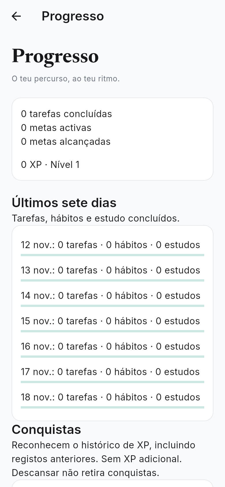 | 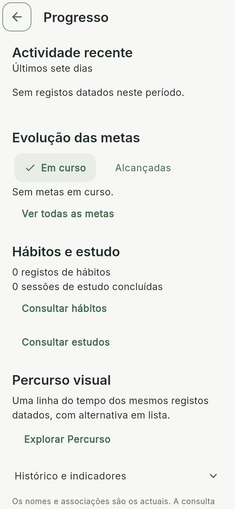 |

### Actividade recente e evolução

| Antes | Depois |
| --- | --- |
|  |  |

### Metas

| Antes | Depois |
| --- | --- |
|  | 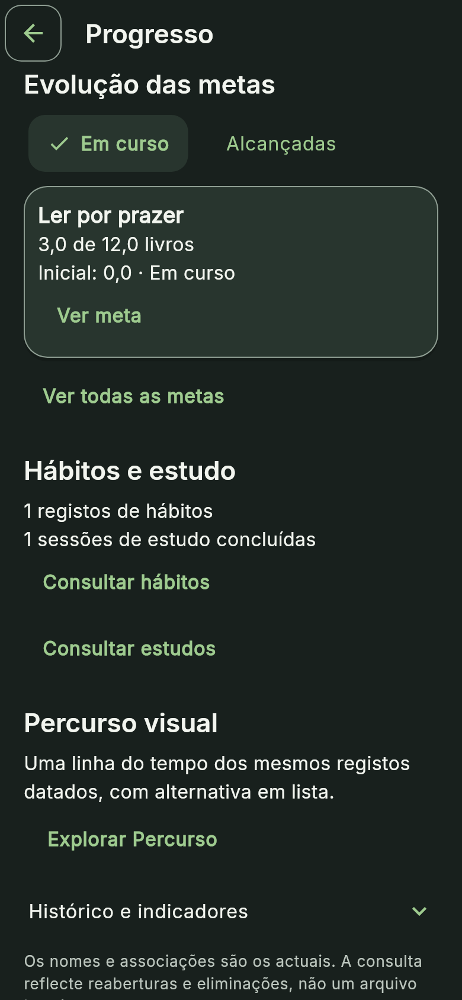 |

### Hábitos e estudo

| Antes | Depois |
| --- | --- |
|  | 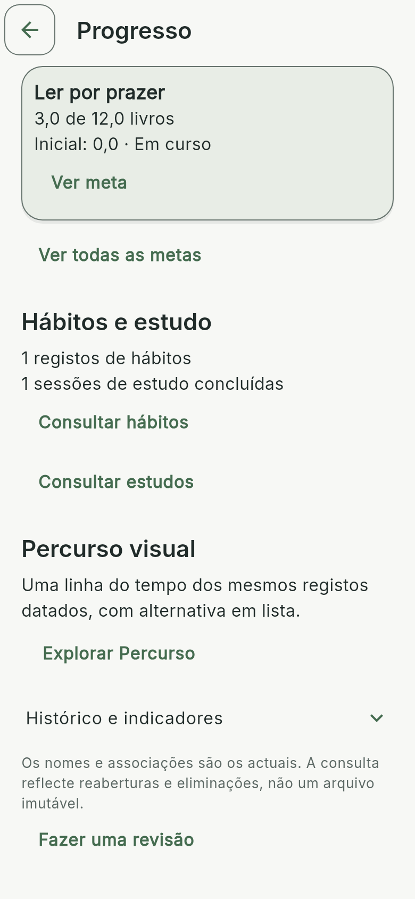 |

### Histórico e indicadores

| Antes | Depois |
| --- | --- |
| 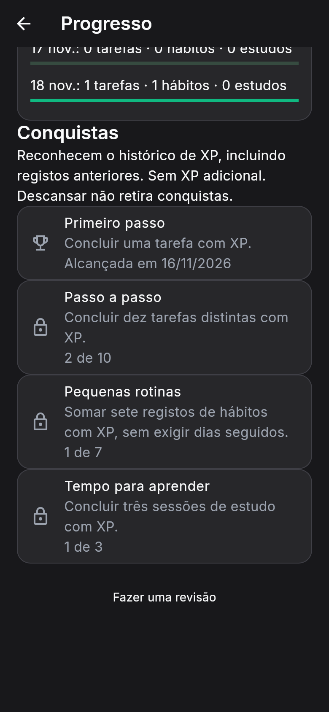 | 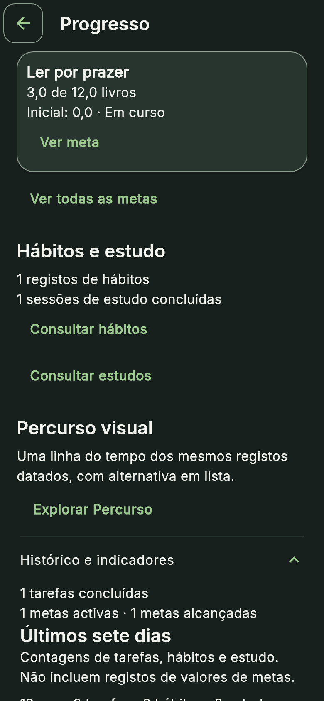 |

### Percurso cronológico

| Antes | Depois |
| --- | --- |
| 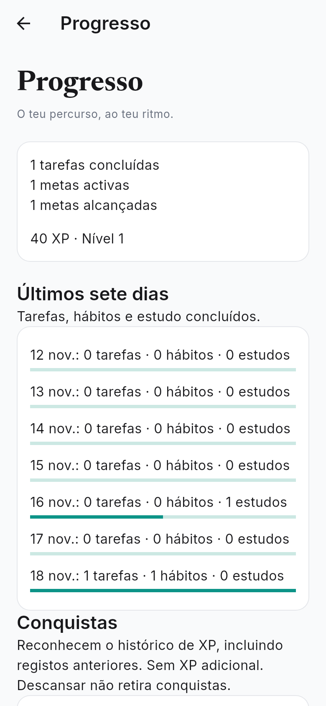 | 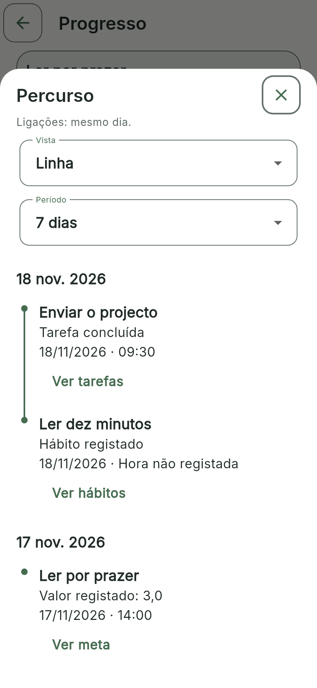 |

### Alternativa em lista

| Antes | Depois |
| --- | --- |
|  | 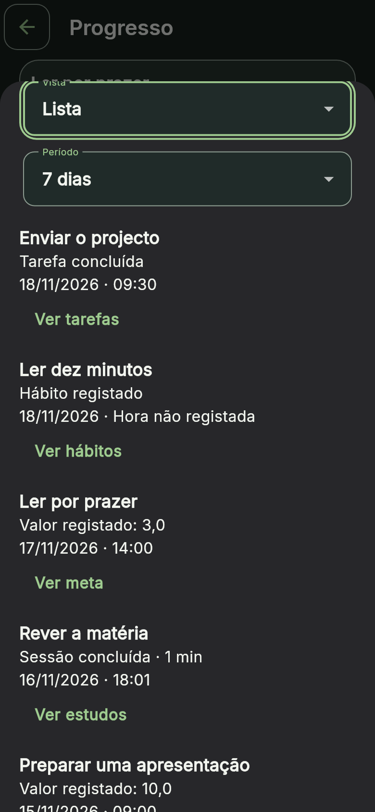 |

### 320 dp / 200%

| Antes | Depois |
| --- | --- |
| 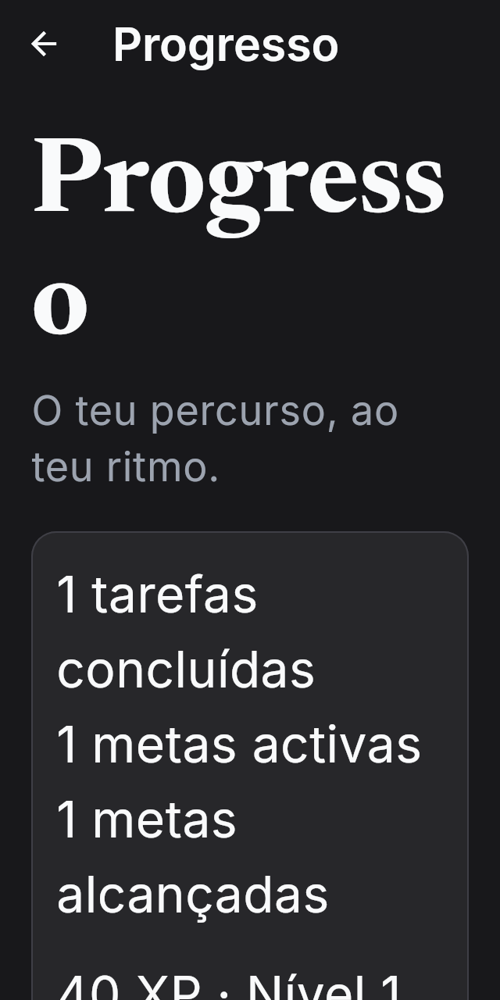 | 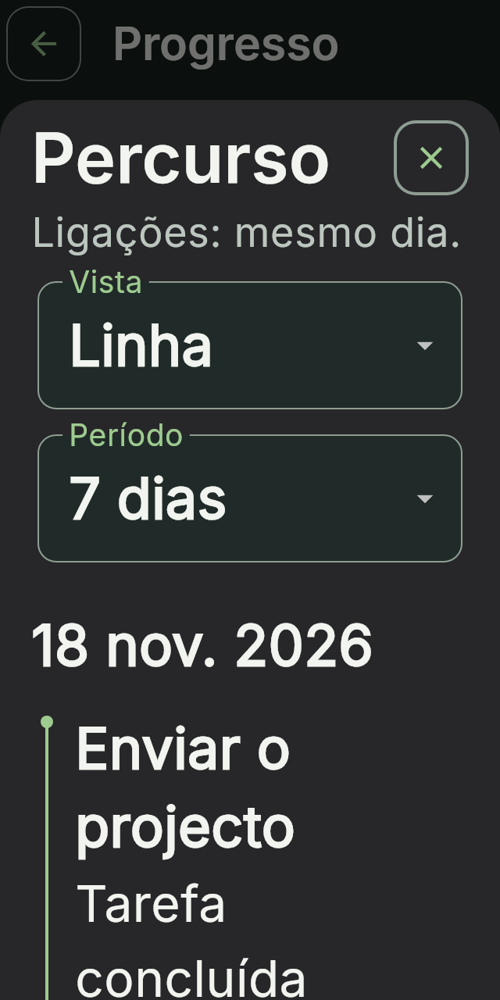 |

### Dados antigos incompletos

| Antes | Depois |
| --- | --- |
|  | 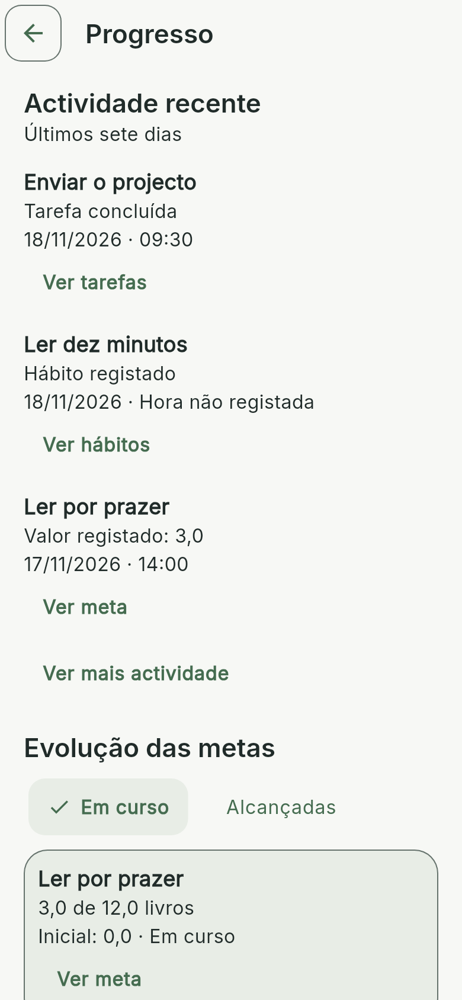 |

### Histórico extenso

| Antes | Depois |
| --- | --- |
| 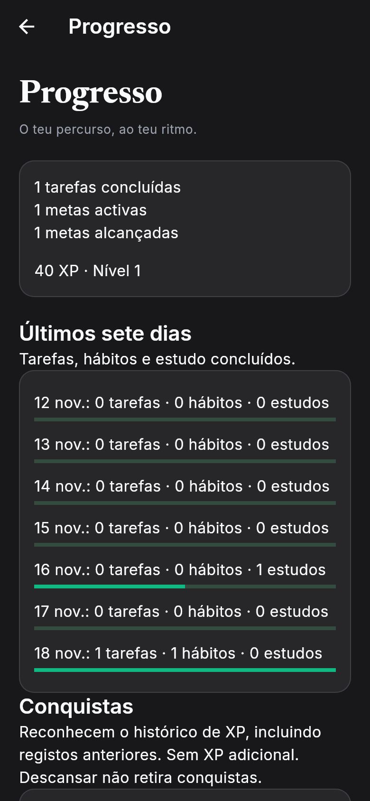 | 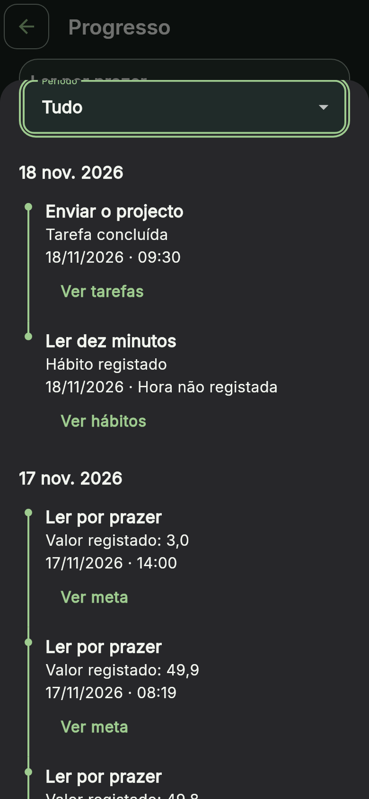 |

### Foco

| Antes | Depois |
| --- | --- |
|  | 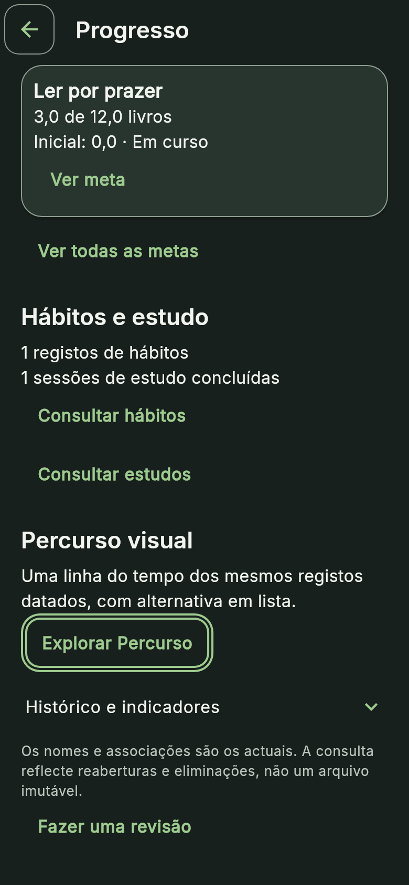 |

### Gamificação desligada

| Antes | Depois |
| --- | --- |
| 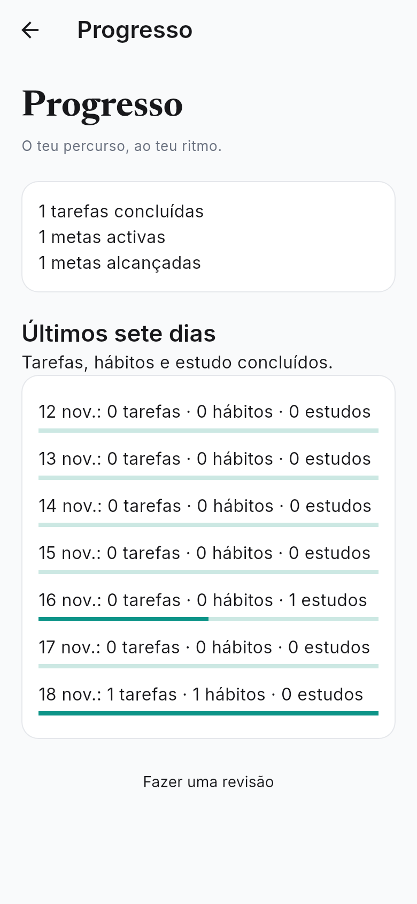 |  |

## Índice completo

| Cenário / tema | dp | Texto | Antes | Depois |
| --- | --- | --- | --- | --- |
| academics-dark | 390×844 | 100% | [PNG](../previews/phase4c3e/before/academics-dark.png) | [PNG](../previews/phase4c3e/after/academics-dark.png) |
| academics-light | 390×844 | 100% | [PNG](../previews/phase4c3e/before/academics-light.png) | [PNG](../previews/phase4c3e/after/academics-light.png) |
| calendar-dark | 390×844 | 100% | [PNG](../previews/phase4c3e/before/calendar-dark.png) | [PNG](../previews/phase4c3e/after/calendar-dark.png) |
| calendar-light | 390×844 | 100% | [PNG](../previews/phase4c3e/before/calendar-light.png) | [PNG](../previews/phase4c3e/after/calendar-light.png) |
| editor-dark | 390×844 | 100% | [PNG](../previews/phase4c3e/before/editor-dark.png) | [PNG](../previews/phase4c3e/after/editor-dark.png) |
| editor-light | 390×844 | 100% | [PNG](../previews/phase4c3e/before/editor-light.png) | [PNG](../previews/phase4c3e/after/editor-light.png) |
| finance-dark | 390×844 | 100% | [PNG](../previews/phase4c3e/before/finance-dark.png) | [PNG](../previews/phase4c3e/after/finance-dark.png) |
| finance-light | 390×844 | 100% | [PNG](../previews/phase4c3e/before/finance-light.png) | [PNG](../previews/phase4c3e/after/finance-light.png) |
| goals-create-dark | 390×844 | 100% | [PNG](../previews/phase4c3e/before/goals-create-dark.png) | [PNG](../previews/phase4c3e/after/goals-create-dark.png) |
| goals-create-light | 390×844 | 100% | [PNG](../previews/phase4c3e/before/goals-create-light.png) | [PNG](../previews/phase4c3e/after/goals-create-light.png) |
| goals-dark | 390×844 | 100% | [PNG](../previews/phase4c3e/before/goals-dark.png) | [PNG](../previews/phase4c3e/after/goals-dark.png) |
| goals-light | 390×844 | 100% | [PNG](../previews/phase4c3e/before/goals-light.png) | [PNG](../previews/phase4c3e/after/goals-light.png) |
| habits-dark | 390×844 | 100% | [PNG](../previews/phase4c3e/before/habits-dark.png) | [PNG](../previews/phase4c3e/after/habits-dark.png) |
| habits-light | 390×844 | 100% | [PNG](../previews/phase4c3e/before/habits-light.png) | [PNG](../previews/phase4c3e/after/habits-light.png) |
| hoje-filled-dark | 390×844 | 100% | [PNG](../previews/phase4c3e/before/hoje-filled-dark.png) | [PNG](../previews/phase4c3e/after/hoje-filled-dark.png) |
| hoje-filled-light | 390×844 | 100% | [PNG](../previews/phase4c3e/before/hoje-filled-light.png) | [PNG](../previews/phase4c3e/after/hoje-filled-light.png) |
| plan-tomorrow-dark | 390×844 | 100% | [PNG](../previews/phase4c3e/before/plan-tomorrow-dark.png) | [PNG](../previews/phase4c3e/after/plan-tomorrow-dark.png) |
| plan-tomorrow-light | 390×844 | 100% | [PNG](../previews/phase4c3e/before/plan-tomorrow-light.png) | [PNG](../previews/phase4c3e/after/plan-tomorrow-light.png) |
| progress-empty-200-dark | 390×844 | 200% | [PNG](../previews/phase4c3e/before/progress-empty-200-dark.png) | [PNG](../previews/phase4c3e/after/progress-empty-200-dark.png) |
| progress-empty-200-light | 390×844 | 200% | [PNG](../previews/phase4c3e/before/progress-empty-200-light.png) | [PNG](../previews/phase4c3e/after/progress-empty-200-light.png) |
| progress-empty-320-200-dark | 320×640 | 200% | [PNG](../previews/phase4c3e/before/progress-empty-320-200-dark.png) | [PNG](../previews/phase4c3e/after/progress-empty-320-200-dark.png) |
| progress-empty-320-200-light | 320×640 | 200% | [PNG](../previews/phase4c3e/before/progress-empty-320-200-light.png) | [PNG](../previews/phase4c3e/after/progress-empty-320-200-light.png) |
| progress-empty-320-dark | 320×640 | 100% | [PNG](../previews/phase4c3e/before/progress-empty-320-dark.png) | [PNG](../previews/phase4c3e/after/progress-empty-320-dark.png) |
| progress-empty-320-light | 320×640 | 100% | [PNG](../previews/phase4c3e/before/progress-empty-320-light.png) | [PNG](../previews/phase4c3e/after/progress-empty-320-light.png) |
| progress-empty-360-200-dark | 360×800 | 200% | [PNG](../previews/phase4c3e/before/progress-empty-360-200-dark.png) | [PNG](../previews/phase4c3e/after/progress-empty-360-200-dark.png) |
| progress-empty-360-200-light | 360×800 | 200% | [PNG](../previews/phase4c3e/before/progress-empty-360-200-light.png) | [PNG](../previews/phase4c3e/after/progress-empty-360-200-light.png) |
| progress-empty-360-dark | 360×800 | 100% | [PNG](../previews/phase4c3e/before/progress-empty-360-dark.png) | [PNG](../previews/phase4c3e/after/progress-empty-360-dark.png) |
| progress-empty-360-light | 360×800 | 100% | [PNG](../previews/phase4c3e/before/progress-empty-360-light.png) | [PNG](../previews/phase4c3e/after/progress-empty-360-light.png) |
| progress-empty-dark | 390×844 | 100% | [PNG](../previews/phase4c3e/before/progress-empty-dark.png) | [PNG](../previews/phase4c3e/after/progress-empty-dark.png) |
| progress-empty-light | 390×844 | 100% | [PNG](../previews/phase4c3e/before/progress-empty-light.png) | [PNG](../previews/phase4c3e/after/progress-empty-light.png) |
| progress-filled-200-dark | 390×844 | 200% | [PNG](../previews/phase4c3e/before/progress-filled-200-dark.png) | [PNG](../previews/phase4c3e/after/progress-filled-200-dark.png) |
| progress-filled-200-light | 390×844 | 200% | [PNG](../previews/phase4c3e/before/progress-filled-200-light.png) | [PNG](../previews/phase4c3e/after/progress-filled-200-light.png) |
| progress-filled-320-200-dark | 320×640 | 200% | [PNG](../previews/phase4c3e/before/progress-filled-320-200-dark.png) | [PNG](../previews/phase4c3e/after/progress-filled-320-200-dark.png) |
| progress-filled-320-200-light | 320×640 | 200% | [PNG](../previews/phase4c3e/before/progress-filled-320-200-light.png) | [PNG](../previews/phase4c3e/after/progress-filled-320-200-light.png) |
| progress-filled-320-dark | 320×640 | 100% | [PNG](../previews/phase4c3e/before/progress-filled-320-dark.png) | [PNG](../previews/phase4c3e/after/progress-filled-320-dark.png) |
| progress-filled-320-light | 320×640 | 100% | [PNG](../previews/phase4c3e/before/progress-filled-320-light.png) | [PNG](../previews/phase4c3e/after/progress-filled-320-light.png) |
| progress-filled-360-200-dark | 360×800 | 200% | [PNG](../previews/phase4c3e/before/progress-filled-360-200-dark.png) | [PNG](../previews/phase4c3e/after/progress-filled-360-200-dark.png) |
| progress-filled-360-200-light | 360×800 | 200% | [PNG](../previews/phase4c3e/before/progress-filled-360-200-light.png) | [PNG](../previews/phase4c3e/after/progress-filled-360-200-light.png) |
| progress-filled-360-dark | 360×800 | 100% | [PNG](../previews/phase4c3e/before/progress-filled-360-dark.png) | [PNG](../previews/phase4c3e/after/progress-filled-360-dark.png) |
| progress-filled-360-light | 360×800 | 100% | [PNG](../previews/phase4c3e/before/progress-filled-360-light.png) | [PNG](../previews/phase4c3e/after/progress-filled-360-light.png) |
| progress-filled-dark | 390×844 | 100% | [PNG](../previews/phase4c3e/before/progress-filled-dark.png) | [PNG](../previews/phase4c3e/after/progress-filled-dark.png) |
| progress-filled-light | 390×844 | 100% | [PNG](../previews/phase4c3e/before/progress-filled-light.png) | [PNG](../previews/phase4c3e/after/progress-filled-light.png) |
| progress-focus-200-dark | 390×844 | 200% | [PNG](../previews/phase4c3e/before/progress-focus-200-dark.png) | [PNG](../previews/phase4c3e/after/progress-focus-200-dark.png) |
| progress-focus-200-light | 390×844 | 200% | [PNG](../previews/phase4c3e/before/progress-focus-200-light.png) | [PNG](../previews/phase4c3e/after/progress-focus-200-light.png) |
| progress-focus-320-200-dark | 320×640 | 200% | [PNG](../previews/phase4c3e/before/progress-focus-320-200-dark.png) | [PNG](../previews/phase4c3e/after/progress-focus-320-200-dark.png) |
| progress-focus-320-200-light | 320×640 | 200% | [PNG](../previews/phase4c3e/before/progress-focus-320-200-light.png) | [PNG](../previews/phase4c3e/after/progress-focus-320-200-light.png) |
| progress-focus-320-dark | 320×640 | 100% | [PNG](../previews/phase4c3e/before/progress-focus-320-dark.png) | [PNG](../previews/phase4c3e/after/progress-focus-320-dark.png) |
| progress-focus-320-light | 320×640 | 100% | [PNG](../previews/phase4c3e/before/progress-focus-320-light.png) | [PNG](../previews/phase4c3e/after/progress-focus-320-light.png) |
| progress-focus-360-200-dark | 360×800 | 200% | [PNG](../previews/phase4c3e/before/progress-focus-360-200-dark.png) | [PNG](../previews/phase4c3e/after/progress-focus-360-200-dark.png) |
| progress-focus-360-200-light | 360×800 | 200% | [PNG](../previews/phase4c3e/before/progress-focus-360-200-light.png) | [PNG](../previews/phase4c3e/after/progress-focus-360-200-light.png) |
| progress-focus-360-dark | 360×800 | 100% | [PNG](../previews/phase4c3e/before/progress-focus-360-dark.png) | [PNG](../previews/phase4c3e/after/progress-focus-360-dark.png) |
| progress-focus-360-light | 360×800 | 100% | [PNG](../previews/phase4c3e/before/progress-focus-360-light.png) | [PNG](../previews/phase4c3e/after/progress-focus-360-light.png) |
| progress-focus-dark | 390×844 | 100% | [PNG](../previews/phase4c3e/before/progress-focus-dark.png) | [PNG](../previews/phase4c3e/after/progress-focus-dark.png) |
| progress-focus-light | 390×844 | 100% | [PNG](../previews/phase4c3e/before/progress-focus-light.png) | [PNG](../previews/phase4c3e/after/progress-focus-light.png) |
| progress-goals-200-dark | 390×844 | 200% | [PNG](../previews/phase4c3e/before/progress-goals-200-dark.png) | [PNG](../previews/phase4c3e/after/progress-goals-200-dark.png) |
| progress-goals-200-light | 390×844 | 200% | [PNG](../previews/phase4c3e/before/progress-goals-200-light.png) | [PNG](../previews/phase4c3e/after/progress-goals-200-light.png) |
| progress-goals-320-200-dark | 320×640 | 200% | [PNG](../previews/phase4c3e/before/progress-goals-320-200-dark.png) | [PNG](../previews/phase4c3e/after/progress-goals-320-200-dark.png) |
| progress-goals-320-200-light | 320×640 | 200% | [PNG](../previews/phase4c3e/before/progress-goals-320-200-light.png) | [PNG](../previews/phase4c3e/after/progress-goals-320-200-light.png) |
| progress-goals-320-dark | 320×640 | 100% | [PNG](../previews/phase4c3e/before/progress-goals-320-dark.png) | [PNG](../previews/phase4c3e/after/progress-goals-320-dark.png) |
| progress-goals-320-light | 320×640 | 100% | [PNG](../previews/phase4c3e/before/progress-goals-320-light.png) | [PNG](../previews/phase4c3e/after/progress-goals-320-light.png) |
| progress-goals-360-200-dark | 360×800 | 200% | [PNG](../previews/phase4c3e/before/progress-goals-360-200-dark.png) | [PNG](../previews/phase4c3e/after/progress-goals-360-200-dark.png) |
| progress-goals-360-200-light | 360×800 | 200% | [PNG](../previews/phase4c3e/before/progress-goals-360-200-light.png) | [PNG](../previews/phase4c3e/after/progress-goals-360-200-light.png) |
| progress-goals-360-dark | 360×800 | 100% | [PNG](../previews/phase4c3e/before/progress-goals-360-dark.png) | [PNG](../previews/phase4c3e/after/progress-goals-360-dark.png) |
| progress-goals-360-light | 360×800 | 100% | [PNG](../previews/phase4c3e/before/progress-goals-360-light.png) | [PNG](../previews/phase4c3e/after/progress-goals-360-light.png) |
| progress-goals-dark | 390×844 | 100% | [PNG](../previews/phase4c3e/before/progress-goals-dark.png) | [PNG](../previews/phase4c3e/after/progress-goals-dark.png) |
| progress-goals-light | 390×844 | 100% | [PNG](../previews/phase4c3e/before/progress-goals-light.png) | [PNG](../previews/phase4c3e/after/progress-goals-light.png) |
| progress-habits-study-200-dark | 390×844 | 200% | [PNG](../previews/phase4c3e/before/progress-habits-study-200-dark.png) | [PNG](../previews/phase4c3e/after/progress-habits-study-200-dark.png) |
| progress-habits-study-200-light | 390×844 | 200% | [PNG](../previews/phase4c3e/before/progress-habits-study-200-light.png) | [PNG](../previews/phase4c3e/after/progress-habits-study-200-light.png) |
| progress-habits-study-320-200-dark | 320×640 | 200% | [PNG](../previews/phase4c3e/before/progress-habits-study-320-200-dark.png) | [PNG](../previews/phase4c3e/after/progress-habits-study-320-200-dark.png) |
| progress-habits-study-320-200-light | 320×640 | 200% | [PNG](../previews/phase4c3e/before/progress-habits-study-320-200-light.png) | [PNG](../previews/phase4c3e/after/progress-habits-study-320-200-light.png) |
| progress-habits-study-320-dark | 320×640 | 100% | [PNG](../previews/phase4c3e/before/progress-habits-study-320-dark.png) | [PNG](../previews/phase4c3e/after/progress-habits-study-320-dark.png) |
| progress-habits-study-320-light | 320×640 | 100% | [PNG](../previews/phase4c3e/before/progress-habits-study-320-light.png) | [PNG](../previews/phase4c3e/after/progress-habits-study-320-light.png) |
| progress-habits-study-360-200-dark | 360×800 | 200% | [PNG](../previews/phase4c3e/before/progress-habits-study-360-200-dark.png) | [PNG](../previews/phase4c3e/after/progress-habits-study-360-200-dark.png) |
| progress-habits-study-360-200-light | 360×800 | 200% | [PNG](../previews/phase4c3e/before/progress-habits-study-360-200-light.png) | [PNG](../previews/phase4c3e/after/progress-habits-study-360-200-light.png) |
| progress-habits-study-360-dark | 360×800 | 100% | [PNG](../previews/phase4c3e/before/progress-habits-study-360-dark.png) | [PNG](../previews/phase4c3e/after/progress-habits-study-360-dark.png) |
| progress-habits-study-360-light | 360×800 | 100% | [PNG](../previews/phase4c3e/before/progress-habits-study-360-light.png) | [PNG](../previews/phase4c3e/after/progress-habits-study-360-light.png) |
| progress-habits-study-dark | 390×844 | 100% | [PNG](../previews/phase4c3e/before/progress-habits-study-dark.png) | [PNG](../previews/phase4c3e/after/progress-habits-study-dark.png) |
| progress-habits-study-light | 390×844 | 100% | [PNG](../previews/phase4c3e/before/progress-habits-study-light.png) | [PNG](../previews/phase4c3e/after/progress-habits-study-light.png) |
| progress-history-200-dark | 390×844 | 200% | [PNG](../previews/phase4c3e/before/progress-history-200-dark.png) | [PNG](../previews/phase4c3e/after/progress-history-200-dark.png) |
| progress-history-200-light | 390×844 | 200% | [PNG](../previews/phase4c3e/before/progress-history-200-light.png) | [PNG](../previews/phase4c3e/after/progress-history-200-light.png) |
| progress-history-320-200-dark | 320×640 | 200% | [PNG](../previews/phase4c3e/before/progress-history-320-200-dark.png) | [PNG](../previews/phase4c3e/after/progress-history-320-200-dark.png) |
| progress-history-320-200-light | 320×640 | 200% | [PNG](../previews/phase4c3e/before/progress-history-320-200-light.png) | [PNG](../previews/phase4c3e/after/progress-history-320-200-light.png) |
| progress-history-320-dark | 320×640 | 100% | [PNG](../previews/phase4c3e/before/progress-history-320-dark.png) | [PNG](../previews/phase4c3e/after/progress-history-320-dark.png) |
| progress-history-320-light | 320×640 | 100% | [PNG](../previews/phase4c3e/before/progress-history-320-light.png) | [PNG](../previews/phase4c3e/after/progress-history-320-light.png) |
| progress-history-360-200-dark | 360×800 | 200% | [PNG](../previews/phase4c3e/before/progress-history-360-200-dark.png) | [PNG](../previews/phase4c3e/after/progress-history-360-200-dark.png) |
| progress-history-360-200-light | 360×800 | 200% | [PNG](../previews/phase4c3e/before/progress-history-360-200-light.png) | [PNG](../previews/phase4c3e/after/progress-history-360-200-light.png) |
| progress-history-360-dark | 360×800 | 100% | [PNG](../previews/phase4c3e/before/progress-history-360-dark.png) | [PNG](../previews/phase4c3e/after/progress-history-360-dark.png) |
| progress-history-360-light | 360×800 | 100% | [PNG](../previews/phase4c3e/before/progress-history-360-light.png) | [PNG](../previews/phase4c3e/after/progress-history-360-light.png) |
| progress-history-dark | 390×844 | 100% | [PNG](../previews/phase4c3e/before/progress-history-dark.png) | [PNG](../previews/phase4c3e/after/progress-history-dark.png) |
| progress-history-light | 390×844 | 100% | [PNG](../previews/phase4c3e/before/progress-history-light.png) | [PNG](../previews/phase4c3e/after/progress-history-light.png) |
| progress-legacy-200-dark | 390×844 | 200% | [PNG](../previews/phase4c3e/before/progress-legacy-200-dark.png) | [PNG](../previews/phase4c3e/after/progress-legacy-200-dark.png) |
| progress-legacy-200-light | 390×844 | 200% | [PNG](../previews/phase4c3e/before/progress-legacy-200-light.png) | [PNG](../previews/phase4c3e/after/progress-legacy-200-light.png) |
| progress-legacy-320-200-dark | 320×640 | 200% | [PNG](../previews/phase4c3e/before/progress-legacy-320-200-dark.png) | [PNG](../previews/phase4c3e/after/progress-legacy-320-200-dark.png) |
| progress-legacy-320-200-light | 320×640 | 200% | [PNG](../previews/phase4c3e/before/progress-legacy-320-200-light.png) | [PNG](../previews/phase4c3e/after/progress-legacy-320-200-light.png) |
| progress-legacy-320-dark | 320×640 | 100% | [PNG](../previews/phase4c3e/before/progress-legacy-320-dark.png) | [PNG](../previews/phase4c3e/after/progress-legacy-320-dark.png) |
| progress-legacy-320-light | 320×640 | 100% | [PNG](../previews/phase4c3e/before/progress-legacy-320-light.png) | [PNG](../previews/phase4c3e/after/progress-legacy-320-light.png) |
| progress-legacy-360-200-dark | 360×800 | 200% | [PNG](../previews/phase4c3e/before/progress-legacy-360-200-dark.png) | [PNG](../previews/phase4c3e/after/progress-legacy-360-200-dark.png) |
| progress-legacy-360-200-light | 360×800 | 200% | [PNG](../previews/phase4c3e/before/progress-legacy-360-200-light.png) | [PNG](../previews/phase4c3e/after/progress-legacy-360-200-light.png) |
| progress-legacy-360-dark | 360×800 | 100% | [PNG](../previews/phase4c3e/before/progress-legacy-360-dark.png) | [PNG](../previews/phase4c3e/after/progress-legacy-360-dark.png) |
| progress-legacy-360-light | 360×800 | 100% | [PNG](../previews/phase4c3e/before/progress-legacy-360-light.png) | [PNG](../previews/phase4c3e/after/progress-legacy-360-light.png) |
| progress-legacy-dark | 390×844 | 100% | [PNG](../previews/phase4c3e/before/progress-legacy-dark.png) | [PNG](../previews/phase4c3e/after/progress-legacy-dark.png) |
| progress-legacy-light | 390×844 | 100% | [PNG](../previews/phase4c3e/before/progress-legacy-light.png) | [PNG](../previews/phase4c3e/after/progress-legacy-light.png) |
| progress-list-200-dark | 390×844 | 200% | [PNG](../previews/phase4c3e/before/progress-list-200-dark.png) | [PNG](../previews/phase4c3e/after/progress-list-200-dark.png) |
| progress-list-200-light | 390×844 | 200% | [PNG](../previews/phase4c3e/before/progress-list-200-light.png) | [PNG](../previews/phase4c3e/after/progress-list-200-light.png) |
| progress-list-320-200-dark | 320×640 | 200% | [PNG](../previews/phase4c3e/before/progress-list-320-200-dark.png) | [PNG](../previews/phase4c3e/after/progress-list-320-200-dark.png) |
| progress-list-320-200-light | 320×640 | 200% | [PNG](../previews/phase4c3e/before/progress-list-320-200-light.png) | [PNG](../previews/phase4c3e/after/progress-list-320-200-light.png) |
| progress-list-320-dark | 320×640 | 100% | [PNG](../previews/phase4c3e/before/progress-list-320-dark.png) | [PNG](../previews/phase4c3e/after/progress-list-320-dark.png) |
| progress-list-320-light | 320×640 | 100% | [PNG](../previews/phase4c3e/before/progress-list-320-light.png) | [PNG](../previews/phase4c3e/after/progress-list-320-light.png) |
| progress-list-360-200-dark | 360×800 | 200% | [PNG](../previews/phase4c3e/before/progress-list-360-200-dark.png) | [PNG](../previews/phase4c3e/after/progress-list-360-200-dark.png) |
| progress-list-360-200-light | 360×800 | 200% | [PNG](../previews/phase4c3e/before/progress-list-360-200-light.png) | [PNG](../previews/phase4c3e/after/progress-list-360-200-light.png) |
| progress-list-360-dark | 360×800 | 100% | [PNG](../previews/phase4c3e/before/progress-list-360-dark.png) | [PNG](../previews/phase4c3e/after/progress-list-360-dark.png) |
| progress-list-360-light | 360×800 | 100% | [PNG](../previews/phase4c3e/before/progress-list-360-light.png) | [PNG](../previews/phase4c3e/after/progress-list-360-light.png) |
| progress-list-dark | 390×844 | 100% | [PNG](../previews/phase4c3e/before/progress-list-dark.png) | [PNG](../previews/phase4c3e/after/progress-list-dark.png) |
| progress-list-light | 390×844 | 100% | [PNG](../previews/phase4c3e/before/progress-list-light.png) | [PNG](../previews/phase4c3e/after/progress-list-light.png) |
| progress-many-200-dark | 390×844 | 200% | [PNG](../previews/phase4c3e/before/progress-many-200-dark.png) | [PNG](../previews/phase4c3e/after/progress-many-200-dark.png) |
| progress-many-200-light | 390×844 | 200% | [PNG](../previews/phase4c3e/before/progress-many-200-light.png) | [PNG](../previews/phase4c3e/after/progress-many-200-light.png) |
| progress-many-320-200-dark | 320×640 | 200% | [PNG](../previews/phase4c3e/before/progress-many-320-200-dark.png) | [PNG](../previews/phase4c3e/after/progress-many-320-200-dark.png) |
| progress-many-320-200-light | 320×640 | 200% | [PNG](../previews/phase4c3e/before/progress-many-320-200-light.png) | [PNG](../previews/phase4c3e/after/progress-many-320-200-light.png) |
| progress-many-320-dark | 320×640 | 100% | [PNG](../previews/phase4c3e/before/progress-many-320-dark.png) | [PNG](../previews/phase4c3e/after/progress-many-320-dark.png) |
| progress-many-320-light | 320×640 | 100% | [PNG](../previews/phase4c3e/before/progress-many-320-light.png) | [PNG](../previews/phase4c3e/after/progress-many-320-light.png) |
| progress-many-360-200-dark | 360×800 | 200% | [PNG](../previews/phase4c3e/before/progress-many-360-200-dark.png) | [PNG](../previews/phase4c3e/after/progress-many-360-200-dark.png) |
| progress-many-360-200-light | 360×800 | 200% | [PNG](../previews/phase4c3e/before/progress-many-360-200-light.png) | [PNG](../previews/phase4c3e/after/progress-many-360-200-light.png) |
| progress-many-360-dark | 360×800 | 100% | [PNG](../previews/phase4c3e/before/progress-many-360-dark.png) | [PNG](../previews/phase4c3e/after/progress-many-360-dark.png) |
| progress-many-360-light | 360×800 | 100% | [PNG](../previews/phase4c3e/before/progress-many-360-light.png) | [PNG](../previews/phase4c3e/after/progress-many-360-light.png) |
| progress-many-dark | 390×844 | 100% | [PNG](../previews/phase4c3e/before/progress-many-dark.png) | [PNG](../previews/phase4c3e/after/progress-many-dark.png) |
| progress-many-light | 390×844 | 100% | [PNG](../previews/phase4c3e/before/progress-many-light.png) | [PNG](../previews/phase4c3e/after/progress-many-light.png) |
| progress-off-200-dark | 390×844 | 200% | [PNG](../previews/phase4c3e/before/progress-off-200-dark.png) | [PNG](../previews/phase4c3e/after/progress-off-200-dark.png) |
| progress-off-200-light | 390×844 | 200% | [PNG](../previews/phase4c3e/before/progress-off-200-light.png) | [PNG](../previews/phase4c3e/after/progress-off-200-light.png) |
| progress-off-320-200-dark | 320×640 | 200% | [PNG](../previews/phase4c3e/before/progress-off-320-200-dark.png) | [PNG](../previews/phase4c3e/after/progress-off-320-200-dark.png) |
| progress-off-320-200-light | 320×640 | 200% | [PNG](../previews/phase4c3e/before/progress-off-320-200-light.png) | [PNG](../previews/phase4c3e/after/progress-off-320-200-light.png) |
| progress-off-320-dark | 320×640 | 100% | [PNG](../previews/phase4c3e/before/progress-off-320-dark.png) | [PNG](../previews/phase4c3e/after/progress-off-320-dark.png) |
| progress-off-320-light | 320×640 | 100% | [PNG](../previews/phase4c3e/before/progress-off-320-light.png) | [PNG](../previews/phase4c3e/after/progress-off-320-light.png) |
| progress-off-360-200-dark | 360×800 | 200% | [PNG](../previews/phase4c3e/before/progress-off-360-200-dark.png) | [PNG](../previews/phase4c3e/after/progress-off-360-200-dark.png) |
| progress-off-360-200-light | 360×800 | 200% | [PNG](../previews/phase4c3e/before/progress-off-360-200-light.png) | [PNG](../previews/phase4c3e/after/progress-off-360-200-light.png) |
| progress-off-360-dark | 360×800 | 100% | [PNG](../previews/phase4c3e/before/progress-off-360-dark.png) | [PNG](../previews/phase4c3e/after/progress-off-360-dark.png) |
| progress-off-360-light | 360×800 | 100% | [PNG](../previews/phase4c3e/before/progress-off-360-light.png) | [PNG](../previews/phase4c3e/after/progress-off-360-light.png) |
| progress-off-dark | 390×844 | 100% | [PNG](../previews/phase4c3e/before/progress-off-dark.png) | [PNG](../previews/phase4c3e/after/progress-off-dark.png) |
| progress-off-light | 390×844 | 100% | [PNG](../previews/phase4c3e/before/progress-off-light.png) | [PNG](../previews/phase4c3e/after/progress-off-light.png) |
| progress-recent-200-dark | 390×844 | 200% | [PNG](../previews/phase4c3e/before/progress-recent-200-dark.png) | [PNG](../previews/phase4c3e/after/progress-recent-200-dark.png) |
| progress-recent-200-light | 390×844 | 200% | [PNG](../previews/phase4c3e/before/progress-recent-200-light.png) | [PNG](../previews/phase4c3e/after/progress-recent-200-light.png) |
| progress-recent-320-200-dark | 320×640 | 200% | [PNG](../previews/phase4c3e/before/progress-recent-320-200-dark.png) | [PNG](../previews/phase4c3e/after/progress-recent-320-200-dark.png) |
| progress-recent-320-200-light | 320×640 | 200% | [PNG](../previews/phase4c3e/before/progress-recent-320-200-light.png) | [PNG](../previews/phase4c3e/after/progress-recent-320-200-light.png) |
| progress-recent-320-dark | 320×640 | 100% | [PNG](../previews/phase4c3e/before/progress-recent-320-dark.png) | [PNG](../previews/phase4c3e/after/progress-recent-320-dark.png) |
| progress-recent-320-light | 320×640 | 100% | [PNG](../previews/phase4c3e/before/progress-recent-320-light.png) | [PNG](../previews/phase4c3e/after/progress-recent-320-light.png) |
| progress-recent-360-200-dark | 360×800 | 200% | [PNG](../previews/phase4c3e/before/progress-recent-360-200-dark.png) | [PNG](../previews/phase4c3e/after/progress-recent-360-200-dark.png) |
| progress-recent-360-200-light | 360×800 | 200% | [PNG](../previews/phase4c3e/before/progress-recent-360-200-light.png) | [PNG](../previews/phase4c3e/after/progress-recent-360-200-light.png) |
| progress-recent-360-dark | 360×800 | 100% | [PNG](../previews/phase4c3e/before/progress-recent-360-dark.png) | [PNG](../previews/phase4c3e/after/progress-recent-360-dark.png) |
| progress-recent-360-light | 360×800 | 100% | [PNG](../previews/phase4c3e/before/progress-recent-360-light.png) | [PNG](../previews/phase4c3e/after/progress-recent-360-light.png) |
| progress-recent-dark | 390×844 | 100% | [PNG](../previews/phase4c3e/before/progress-recent-dark.png) | [PNG](../previews/phase4c3e/after/progress-recent-dark.png) |
| progress-recent-light | 390×844 | 100% | [PNG](../previews/phase4c3e/before/progress-recent-light.png) | [PNG](../previews/phase4c3e/after/progress-recent-light.png) |
| progress-timeline-200-dark | 390×844 | 200% | [PNG](../previews/phase4c3e/before/progress-timeline-200-dark.png) | [PNG](../previews/phase4c3e/after/progress-timeline-200-dark.png) |
| progress-timeline-200-light | 390×844 | 200% | [PNG](../previews/phase4c3e/before/progress-timeline-200-light.png) | [PNG](../previews/phase4c3e/after/progress-timeline-200-light.png) |
| progress-timeline-320-200-dark | 320×640 | 200% | [PNG](../previews/phase4c3e/before/progress-timeline-320-200-dark.png) | [PNG](../previews/phase4c3e/after/progress-timeline-320-200-dark.png) |
| progress-timeline-320-200-light | 320×640 | 200% | [PNG](../previews/phase4c3e/before/progress-timeline-320-200-light.png) | [PNG](../previews/phase4c3e/after/progress-timeline-320-200-light.png) |
| progress-timeline-320-dark | 320×640 | 100% | [PNG](../previews/phase4c3e/before/progress-timeline-320-dark.png) | [PNG](../previews/phase4c3e/after/progress-timeline-320-dark.png) |
| progress-timeline-320-light | 320×640 | 100% | [PNG](../previews/phase4c3e/before/progress-timeline-320-light.png) | [PNG](../previews/phase4c3e/after/progress-timeline-320-light.png) |
| progress-timeline-360-200-dark | 360×800 | 200% | [PNG](../previews/phase4c3e/before/progress-timeline-360-200-dark.png) | [PNG](../previews/phase4c3e/after/progress-timeline-360-200-dark.png) |
| progress-timeline-360-200-light | 360×800 | 200% | [PNG](../previews/phase4c3e/before/progress-timeline-360-200-light.png) | [PNG](../previews/phase4c3e/after/progress-timeline-360-200-light.png) |
| progress-timeline-360-dark | 360×800 | 100% | [PNG](../previews/phase4c3e/before/progress-timeline-360-dark.png) | [PNG](../previews/phase4c3e/after/progress-timeline-360-dark.png) |
| progress-timeline-360-light | 360×800 | 100% | [PNG](../previews/phase4c3e/before/progress-timeline-360-light.png) | [PNG](../previews/phase4c3e/after/progress-timeline-360-light.png) |
| progress-timeline-dark | 390×844 | 100% | [PNG](../previews/phase4c3e/before/progress-timeline-dark.png) | [PNG](../previews/phase4c3e/after/progress-timeline-dark.png) |
| progress-timeline-light | 390×844 | 100% | [PNG](../previews/phase4c3e/before/progress-timeline-light.png) | [PNG](../previews/phase4c3e/after/progress-timeline-light.png) |
| tasks-dark | 390×844 | 100% | [PNG](../previews/phase4c3e/before/tasks-dark.png) | [PNG](../previews/phase4c3e/after/tasks-dark.png) |
| tasks-light | 390×844 | 100% | [PNG](../previews/phase4c3e/before/tasks-light.png) | [PNG](../previews/phase4c3e/after/tasks-light.png) |
